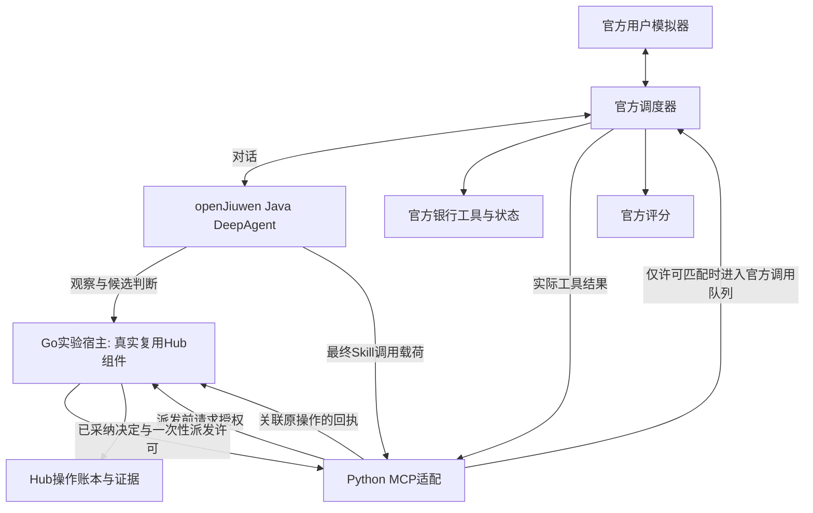

# Agent Hub Banking 测试方案审查与修订要求

日期：2026-11-16。审查对象：V1.0测试方案、执行入口、核验脚本及已完成的英文task_054批次。结论：**V1.0不能通过“复用agent-hub-alpha架构和代码、与openJiuwen Java整合验证”的审查。**

用户要求包含实际代码复用。此前将Go组件降为参考资料、把一次现有基线运行当作本轮交付，是执行者擅自缩小范围。原方案有正确的banking边界和控制契约，但缺少实际接线与执行门槛，不能作为整合已经完成的依据。本报告给出修订要求；报告生成不等于集成实现。

## 1. 要求与交付核对

| 用户要求 | 已交付事实 | 审查结论 |
|---|---|---|
| 使用agent-hub-alpha架构设计与代码 | 方案引用Adopt/Dispatch、R/K、回放；运行未调用相关组件 | 未满足代码复用要求 |
| 与openJiuwen Java结合 | 运行了原有Java DeepAgent；新增控制接口仍是拟建 | 集成未实现 |
| 考虑tau3 banking环境 | 官方工具/调度/判分保持，隐藏答案与运行侧分离 | 这部分应保留 |
| 英文基准 | 英文task_054、Skill 3.2.0、en语言事件均有证据 | 已满足本次基线语言要求 |
| 对应测试目录中执行端到端验证 | 新目录调用旧runner，明确agent_hub_enforcement=false | 仅完成旧基线E2E，不是增强E2E |

依据：[原方案](../../测试方案与架构评审.md)、[实际执行记录](../../runs/english-e2e-20261116-task054-a00/execution.json)、[基线结果](../english-e2e-20261116-task054-a00/verification.json)。

## 2. 按严重性排列的问题

| ID/优先级 | 证据及问题 | 必须修订的内容 |
|---|---|---|
| F01 / P0 | 原方案第4节只画Java控制层；第10节第203行明确Go“不加入在线生产调用链”，W2默认另建Java控制层 | 恢复代码复用目标。为本次研究demo建立真实Go组件宿主和Java/Python适配；长期Java SDK目标不能用来排除本次Go代码复用 |
| F02 / P0 | run_english_e2e.py第39–43行固定existing-baseline、enforcement=false；第65–78行只构建Java并调用原runner | 基线入口只能归类为B-pre。新增独立整合入口，Go缺失或模式缺失时停止；禁止静默退回旧基线 |
| F03 / P0 | verify_english_e2e.py检查语言、回执、业务结果，却不检查Go构建、启动、采纳/派发记录；它是报告生成器，检查为false也正常退出 | 增加代码复用和控制接线验收。报告生成与CI验收分开，增强验收失败必须返回非零 |
| F04 / P1 | 原方案列出6个拟建接口，却没有既有Go函数到这些接口的映射。Go宿主/RK/业务verify有部分位于_test.go | 指定直接调用、抽取复用和必要补齐的边界；抽取需保留原测试和行为，不把样例校验CLI当服务 |
| F05 / P1 | 原方案CT15追溯M15，但07主架构M15是CASE1→candidate→evaluation→activation，而非Todo收尾 | 建立逐条M01–M15的完整/部分/未覆盖表，保留独立改进发布用例；不得由单题E2E宣称整个架构闭环通过 |
| F06 / P1 | 本次Todo异常被包装为answer并进入客户回复；现有协议夹具未制造多in_progress或嵌套错误结果 | 增加错误类型贯穿、Todo失败处理和同轮后续写入受控测试；检查错误不能转成普通客户正文 |
| F07 / P1 | task_054在首次写入前已有冲突政策及前置查询，却先提交争议、再补卡；原CT01偏重缺证据 | 增加“证据齐全但跨目标顺序错误”反例；验证判断真的影响最后的银行派发，不止记录检查日志 |
| F08 / P1 | 原方案在新接线不存在时先展开148次计划；实际只有task_054且其user_tools=[] | 先通过最小真实整合和故障门槛，再放行小样本与配对回归；补独立用户侧工具场景，054不能证明双主体写入链 |

上述问题与Go是否在PATH中是两回事。当前PATH未发现go，只是环境准备项；它不能成为绕过用户要求、运行另一套系统的理由。

## 3. 实际组件、交互与控制权

| 实体 | 当前角色/状态 | 控制与状态所有权 |
|---|---|---|
| openJiuwen DeepAgent | 真正的被测Agent，使用模型、Todo、Skill | Agent执行调度、对话和计划；没有接入Hub生效控制 |
| 官方用户模拟器 | benchmark参与者 | 客户对话及题目允许的客户侧工具；不是Agent委派的子Agent |
| Python supervisor/episode | 测试控制器 | episode生命周期、超时、结果记录 |
| Python BenchmarkMcpFacade | 传输与队列适配 | 将调用交官方调度，保存观察回执；不是语义决策Agent |
| 官方银行环境/评分器 | 模拟业务提供方/独立评估方 | 银行效果及官方分数 |
| Go adopt/ledger/evidlog/replay等 | 已存在的参考组件 | 当前测试链中未调用；不能算已部署控制层 |

当前实际边：Java→MCP为有界工具调用，MCP→官方调度为事件队列桥接，模拟器↔Agent为基准交互；这些都不是新引入的多Agent委托或协同。拟增加的Java/Python→Go是有界控制服务调用（Calling语义），没有理由把Go包装成另一个自主Agent或再造工作流调度器。

调用证据：[DeepAgentAssembly.invokeInternal](../../../../deepagent-todo-skill-mcp/java/src/main/java/eval/DeepAgentAssembly.java)、[Python适配器](../../../../deepagent-todo-skill-mcp/python/deepagent_java_agent.py)、[MCP桥](../../../../deepagent-todo-skill-mcp/python/benchmark_mcp.py)。

## 4. 应采用的实际代码复用边界

主架构[07](../../../../../../agent-hub-alpha/achitecture%20design/07-nga-architecture-proposal.md)要求保留openJiuwen主基座、优先复用；[08](../../../../../../agent-hub-alpha/achitecture%20design/08-r1-r6-acceptance-and-open-items.md)限制Go组件的可宣称范围。两者都不支持“因为是参考组件，所以完全不接入”。

本次研究demo的修订选择：在现有 `agent-festival/go` 模块内增加薄宿主，例如拟建 `cmd/tau3-host`，直接导入既有 `internal` 包；Java保持Agent执行基座。这个宿主是实验适配，不宣称已经交付07要求的完整Java SDK/Starter。将来Java化需要同一契约的差分验证，不能在当前实验里悄悄替换为另一实现。

| 现有代码 | 应如何复用 | 不能冒称的能力/需补齐内容 |
|---|---|---|
| [adopt.Machine](../../../../../../agent-hub-alpha/agent-festival/go/internal/adopt/adopt.go)：Open/Adopt/Dispatch/MarkUnresolved/MarkCompleted/MarkFailed | 直接链接原Go实现，独占本episode操作账本；真实派发与回执驱动状态变化 | Adopt不等于银行判断正确；DispatchIfCurrent不自动检测另一操作上的有效修订替代；需宿主权威修订与当前权限提供方 |
| [ledger](../../../../../../agent-hub-alpha/agent-festival/go/internal/ledger/ledger.go)、[evidlog](../../../../../../agent-hub-alpha/agent-festival/go/internal/evidlog/evidlog.go) | 复用身份/版本/事件与证据校验；对外原始回执和控制事件关联 | 不将telemetry日志替代必需审计；真实拒绝也要持久记录；跨文件提交要有明确恢复协议 |
| [judgment.CheckSpec](../../../../../../agent-hub-alpha/agent-festival/go/internal/judgment/check.go) | 校验已批准判断规格的结构 | 只做schema检查，不执行银行语义；补银行检查器并在真实adopt/dispatch路径执行 |
| [validate](../../../../../../agent-hub-alpha/agent-festival/go/internal/validate/validate.go)、[compose](../../../../../../agent-hub-alpha/agent-festival/go/internal/compose/compose.go)、[release](../../../../../../agent-hub-alpha/agent-festival/go/internal/release/check.go) | 复用适用的契约、授权/组合与发布结构检查；逐项声明实际调用 | 结构合格不等于已获当前授权或已经激活；不要为“全覆盖”引入无业务意义的图 |
| [replay.Replay/Inspect/Recover](../../../../../../agent-hub-alpha/agent-festival/go/internal/replay/replay.go) | 对真实宿主生成的事件建立兼容输入并执行隔离重放 | 不能代替官方DB重放，也不能据此声称整个Java/Python堆栈恢复 |
| [t2Host.nodeEntryExec](../../../../../../agent-hub-alpha/agent-festival/go/internal/e2e/t2host_test.go)、[verify](../../../../../../agent-hub-alpha/agent-festival/go/internal/e2e/verifier_test.go) | 抽取可复用宿主逻辑及端口，保留测试；银行规则另以公开政策定义 | 当前在测试文件中，不是可直接启动的生产服务；原信用贷夹具规则不是tau3银行规则 |

Go已知开放项仍按08记录。原套件通过与系统反例通过分别报告；不得删掉旧修订、未采纳高修订、拒绝缺审计、必需配置缺失等反例来取得全绿。

## 5. 必须写入修订方案的调用链

Go宿主独占有效决定和操作状态；Java独占Agent调度；官方环境独占银行效果。Python最后出口强制执行宿主许可，不能只在Java侧添加可绕过的日志钩子。Go宿主不直接写官方数据库，不取得隐藏答案。

必须补齐的接口契约（均为拟建，非现有API）：

- **启动与身份**：supervisor启动一个Go宿主，记录PID、实际二进制hash、构建来源、协议/Schema/检查器版本和scope；生命周期由supervisor唯一管理。拒绝两个宿主写同一账本。
- **观察与判断**：只接收本episode实际可见的工具/对话证据，保存原文hash、对象与参考时间；模型仅提交候选，schema检查与语义检查分开；采纳必须引用实际检查记录。
- **最后派发**：绑定episode、意图、operation_id、有效decision_revision、最终内层工具名和规范化载荷hash。当前权限来自受信提供方，不相信模型自报。Python验证关联与一次性使用后才排队；篡改参数或跳过宿主均不得产生效果。
- **顺序边界**：明确由单宿主串行化检查、有效修订推进、派发预留与许可消费，用户侧状态变化使相关证据失效。不得把一次HTTP检查到随后银行调用之间的间隔当作天然原子操作；许可未消费/已消费无回执均需可恢复记录。
- **超时与异常**：Go控制RPC首版配置30秒超时、不自动重试写入；官方MCP保持现有120秒上限。Go不可达时两组都报基础设施错误并停止新派发；B0只忽略业务检查的阻断建议，不忽略服务断连。结果未知保留同一操作身份，先查询账本/允许的provider证据，不能新建调用号重发。
- **回执与终答**：银行成功回执驱动completed；超时/丢失驱动unresolved；Todo只是计划展示。结果为error/needs_evidence/blocked时不得改包装成普通answer；客户说明与内部错误结构分离。

单独“Go进程启动成功”不构成验收；启动进程但银行调用不经过它，同样判失败。

## 6. 执行前置门槛与证据

| 门槛 | 可执行验收要求 |
|---|---|
| G0 环境与代码来源 | Go版本满足go.mod；保存commit/dirty diff、构建命令、二进制hash和go version -m；运行原组件套件及独立诊断并逐项解释 |
| G1 真实调用 | 正例产生Go库生成的adoption/dispatch/receipt记录；银行official_call_id可反向关联到同一操作；不能只有自报used_hub=true |
| G2 依赖破坏探针 | 停止Go宿主、损坏二进制版本、替换错误schema时，整合入口停止且银行写入0次；禁止fallback到旧runner |
| G3 最终出口 | 改金额、换账户、绕开Java直接请求MCP、重放许可、用旧revision均被拒绝；同时证明合法请求能产生一次预期效果 |
| G4 错误与顺序 | 新增CT18：Todo多in_progress及嵌套result_type=error不成为客户正文，失败后银行效果不盲重发。新增CT19：公开证据齐全但三个目标顺序冲突，先澄清/重规划再授权 |
| G5 开放项与恢复 | 在声明的单宿主、Java重启且Python环境存活边界内，验证真实拒绝审计、有效修订、未知回执、重复命令、故障重启及无活出口回放；Go重启单列测试，不能和Java恢复混算 |
| G6 英文banking | 新批次执行真实增强task_054，记录Go运行证据、独立控制断言与官方分数；未接入状态直接拒绝启动。补一个原始英文user_tools非空的场景，覆盖模拟客户侧工具 |
| G7 对照与扩大 | B0/B1使用同一增强制品和可见规则；B0观察、B1执行，真实回执据实记录。先最小用例与8题诊断，再判断是否开展22题×3次配对；148次仅是后续计划，不自动启动 |

B-pre：本次已经运行的原基线，保留原目录、原hash和reward=0，不重标为B0或B1。

B0记录would_allow/would_block，仍调用真实Hub分析与账本；实际派发记录必须标明shadow授权，不能假称语义检查已通过。B1必须让检查结果决定派发。两组协议、模型、规则、输入版本相同，模式为显式冻结条件；两组都不能在Go失效时绕过组件。

验收分别输出 `integration_status`、`control_acceptance`、`benchmark_reward`。整合缺失/控制硬门槛失败时验收非零；官方reward=0也保留，不能反复重跑至通过。关闭四个业务检查后得到绿色报告不属于修复。

## 7. 主架构覆盖修订

必须按07原文登记M01–M15，不能用同号引用代替覆盖。当前运行未证明其中任何一项完整的NGA集成验收。

| 范围 | 本次修订必须处理 |
|---|---|
| M01 | Go研究宿主与Java执行生命周期接线单独验收；未实现Java SDK/Boot Starter，不能标M01完整通过 |
| M02–M06、M12–M13 | 建立有用判断、身份/去重、当前修订、最终载荷、持久证据、真实控制回放；每项关联具体原测试与新增整合反例 |
| M07–M09 | 分别验证Java、Go进程故障；Python官方环境存活是明确前提；无回执不是业务失败 |
| M10–M11 | 补偿能力及嵌套重试预算尚未由当前测试证明；无provider保证时保留unsupported。累计Token不设预算不等于重试可以无限 |
| M14 | 配置/导入/自定义原语与版本兼容另设用例；只验证Skill文件hash不足以覆盖 |
| M15 | 增加“本次错误案例→候选修正→离线评估→显式激活→旧版本仍可回放”的独立闭环；原CT15继续检验完成表述，但取消其覆盖M15的声称 |

R/K不能只出现在设计词汇中：对抽取后的统一入口分别验证同实例R复用、新任务K消费、首次执行。银行正式实验保持跨题K共享关闭；R/K可先用独立英文合成数据验证，不将其成绩混入banking分数。

## 8. 优先修订责任与交付顺序

| 顺序/责任角色 | 必须交付 | 完成证据 |
|---|---|---|
| P0 架构/集成SE | 将第4/10节改为实际代码复用拓扑、明确状态所有权和缺口提供方 | 逐组件函数映射、协议、实际构建目标；不以新造Java同名类代替Go实现 |
| P0 Go适配SE | 薄宿主、原组件复用、必要宿主逻辑抽取及未闭合问题修复 | 原测试保留，新接线/拒绝/恢复反例通过 |
| P0 Java/Python适配SE | 候选/观察接口、MCP最后出口控制、回执对账、错误类型修复 | G1–G5，包括直接MCP绕过及同轮异常场景 |
| P0 测试SE | 新整合runner、显式B0/B1、代码来源与活调用门禁 | Go缺失时拒绝执行；验收状态与官方评分分列 |
| P1 评测SE | 英文054增强实测和用户侧工具场景，再推进对照 | 新批次、实际控制事件、官方结果及独立审计；原基线不改名 |

唯一责任角色须在实施时落到实际人员，不虚构姓名。原20–30人日估算基于另建Java控制层，不适用于本修订；应按Go复用与真实缺口重新估算，而不是直接承诺更快。

## 9. 审查方法、评分及限制

按multi-agent-architecture-review的COM-03/04/08/09/10与CALL-04/06检查。当前系统是单业务Agent加工具/控制器；新增确定性控制服务比额外自主Agent更合适。未发现需要新委托或多Agent协调循环的依据。

对“当前增强集成交付”的工程审查分为44/100：通用边界20/40、调用控制16/50、复杂度比例8/10，风险high。该分数不是benchmark成绩，不是Go原型或openJiuwen整体产品评分。硬缺口是未接入被测组件及缺少真实生效检查；现有超时、证据隔离、拒绝自动业务重试和官方状态所有权是可保留的基础。

模式方面没有新增长任务委托、无限递归或协调收敛问题；不因此假设重启、幂等、权限与修订已成立。已知组件限制依据本地源代码和08验收范围，未开展新的Go套件、故障实验或付费模型调用。本轮只完成方案/代码/历史证据审查及审查产物验证，不把修订要求标成实现完成。

结构化发现、实体、交互、硬缺口和整改验收见 [assessment.json](assessment.json)。源码与审查输入hash见 [source-snapshot.json](source-snapshot.json)。原设计及原始批次保留；测试目录README明确链接本次不通过结论。
