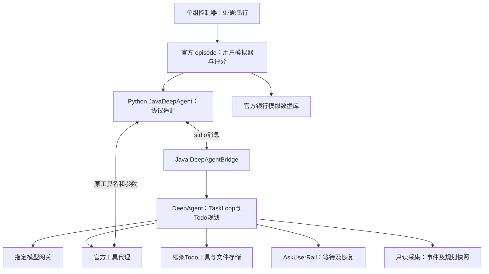

# DeepAgent Todo 单组测试与代码设计 V0.2

状态：已由[Skill/MCP 单组方案 V0.3](DeepAgent-Todo-Skill-MCP测试设计-V0.3.md)修订。本文“直接注册银行工具”及不使用 Skill 的设计不再适用；保留仅供追溯。此前未实施、未构建、未执行测试。

## 1. 最终范围

只装配一个版本：直接 DeepAgent，TaskLoop 开启、TaskPlanning 开启、通用子 Agent 关闭。不引入 NativeSkillAgent、MOA MAIN、Runtime 服务入口、自动业务 graph 或额外大模型裁判。

使用原 P07 准确的 97 题清单，每题一次，单并发。首题 task_001 兼作接入观察，不另外安排真实模型冒烟，不设置关闭规划的对照组，不进行五次重复。离线协议夹具是实现验收，不是额外银行模型评测。

目标是看清这套装配的实际业务效果、规划使用情况、执行错误、耗时和 Token。没有关闭规划的同条件对照，不能量化“Todo 导致提升多少”；旧结果只能作历史参考。单轮不能验证每次轨迹相同或生产长期稳定。

## 2. 调用链与状态归属



Python 官方环境拥有银行数据库、工具解锁状态、用户模拟器和官方判分；Java 只转发银行操作，不重写银行规则。DeepAgent/Core 拥有模型循环、交互等待和会话历史；FileTodoStorage 保存规划状态。控制器拥有执行台账和进程生命周期，不替模型生成计划。

Todo 是模型自己生成并维护的清单，不是人工按题编制的流程，也不是业务正确性的证明。

## 3. 文件和模块怎么改

建议新增独立模块 `deepagent-java/`，保留旧 `java/` 入口以便复核历史。下列文件均为拟新增，当前尚未创建。

| 文件 | 主要职责 |
|---|---|
| `deepagent-java/pom.xml` | 直接依赖 `com.openjiuwen:agent-core-java`，显式管理 JSON 序列化依赖；不依赖 moa-agent |
| `deepagent-java/run.sh` | 仅启动新桥；日志写 stderr，stdout 只写有前缀的协议消息 |
| `eval.deepagent.DeepAgentBridge` | 协议主循环、创建会话、调用 stream、处理中断及输出、关闭资源 |
| `eval.deepagent.DeepAgentAssembly` | 唯一装配点：模型、配置、工具、Rail、workspace；生成有效配置清单 |
| `eval.deepagent.OfficialToolProxy` | 继承 Core Tool，以原始 ToolCard/schema 暴露银行工具，转发调用和回包 |
| `eval.deepagent.BridgeTransport` | 帧解析、请求关联、等待超时、stdout 串行输出及协议校验 |
| `eval.deepagent.EpisodeState` | 会话 ID、当前交互 ID、状态机、在途调用；替代 static 全局业务状态 |
| `eval.deepagent.EvidenceRail` | 模型/工具事件观测及 Todo 快照；不改模型输入、业务输出或判分 |
| `eval.deepagent.ToolExposureRail` | 限制本评测暴露的工具集合，阻止无关文件/shell/子 Agent 工具 |
| `python/deepagent_agent.py` | 新 `JavaDeepAgent` 适配类；复用旧桥协议思想，不继承带 NativeSkill 标签的实现 |
| `python/deepagent_episode.py` | 注册 `openjiuwen_java_deepagent_todo`，接入官方调度和评分，保留异常前轨迹 |
| `python/run_deepagent_todo.py` | 单组清单、版本冻结、逐题子进程、终态记录和断点接管 |
| `python/report_deepagent_todo.py` | 结果、规划、开销、异常和 81 卡覆盖汇总 |

优先复用现有监督器、证据 hash 和采集函数；仅当能保持旧接口及行为时抽取公共模块。不要直接改旧 JavaMoaAgent 的含义，避免旧结果标签失真。新报告的主键不再包含实验 arm/pair，不保留无用 A/B 调度分支。

Core 当前源码 POM 显示版本 0.1.17，但版本号不足以识别制品。实施时冻结实际 commit、源码变更、构建来源、依赖树及 JAR SHA，核验实际加载的类来自该制品。以下 API 设计来自本地源码，最终仍以编译和协议夹具为准。

## 4. DeepAgent 如何装配

采用 `HarnessFactory.createDeepAgent(card, config, workspace)`。以下为设计代码，省略导入和辅助方法，尚未编译：

```java
DeepAgentConfig config = DeepAgentConfig.builder()
    .enableTaskLoop(true)
    .enableTaskPlanning(true)
    .addGeneralPurposeAgent(false)
    .maxIterations(100)
    .maxParallelToolCalls(1)
    .completionTimeout(1200.0)
    .todoStorageType("file")
    .workspacePath(attemptWorkspace.toString())
    .restrictToWorkDir(true)
    .language("en")
    .systemPrompt(buildPrompt(domainPolicy))
    .model(modelConfig)       // deepseek-v4-flash，temperature=0，top_p=1
    .backend(backendConfig)   // 指定火山Chat入口，密钥仅运行时注入
    .build();

// Assembly 中安装一次 AskUserRail、观测Rail及工具边界Rail，
// 注册官方工具代理，再初始化并核验最终工具表。
DeepAgent agent = HarnessFactory.createDeepAgent(card, config, workspace);
```

异步子 Agent、Skill discovery、多模型选择显式关闭或固定为空。实际配置导出必须确认这些值，不能只相信构造默认值。`AskUserRail.init` 本身会注册 AskUserTool，不重复注册同名工具。

不复制 TaskPlanningRail 或 TodoTools 的逻辑。框架开关负责安装原生规划 Rail；沿用默认关闭的周期进度重播，避免增加未要求的规划策略。

提示由两部分组成：原始官方银行政策＋统一适配说明。适配说明只解释工具调用、数据与指令的区别、按实际结果回答及需要用户输入时使用 ask_user。规划说明使用框架原生 TodoSection，不为003/041等题预置步骤，也不强制每次回答前先新建计划。

若模型不使用 Todo，报告“规划开启但未使用”，不由桥代建清单。后续若要求强制规划，应作为新的明确策略和版本，不能悄悄加入本版。

启动后输出 `ready` 前检查：规划 Rail 存在；Todo 工具已注册并可见；工具名无冲突；只有允许的工具；workspace 为本 attempt；模型和超时参数正确。任一关键项失败即启动失败，不发送虚假的 ready。

## 5. 官方工具代理如何设计

从 Python `session_init.tools` 读取工具名称、description、parameters，生成 ToolCard。输入 schema 保留对象、数组、必填项及枚举，不再把所有参数变成外加的 `arguments_json` 字符串。

代理的执行逻辑只有：

```text
invokeInternal(arguments)
  → 校验当前状态和可调用工具
  → 产生 bridge_call_id，记录与 Core call_id 的实际映射（可取得时）
  → 发 tool_calls(name=官方名称, arguments=原始参数对象)
  → 等待同一 call_id 的 tool_result
  → 保存原始 content、error 和 hash
  → 将原始结果交回 Core 工具消息
```

同一 episode 仅允许一个在途业务调用；未知 ID、重复回包、错序帧属于协议错误，不猜测匹配，也不重发写操作。当前配置 maxParallelToolCalls=1 与此一致。

必须保留的一个区别：官方 `call_discoverable_agent_tool(agent_tool_name, arguments)` 自己就要求 arguments 为 JSON 字符串。这是 benchmark 协议，保留原样。去掉的是旧 Skill 适配器额外添加的外层包装。

本地官方源码明确要求先 `unlock_discoverable_agent_tool`，再通过 `call_discoverable_agent_tool` 使用隐藏操作。新桥不解析其文本后偷偷注册顶层隐藏工具，也不提前提供所有隐藏工具；解锁状态仍由官方环境持有。

工具返回含业务拒绝时，完整反馈给模型，让模型按原政策处理。框架异常和桥协议异常独立上报，不能伪装为业务拒绝。实施时以夹具核验 Core ToolMessage 的错误标记映射；如果公开接口不能无损表达，明确记录适配缺口，不能声称已经保持完整语义。

官方有些工具以普通文本返回 `Error:`，不能仅凭该字符串把它改成 Core 执行异常。正式的 ToolMessage.error、内容文本及框架异常分别保存。

ToolExposureRail 仅处理评测工具边界：允许官方初始工具、原生 Todo 及 ask_user。不是新增银行规则或人工业务 rail。模型可见过滤与实际调用检查都要覆盖；不能只隐藏工具描述，却允许直接调用。框架若存在必要内部控制工具，逐项查明后冻结允许范围，不能笼统禁止导致 TaskLoop 失效。

## 6. 多轮会话、Todo 和用户交互

一个 episode 对应一个 JVM、一个 DeepAgent 实例、一个稳定 conversation_id 和独立 attempt workspace。Python 产生安全格式的 session UUID，Java 校验后使用同一个 ID，减少现有两套 UUID 的关联歧义。模型不能选择别的会话或文件路径。

采用框架 FileTodoStorage，不引入 Redis。实际存储根路径及其下 `<session_id>/todo.json` 的位置在初始化后核验并记录；不要凭默认目录推断。正常运行跨用户回复仍保持同一会话及 Todo，不每次调用清空。

核心桥状态：

```text
NEW → READY → RUNNING
RUNNING → WAIT_TOOL → RUNNING
RUNNING → WAIT_USER → RUNNING
RUNNING → READY（本次答复已发出，episode可能仍有后续用户消息）
任意活动态 → FAILED / CLOSED
```

Todo 的 pending/in_progress/completed/cancelled 是另一套状态，不能用它替代桥状态或官方 episode 终态。

用户询问路径使用 Core `AskUserRail`：流返回 InteractionOutput → 记录交互 ID → 提取人可读问题发给官方用户模拟器 → 收到回复 → 用 InteractiveInput 绑定原 ID → 同一会话继续。多问题 payload 需要按框架 schema 映射，不能一律把整个 JSON 丢给用户或把一个回答绑定到所有问题。

普通 assistant 答复也不能自行宣布整个银行 episode 成功。官方用户可能接着回复、调用用户侧工具，或结束对话。由官方调度器决定 episode 终止，官方评分决定业务结果。TaskLoop/终答/全部 Todo 完成均不替代官方验收。

checkpoint 暂沿用 InMemoryCheckpointer；进程结束保留 Todo 文件和证据。不宣称进程崩溃后可以恢复完整任务，因为官方数据库、隐藏工具状态、Core 内存历史和交互状态尚未建立一致检查点。

## 7. 上下文如何处理

主路径是官方工具原文进入 Core 原生工具消息和会话历史，首次实现不启用额外摘要、主动截断或手工检索去重。不复用依赖 MOA 的 ObservedToolContext，也不再把全部历史工具全文作为一个额外用户消息重复注入。

这是一项新的上下文装配选择，应写入 manifest。因此新成绩与历史 NativeSkill 成绩存在上下文差异，不能归因于 Todo。

需检查 DeepAgent 默认上下文组件是否自动卸载、摘要或裁剪。在离线夹具中确认长工具回包和跨用户回复后的事实仍进入实际模型请求。若默认策略会改变可见内容，显式配置关闭或另行设计可验证的取回路径；在解决前不开展正式模型测试，不拿“原文在磁盘”代替“模型可使用”。

Todo 通过原生工具回包及框架提示供模型使用，不再自写一个每轮插入全部 Todo 的提示插件。本版不采集内部思维链，只保存工具可见的任务计划、状态和结果证据。

## 8. 观测代码怎么设计

EvidenceRail 接入 Core 模型和工具调用前后及异常回调。事件使用桥侧不可变 ID，记录真实 Core ID（可取得时）；不能把相同事件在外层 DeepAgent 和内层 ReAct 重复计数。stdout 不输出观测事件，避免 Python 把它们误认为业务答复。

每条 JSONL 最少包含：schema_version、experiment_id、attempt_id、case_id、session_id、event_id、parent_event_id、event_type、UTC 时间、单调计时值、状态及证据引用。单调时钟只在同一进程内相减，Python/Java 跨进程耗时分别计量。

事件类型包括 model_start/end/error、tool_start/end/error、todo_snapshot、interaction_wait/resume、assistant_output、bridge_error、episode_terminal。模型 usage 来自原始响应；回调取不到时采用明确的日志补充来源，仍取不到则写 null 和原因。

Todo 操作后通过框架存储读取同会话快照，保存版本、前后 hash、条目、状态及来源调用 ID。最终关闭前再保存一次。采集器读失败只标记采集缺失，不反向伪造 Todo 状态或改变业务返回。运行清单须同时标记证据不完整。

规划诊断字段：首次规划发生时点、创建/读取/修改次数、Todo 数量、状态变化、任务取消/重建、完成时仍未结束的条目。离线核验“标完成是否有证据”，不自动把所有取消记失败，也不把 Todo 数量多当成规划质量高。

模型 Token、调用次数和时间分 Agent/用户模拟器/官方裁判三个角色记录。Python 计量应在实际调用入口标角色，不依据返回型号猜角色。未知或失败调用用量保持 null，已有累计量标“已观测”。

规划工具耗时可以直接量；模型一次调用兼做规划和业务推理的 Token 不能准确拆开，标“无法精确拆分”。没有对照组，不报告纯 Todo 增量成本。可以报告整套方案耗时、总消耗和规划相关调用事实。

沿用 81 卡口径。Todo 是新增诊断数据，不虚构 Runtime Task ID，不把官方 reward 当完整 Q08，不用文件存在证明审计防篡改或检查点恢复。

## 9. Python 接口和控制器怎么设计

新 JavaDeepAgent 保留官方 LLMAgent 适配接口 `generate_next_message(message, state)`。只向 Java 发送当前可见政策、工具和对话，不能传入隐藏 task 说明、required_documents 或评价答案。每次将 Java 返回的业务调用转换成官方 ToolCall，将官方 ToolMessage 原样回传。

保留基本协议帧 session_init、ready、user、tool_calls、tool_result、content、error、close；增加 protocol_version、attempt_id 等元数据并验证兼容。`ready.implementation` 和 AssistantMessage.raw_data 改为准确的 DeepAgent Todo 标识，不继续写 native-skill。

新控制器默认只生成计划，真正执行要求显式 execute 参数；本次不创建或调用执行入口。未来执行模式必须在沙箱外启动。

控制逻辑：读取冻结 97 题 → 核对制品/配置 → 创建独立 attempt → 启动 episode 子进程 → 监督时限和日志 → 写终态 → 再开下一题。首题只作为同一清单的第一项，不单列模型冒烟或重复执行。

若首题暴露协议错误，暂停后续并修复；已经产生的失败证据保留。改代码后的结果必须属于新版本，不能同旧版本拼成一份“同配置97题”。得分为0但接入正常则照常继续，不重跑到成功。

建议固定：seed=300、并发1、每题1次、Core1200秒、桥等待300秒、episode1800秒、官方max_steps=200、max_errors=10、Core maxIterations=100。实施前核对真实限制及单位，另记录模型请求超时。Todo 是内部工具调用，不人为加入官方轨迹增加银行步数；Core自身消耗的迭代如实统计。

不设置累计 Token 预算。聊天中断或上下文耗尽后，从台账和真实进程接管；已有终态不再启动；running 状态先查进程再处理。业务写入后的异常不自动重放。退出需要终止并回收进程树、刷新文件，不能仅调用 terminate 就假定已经停止。

旧 run_single_round、原 P07 范围和 P08 取消约定保持原状，使用新的 suite 目录和 scope，避免新单组实验被旧流水线误接入重复阶段。

## 10. 目录和最终报告

```text
runs/deepagent-todo-<timestamp>/
  scope.json                 # 单组、97位置、每题1次、无预算停止
  manifest.json              # 题集、配置、源码、制品及工具契约hash
  execution-ledger.jsonl
  task_003-a00/
    status.json
    result.json              # 有官方评分时产生
    official-trajectory.jsonl
    bridge.jsonl
    events.jsonl
    model-usage.jsonl
    todo-events.jsonl
    workspace/               # 框架Todo实际存储，路径另登记
    metrics-v02.json
  summary.md
  todo-analysis.md
```

报告包含全部97位置的终态及未执行情况、评分覆盖、已评分通过率、全清单确认通过占比、错误原因、Token/时间分布、Todo 实际使用与失败案例。超时和无评分不能从分母及开销中消失。

task_003 重点核验候选遗漏是否仍发生、规划是否在推荐前出现、完成标记是否有证据。041看全局限额，060看操作顺序，064/067看检索不收敛，094看规则和计算。所有诊断规则用于离线分析，不注入 Agent 影响答案。

102的官方裁判若仍不可用，保留官方评分未知，不换裁判混入官方成绩。企业完整验收、安全和重复一致性未执行的部分保持未验证。

## 11. 实现验收与顺序

未来实施按以下依赖推进，不需要同时改三个框架仓：

1. 建独立 Core 模块和装配器，验证依赖来源及配置。
2. 完成协议与官方 Tool 代理，使用固定响应夹具验证参数、长回包、业务拒绝、错ID和异常传播。
3. 接通原生 Todo 与 AskUserRail，验证同会话续接、跨题隔离和用户侧工具仍由官方执行。
4. 加入只读事件采集，验证计数无重复、异常用量空值及 Todo 快照。
5. 接入新 Python episode、单组控制器和报告；验证计划模式不调用模型，接管不重复启动，关闭不留进程。
6. 在以后明确要求执行时，再于沙箱外运行单组97题。

离线测试重点是适配是否保留官方语义，不为文档字段或简单 getter 编写重复实现的测试。构建成功不等于模型接入成功，固定响应夹具成功不等于真实银行任务通过。

## 12. 当前证据与尚待验证项

已通过本地源码阅读核实：Core 提供直接 DeepAgent 工厂、原生 Todo/FileTodoStorage、AskUserRail 及工具代理扩展点；现桥使用 NativeSkill 装配与额外参数包装；官方隐藏工具通过 unlock/call 两个正式入口调用。

尚待实现验证：加载制品与源码一致、最终工具可见范围、错误标记无损映射、流式多问题恢复、工具原文的模型可见完整性、观测回调字段及去重、控制器退出和接管。

参考：

- [现有 Java 桥](java/src/main/java/eval/Tau2Bridge.java)与[Python 桥](python/java_agent.py)。
- [官方 episode 适配](python/episode.py)。
- [Core 无 Redis 示例](../agent-core-java/examples/deep_agent_without_jedis/src/main/java/examples/deepagent/DeepAgentWithoutJedisExample.java)。
- [TaskPlanningRail](../agent-core-java/core/src/main/java/com/openjiuwen/harness/rails/TaskPlanningRail.java)、[FileTodoStorage](../agent-core-java/core/src/main/java/com/openjiuwen/harness/tools/FileTodoStorage.java)。
- [AskUserRail](../agent-core-java/core/src/main/java/com/openjiuwen/harness/rails/interrupt/AskUserRail.java)。
- [Core Tool](../agent-core-java/core/src/main/java/com/openjiuwen/core/foundation/tool/Tool.java)及[ToolCard](../agent-core-java/core/src/main/java/com/openjiuwen/core/foundation/tool/ToolCard.java)。
- [官方银行工具](.deps/tau2-bench/src/tau2/domains/banking_knowledge/tools.py)。
- [企业指标卡](企业任务执行效果指标卡-V0.2.md)与[数据采集方法](数据采集方法-V0.2.md)。
