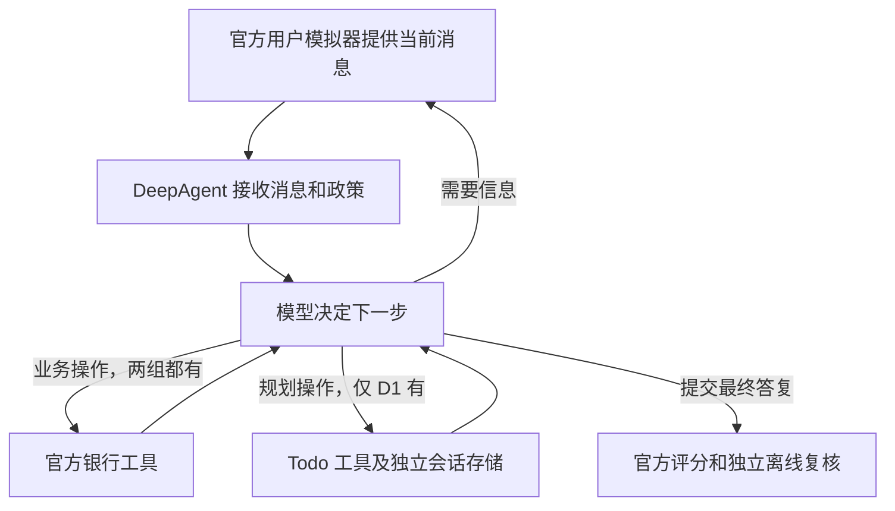

# DeepAgent Todo 规划对照测试方案 V0.1

状态：已被用户后续要求替代，未执行。当前采用[DeepAgent Todo 单组测试与代码设计 V0.2](DeepAgent-Todo单组测试与代码设计-V0.2.md)。本文的双组、194 次正式执行及额外模型冒烟安排不再适用，保留仅供追溯。

## 1. 要回答的问题

在相同模型、银行题目、工具、政策、初始数据库和执行限制下，直接 DeepAgent 开启 Todo 规划，相比关闭规划，是否提高任务正确率、减少遗漏和顺序错误？它增加或减少多少模型调用、Token 和时间？

本轮保留“每题每组只跑一次”的约定，不设累计 Token 预算，只记录用量。单轮可比较两组效果，不能证明同一组多次执行结果或轨迹相同，也不能证明生产环境长期稳定。

## 2. 规划到底做什么

直接 DeepAgent 仍通过底层 ReAct 循环选择下一步：调用模型、执行工具、读取结果，再决定下一步。TaskPlanning 给这个循环增加可读写的待办清单及使用说明。模型自行拆任务、读取任务、更新状态。

当前源码的 `TaskPlanningRail` 注册 Todo 工具，在模型调用前加入规划提示。DeepAgent 使用无参构造安装它；该构造的周期进度提醒默认关闭，模型选择表为空。主实验沿用这一默认行为，不额外打开进度重播或多模型选择。

Todo 是模型维护的任务状态，不是经过验证的银行约束。它不能天然保证候选完整、算术正确、前置条件满足或全局额度不超限。`completed` 只表示模型把该项标为完成，业务正确性必须另查官方结果和数据库事实。

## 3. 实验组及控制变量

| 条件 | D0：对照组 | D1：实验组 |
|---|---|---|
| 入口 | 直接装配 DeepAgent | 同一份装配代码 |
| TaskLoop | 显式开启 | 相同 |
| TaskPlanning | 关闭 | 开启 |
| 通用子 Agent、异步子 Agent | 关闭 | 相同 |
| MOA MAIN、Runtime 服务入口 | 不接入 | 相同 |
| 银行业务工具 | 原始名称及结构化参数 schema | 相同 |
| 规划工具与规划提示 | 无 | 框架原生 Todo 工具与提示 |
| 自动生成 graph、银行校验 rail | 无 | 无 |
| 官方政策、基础系统提示、语言 | 冻结统一版本，语言显式设为 en | 相同 |
| 上下文策略、工具回包内容 | 相同实现、相同配置 | 相同；自然增加 Todo 历史 |
| 交互、业务工具错误处理、任务完成机制 | 同一实现 | 相同；保留规划机制本身的实际影响 |

唯一有意改变的因素是 TaskPlanning。它带来的工具表、提示、状态和后续行动变化都是被测效果，不能为了“提示完全相同”把这些变化消掉。

旧 NativeSkillAgent 结果只作历史参考。旧组和新组之间存在工具包装、提示、上下文、框架版本及运行时间差异，不能用新组减旧组来计算 Todo 收益。

明确冻结以下设置：

- 网关沿用用户指定的火山 OpenAI Chat 入口，模型 `deepseek-v4-flash`；temperature=0、top_p=1。记录实际返回型号、请求参数和时间，不能由别名推定后端权重完全相同。
- 每题每组 1 次，seed=300，用户模拟器配置一致，单并发；固定 seed 不保证远端模型确定性，也不保证两组对话完全相同。
- 建议沿用既有上限：Core completion timeout 1200 秒、桥等待 300 秒、episode 1800 秒、maxIterations=100、官方 max_steps=200、max_errors=10；实施时核验各限制的实际计数单位和生效范围，写入 manifest。模型请求超时也须冻结其真实值。
- 每题每组独立初始数据库、会话、工作目录及 Todo 存储；同一 episode 多轮交互保持同一会话。不得把上一题的 Todo 带到下一题。
- 不静默截断官方工具数据，不同时做上下文去重、摘要或模型升级。自然生成的上下文可以不同，但处理规则必须相同。
- Todo 工具在 Java 本地执行，不作为银行工具转发给官方环境。分别记录 Core 迭代、内部 Todo 调用和官方交互步数，查清内部工具是否影响官方步数；不能把 Todo 操作伪装成银行动作。
- 两组只暴露所需银行工具、共同交互入口及 D1 的 Todo 工具，核验最终模型可见工具表。不得因直接 DeepAgent 默认装配而意外开放 shell、任意文件或子 Agent 能力。

相同时间和迭代上限衡量的是同等限制下的实际收益。若 D1 因规划操作提前触顶，这是主结果的一部分；后续可另做提高上限的诊断实验，但不得补跑替换主结果。

## 4. 测试规模与执行顺序

使用既有 P07 的准确 97 题清单，按清单冻结题目和数据 hash，不以 task_001 到 task_102 的连续编号猜测范围。

| 阶段 | 内容 | 规模 | 进入下一阶段的条件 |
|---|---|---:|---|
| S0 方案和版本冻结 | 固定题目、两组差异、指标、顺序、源码及制品 | 不调用模型 | 对比条件与评分依赖明确 |
| S1 离线接入检查 | 工具协议、Todo 注册/隔离、用户交互、错误与事件采集 | 确定性夹具 | 接入与证据检查通过 |
| S2 模型接入冒烟 | task_001，两组各一次，新目录 | 2 次，非正式 | 能完成完整协议流程并保存结果；得分为 0 不反复重跑 |
| S3 首批正式对照 | 预选 12 题，两组各一次 | 24 次 | 无系统性接入错误；不是通过率达到某数才放行 |
| S4 剩余正式对照 | 剩余 85 题，两组各一次 | 170 次 | 全部取得终态或明确的未执行状态 |
| S5 离线分析 | 判分、配对变化、开销、错误归因、81 卡覆盖 | 不新增模型调用 | 原始记录与汇总可相互核对 |

正式共 194 次；加独立冒烟共 196 次银行 episode，网关预检若需要则另计。不是 194 次模型请求，一个 episode 会包含多次模型请求。

12 题预选：001、002、003、026、041、060、064、067、080、094、098、099。覆盖既有失败模式和回归观察点；它是有意挑选的诊断子集，不代表随机样本，不能用其成功率代替全题结论。

S3 与 S4 构成一份正式清单。配置、制品和采集规则未变时，S3 直接计入 194 次，不再执行。如果 S3 暴露实现缺陷而必须修改，旧结果完整保留，新版本另建实验；禁止拼接不同版本的成绩。

每题两组相邻执行，组顺序预先随机生成并平衡到 49 对 D0→D1、48 对 D1→D0，保存随机种子和清单。不要先跑完全部 D0 再跑 D1，以减少网关状态随时间变化造成的偏差。全程串行；组间不共享执行状态。

102 的官方裁判曾因模型路由不可用而无法评分。S0 先列出其依赖；若仍不具备，继续保留该题及其状态，官方分数记未知。不得偷偷换成 DeepSeek 裁判后并入官方成绩。

## 5. 离线接入检查必须证明什么

1. 两组的最终业务工具名称和 schema 一致，动态发现/解锁按官方可见性语义工作；不能预先暴露所有隐藏工具。
2. D0 看不到 Todo；D1 能创建、列出、修改 Todo，存储确实读写成功。不能只看配置中的 true。
3. Todo 绑定实际会话；同会话跨用户回复可继续读取，不同题和不同组互相不可见。
4. 初始政策、业务工具返回内容保持完整；基础提示差异仅来自规划机制。保存提示、工具表和配置差异报告。
5. 用户回复进入原会话，Todo 调用不被误当作用户回复或官方业务工具；银行错误保持原有语义。
6. 事件采集能关联模型调用、Todo、银行动作及最终状态；异常和超时也有部分轨迹，缺失用量保留 null。
7. 退出后没有遗留子进程，重启控制器不会再次执行已有终态项目。文件 Todo 存储不能被宣称为完整业务检查点恢复。

上述检查是新适配器实施后需要完成的验收，本方案没有声称它们已经通过。

## 6. 如何判断效果是否改善

每个正式配对位置有两组执行状态、官方评分及证据路径。首先报告全部 97 个位置，不只挑有结果的文件。

| 指标 | 计算及用途 |
|---|---|
| 官方评分覆盖 | 各组有效评分数 / 97；其余按执行错误、超时、评分错误、中断等列出 |
| 已评分通过率 | 官方通过数 / 有效评分数；同时给出分母，不能隐藏未评分 |
| 全清单确认通过占比 | 官方已确认通过数 / 97；未评分仍是未知，不改写为 reward=0 |
| 配对修复和退化 | 仅双方有效评分的题目，列 D0失败→D1通过、D0通过→D1失败、同过、同败 |
| 关键业务缺陷 | 漏候选、漏任务、顺序破坏资格、全局限额错误、计算错误、错数据源、检索不收敛，逐题关联证据 |
| 执行可靠性观察 | 两组完成、框架异常、网关异常、超时、步数触顶的数量与差异；不混为一种失败 |

配对净提升 =（失败→通过题数 − 通过→失败题数）/ 双方有效评分题数。报告题数和百分点。未配对部分单列，并给未知结果在最好/最坏情况下对全题差值的范围，不借缺失结果制造提升。

可报告配对 bootstrap 的 95% 区间及基于不一致配对的精确 McNemar 检验，按题目配对取样，不能把消息或工具调用当独立样本。它们仅作题集差异的辅助分析；单次轨迹和固定题集不足以估计模型重复波动或保证对所有企业任务有效。

官方评分是主结果。业务诊断规则在正式执行前冻结，只供离线评审，不送入 Agent。人工复核使用匿名组标识；争议项保留争议，不凭一个模型裁判改写官方分数。新增模型裁判属于额外实验，本方案不默认安排。

## 7. 如何测量规划开销

| 观测项 | 采集方式与解释 |
|---|---|
| Agent Token | 每次模型请求的 input/output/total、可用缓存字段；逐调用保存后汇总 |
| 用户模拟器及官方裁判 Token | 分角色记录，与 Agent 分开；不能混为规划本身用量 |
| 总已观测 Token | 包括失败尝试的已知用量；缺失次数和原因另报，不补 0 |
| 模型调用数与耗时 | 单调计时，记录请求起止及状态；失败调用也应留事件 |
| Todo 操作 | create/list/modify 等实际工具名、参数、结果、状态前后快照和时长 |
| 业务动作 | 名称、参数、结果、错误、时间、数据库副作用；区分读写与检索 |
| 端到端时间 | 进程总时长、Agent 活动区间、用户等待/模拟器、评分分别记录，不相互替代 |
| 上下文增长 | 每次输入 Token、最大值、增长曲线；无法得到准确 Token 时单列字符数代理 |
| 无效推进 | 重复检索、相同资料重复出现、Todo 反复改名/状态震荡；诊断规则固定，不把所有重复查询都判无效 |

报告每题 D1−D0 的绝对差、两组总量、配对中位数及分布；相对变化仅在 D0 非零且覆盖足够时计算。P95 注明样本量，超时为受截止限制的观察，不能从耗时统计中删除后声称更快。

开销分三层解释：

1. **可直接测的管理开销**：Todo 工具执行时间、调用次数、可见规划文本大小。
2. **可测的整体净开销**：两组模型 Token、调用数和执行时间差。它包含规划花费，也包含规划可能省下的无效搜索。
3. **不能精确拆分的部分**：模型一次回复同时做业务推理和规划时，不能把内部推理 Token 精确归到规划；共享网关延时不能分解成服务端排队、网络、预填充和生成，除非有相应原始字段。

不用 Todo 工具的几毫秒代表规划总成本，也不把 D1 所有额外 Token 都断言为纯规划成本。

额外报告“全部尝试已观测 Token / 官方通过题数”，分子包含失败消耗；通过数为 0 时不可计算。该值只是 benchmark 的诊断比值，不能替代企业 E02。可列 ΔToken / 净新增通过题数，但仅在净新增大于 0 时使用，并标为汇总取舍信息，不能证明某个成功的因果成本。

## 8. task_003：具体看什么

历史证据：模型读取过 Silver 的旅行返现及订阅免外币费信息，最终却只比较 Gold 和 Platinum，用户据此申请 Gold。失败重点是候选遗漏与排序，不是工具没有返回资料。

假设模型自行形成如下待办，会有帮助：收集用户条件→列候选→逐项核验硬条件→按偏好排序→解释推荐。**这是解释用示例，不写入 task_003 专用提示，也不预置给 D1。** 测试必须观察模型是否自己形成并执行这些步骤。

离线复核检查：

- 规划是否出现在推荐前，而非答错后的补写；相关用户条件是否已通过真实对话获知。
- 是否保留订阅影响、外币手续费、购买保障、可获得额度等条件；是否在拿到新资料后更新判断。
- 是否把有依据的候选全部纳入比较，并按年费、主要消费返现等实际偏好作出选择。
- Todo 标完成时是否已有相应工具或对话证据；清单看起来完整但漏掉 Silver，仍属失败。
- 最后核对官方用户申请动作和评分。最终申请由官方用户模拟器执行，不能改成 Agent 代申请来提高得分。

隐藏用户脚本、required_documents、标准卡名和评价答案仅供评测侧使用，不得注入被测 Agent、规划提示或可检索目录。

对其他重点题同样区分“有清单”和“做对了”：041 看全局额度是否正确约束所有争议；060 看顺序是否保护后续开户资格；026 看是否查对业务状态来源；064/067 看是否减少无进展检索；094 看规则及算术是否正确。Todo 可能改善遗漏，但不保证这些判断正确。

## 9. 指标卡、证据与缺口

沿用《企业任务执行效果指标卡-V0.2.md》和《数据采集方法-V0.2.md》，每个 attempt 输出完整 81 卡覆盖记录。新增 Todo 观测量放在诊断字段，不擅自修改正式指标定义。

| 范围 | 本实验可交付 | 仍需明确的限制 |
|---|---|---|
| Q / R | 官方结果、错误分类、业务缺陷证据 | 未完成企业安全及完整验收，Q08 正式值无法收集 |
| T / E | 限定边界的时长、已观测 Token、模型/工具次数 | 没有费用账单不填费用；没有正式任务承接与验收边界，不冒充 T04/E01/E02 |
| K | 单轮两种配置的行为差异 | 不能计算同配置重复达标率 K05；跨配置差异不是重复不一致 |
| C / G | 会话隔离夹具及有限日志事实 | 未执行故障恢复、授权及审计专项，不宣称通过 |
| X | 评分、用量、场景的证据覆盖及缺失原因 | 无独立调用账时不能宣称计量覆盖 100% |

结构化事件最少包含 experiment_id、pair_id、case_id、arm、attempt_id、实际 session_id、event_id、父事件关联、UTC 时间、单调起止、事件类型、状态、数据路径及 hash。记录模型、工具、Todo 和评分真实事件，不造 Runtime Task ID。不记录模型内部思维链，不把密钥写入日志。

可用 OTel 或结构化 JSONL 实现；采用 OTel 不是本实验成立的前提。先验证事件完整性与关联，再决定导出方式。时间戳、用量、规划状态等采不到时明确“无法收集”，禁止用事后文件读取时间补成原事件时间。

## 10. 运行和中断规则（未来实施时适用）

所有实际冒烟和模型测试在沙箱外执行。凭证从交互输入或安全环境传入，不保存到方案和清单。控制器逐题推进，当前对收官再开始下一对，不依赖聊天持续在线。

执行台账保存 planned/running/terminal、进程标识、心跳、配置 hash 和输出目录。接管时先核验进程和已有终态，禁止重复启动。控制器与 Agent 的模型上下文分别管理；聊天上下文不足不应丢失调度状态。

不设累计 Token 停止条件；上下文长度超限、输出截断、模型配额错误、超时属于不同异常，分别记录。不得静默摘要或放宽上限继续同一正式版本。

业务得分 0 不重试。默认每位置只有一个主尝试；基础设施故障如确需恢复，另开 attempt、保留原状态和全部用量，补充结果单列，不覆盖正式主尝试。已发生写操作时先核实数据库状态，不盲目重放。

普通业务失败继续下一对。系统性接入故障、证据采集失效、服务不可用或用户要求暂停时停止新调度，保存现场。是否完成阶段不以通过率好看为条件。

## 11. 如何形成结论和下一步决策

优先判断官方结果及重大业务错误，再比较时间和 Token，不合成一个加权总分。

| 结果模式 | 可以得出的结论及下一步 |
|---|---|
| 通过增加、退化少、开销下降 | 有利于采用；仍须检查置信范围、缺失与关键错误 |
| 通过增加，但开销上升 | 列出修复/退化题和每项额外消耗，由业务目标决定取舍 |
| 整体接近，但复杂任务改善、简单任务变慢 | 可研究复杂度触发规划；属于新策略，不能用本次切片直接宣称验证成功 |
| Todo 使用很少 | 说明原生开关在本配置下采用不足；不能证明所有规划方法无效 |
| Todo 很多但仍漏规则、算错或假完成 | 状态管理不足以解决语义约束；再设计自动 graph/独立校验的单变量实验 |
| 新增严重业务错误 | 暂不推荐该配置；总通过率提高不能抵消关键风险 |
| 评分缺失多、漂移明显或两组配置不一致 | 结论不足，报告阻碍，不强行选胜者 |

本稿不虚构业务可接受的百分比或耗时阈值。正式启动前，可由业务方冻结最低收益和可接受开销；若未定义，则交付效果—开销对照，不宣布企业准入通过。

一致性单列为后续可选专项，默认不启动：固定模型及用户响应回放用于检查框架路径；同配置真实模型重复用于观察结果、关键动作及轨迹波动。回放不能证明真实模型确定性，固定 seed 和 temperature=0 也不能保证每次轨迹相同。

交付物应包含：冻结方案及配置差异、逐对执行台账、所有原始轨迹、Todo 状态变化、逐题对照表、81 卡覆盖表、效果与开销报告、全部修复/退化案例分析、缺失数据及未验证事项。本方案目前仅完成设计，没有执行这些实验。

## 12. 证据索引

- [TaskPlanningRail.java](../agent-core-java/core/src/main/java/com/openjiuwen/harness/rails/TaskPlanningRail.java)：注册、存储、规划提示、默认关闭的周期提醒。
- [TodoSection.java](../agent-core-java/core/src/main/java/com/openjiuwen/harness/prompts/sections/TodoSection.java)：模型可见的原生规划说明。
- [DeepAgent.java](../agent-core-java/core/src/main/java/com/openjiuwen/harness/deep_agent/DeepAgent.java)：按开关安装 TaskPlanningRail。
- [DeepAgentConfig.java](../agent-core-java/core/src/main/java/com/openjiuwen/harness/schema/config/DeepAgentConfig.java)：默认配置须显式覆盖。
- [已完成单轮结果](runs/enterprise-v02-timeout1200-20261114/P07-single-round-summary.md)：旧组边界与未评分事实。
- [现有装配复核](runs/enterprise-v02-timeout1200-20261114/当前Agent装配选型复核.md)：历史装配与新对照的差异。
- [历史48题分析](runs/enterprise-v02-timeout1200-20261114/48个未通过案例逐项分析.md)：诊断样本来源；该文是阶段性48题，最终主轮有49个已评分零分。
- [指标卡](企业任务执行效果指标卡-V0.2.md)及[采集方法](数据采集方法-V0.2.md)。
