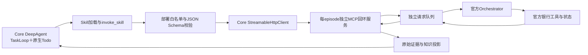

# DeepAgent＋Todo＋Skill/MCP 搭建与验证 V0.3.1

> 历史实现说明：当前 Skill 3.0.0 的业务指南已参与部署与按需加载；最新架构和待补能力见[测试方案与架构评审 V0.4](../v0.4/测试方案与架构评审.md)。本文末尾早期 Skill 拆分状态及 `evidence_read` 能力描述不能作为当前验收依据，后者的注册契约缺口见 V0.4 的 F3。

本实现承接 `DeepAgent-Todo-Skill-MCP测试设计-V0.3.md`。当前为开发集成验证，不是97题正式评测。官方任务、用户模拟器、工具实现和评分器保持原样。真实模型使用用户指定火山网关的 Chat Completions 接口、deepseek-v4-flash；不保存API key。

## 1. 已搭建的调用链



- `java/src/main/java/eval/DeepAgentAssembly.java`：直接通过HarnessFactory创建DeepAgent；TaskPlanning、TaskLoop开启，通用子Agent关闭。原生SkillUseRail、AskUserRail；不经过NativeSkillAgent/MOA MAIN工厂。
- `java/src/main/java/eval/DeepAgentBridge.java`：保留同一Agent实例和会话，使用InteractiveInput恢复ask_user中断；只有answer/error流事件参与最终结果提取，不把普通工具错误当作任务失败。
- 模型工具边界仅允许 `skill_tool`、`list_skill`、`invoke_skill`、`ask_user` 和四个原生Todo工具。边界同时过滤模型工具列表和检查执行请求，不向模型注册银行裸工具、MCP自动发现、shell或任意文件工具。
- `skills/banking-mcp/SKILL.md`：通用操作说明。每episode依据官方最初暴露的工具schema生成operations.json；不加载用例答案，不展开隐藏业务工具全集。
- `invoke_skill` 接收结构化arguments。执行层固定Skill、会话和MCP服务映射，模型不能选择服务URL。Java使用JSON Schema校验，Python执行前再次校验官方schema。官方要求字符串的内层arguments字段保持原样。
- `python/benchmark_mcp.py`：HTTP MCP最小评测服务，支持initialize、notifications/initialized、ping、tools/list、tools/call和DELETE；GET返回405，不提供服务端主动SSE通知。Java SDK和服务端通过真实协议交互，不是把旧stdio改名为MCP。
- MCP按官方工具名逐项公开工具，每项调用都携带Skill ID并由服务端校验；模型侧仍只看到受控的 `invoke_skill` 入口。每episode独立回环端口、随机Bearer令牌及MCP会话ID。令牌不写入轨迹。这是测试隔离，不是生产银行IAM。
- `python/deepagent_java_agent.py`：在Java等待MCP结果时，独立服务线程向队列发送官方工具请求；Python Agent返回该请求给官方调度器，下一次接收ToolMessage时填回等待槽。MCP线程不直接执行银行工具，不旁路修改数据库。
- SDK自动重连重发被关闭。重复invocation_id不重新执行业务；超时、未知结果ID、跨会话请求被拒绝。不能据此声称已经具备生产跨进程exactly-once语义。
- Todo存储在每episode独立workspace；检查点仍为内存，不提供进程重启恢复证明。

## 2. 上下文与进度观测

只对官方 `KB_search` 已知格式的文档正文去重，key包含文档ID和正文hash。相同文档首次返回完整正文，重复命中保留标题、ID、分数、排序及doc_ref；内容变化形成新引用。未知格式原样返回；客户状态等动态业务结果不缓存。

模型可通过同一Skill入口的 `evidence_read` 按引用和字符范围读取已获得原文，不能指定任意文件。原始回包和模型视图双份记录。不改写历史消息，不声称已消除全部累积上下文。

连续3次知识检索没有新增文档/内容版本且Todo版本不变时，给一次短进度提示；同一状态不反复提示，不自动结束任务、不增加LLM审查。Todo版本目前按create/modify完成回调计数，是操作版本观测，不是语义级计划变化证明。

## 3. 构建与运行

在项目根目录构建（沿用已有Java依赖和classpath）：

```bash
mvn -o -f java/pom.xml -DskipTests package
```

测试按约定在沙箱外执行。确定性测试只连接本机，不调用付费模型：

```bash
PYTHONPATH=python .venv312/bin/python -m unittest discover -s tests -p 'test_deepagent_mcp.py' -v
.venv312/bin/python python/check_deepagent_protocol.py --output runs/deepagent-development/protocol-NEW
```

真实网关开发验证（提示输入密钥，不写文件）：

```bash
.venv312/bin/python python/run_deepagent.py \
  --output runs/deepagent-development/live-NEW \
  --task-ids task_001 task_041 --execute
```

不加 `--execute` 只生成计划。入口使用单组、每题一次、串行；不设token预算，保留事件超时1500秒、Core完成超时1200秒和episode超时2400秒。达到超时记录失败，不通过减少超时制造提速成绩。

输出目录必须全新，旧记录不覆盖。开发失败修复后须创建新批次。当前构建验证不自动展开97题正式测试。

离线收集：

```bash
.venv312/bin/python python/collect_deepagent.py runs/deepagent-development/live-NEW
.venv312/bin/python python/analyze_v2.py runs/deepagent-development/live-NEW
```

## 4. 证据与指标

| 文件 | 内容 |
|---|---|
| manifest.json | 用例、模型、源码/制品/Skill hash、依赖仓库版本、超时和seed |
| official-trajectory.jsonl / result.json | 官方逐步轨迹、原始评分结果 |
| java/*.jsonl | Java控制消息；MCP令牌已脱敏 |
| deepagent/*/deepagent-events.jsonl | 原生Todo/Skill动作、实际模型请求与usage、装配参数 |
| deepagent/*/mcp/skill.jsonl | Skill invocation与MCP请求ID、官方调用ID映射 |
| deepagent/*/mcp/evidence.jsonl | 原始回包、hash、模型视图、去重观测 |
| deepagent/*/mcp/mcp.jsonl | MCP方法、JSON-RPC ID和请求区间 |
| user-usage.jsonl | Python模型usage；部分任务可能含裁判调用，不能全部解释为用户模型 |
| metrics-v02.json / metrics-v02.md | 81张指标卡，缺证据不填零、不判达标 |
| deepagent-diagnostics.json | 新装配调用次数、token、去重字节、MCP观测及缺失说明 |

MCP请求区间包含等待官方调度器的时间，不能解释为纯网络时延。嵌套时长不能相加。去重字节不等于节省token；token读取usage。不增加原生OTel已启用的声明，Runtime生命周期、生产银行接入、规划专属token、网关内部计时、同配置重复一致性仍缺证据。

原始请求/回包含测试客户信息，需按项目原始证据的权限要求保存，不在管理汇报中直接铺开。

## 5. 开发记录与验收边界

- protocol-a01：初版夹具失败，模拟模型没有按Java流式请求提供SSE格式；记录保留。
- protocol-a02：确定性真实Java/MCP往返、Todo、Skill及中断恢复通过。
- live-a01：两题未评分，接入层错误；solution的SkillSchema要求additionalProperties=false，不能直接替代官方JSON Schema语义；旧流提取逻辑还把工具错误误判为终局错误。
- 修复：使用标准JSON Schema校验；只从终局answer/error流提取执行结果；明确Skill读取使用skill_name。
- protocol-a03：修复回归通过，增加合法开放schema及错误参数后纠正继续的路径。
- live-a02：修复后两题均正常完成并评分；task_001 reward=1，110.53秒；task_041 reward=0，251.71秒。041严格重放确认临时贷记超额和退款方式错误，不能声称复杂业务测试通过。完整结果见 [开发验证报告](runs/deepagent-development/验证结果.md)。

确定性夹具成功证明装配和传输机制；官方reward=1仅证明所测用例；两者都不能替代97题效果、重复一致性、长时间稳定性或生产银行验收。正式评测需冻结版本后单独运行，不能混合不同开发版本。


## Skill 拆分进展

`skills/dispute-processing/SKILL.md` 将争议处理流程独立描述，覆盖逐笔资格、跨交易额度、提交前复核和结果核验。`banking-mcp` 保留为共享调用与证据规则。

当前 Java 装配和 MCP Facade 仍固定使用单一 `banking-mcp` ID，暂未实现 Skill 目录发现、逐 Skill 操作白名单，也未按后端系统拆成多个 MCP Server。银行评测工具当前由同一官方环境提供，缺少多个后端服务边界证据；贸然拆服务会制造虚假的系统划分。所新增争议 Skill 因此尚未参与运行时。后续需要先将官方操作映射到 Skill，并在执行层校验调用范围，再据实际系统边界决定 MCP Server 数量。
