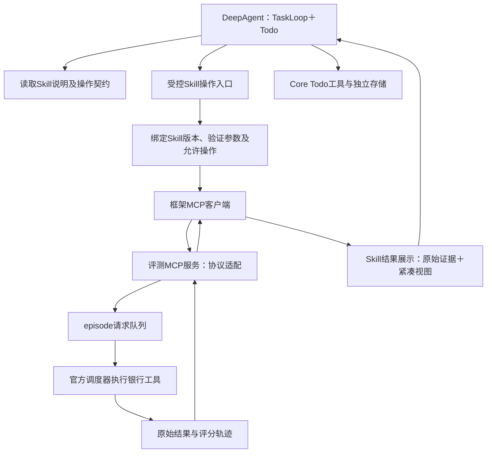

# DeepAgent＋Todo＋Skill/MCP 单组测试设计 V0.3

> 历史设计：当前 Skill 3.0.0 架构、覆盖与判定要求见[测试方案与架构评审 V0.4](../v0.4/测试方案与架构评审.md)。下文保留当时的设计与执行边界，不代表当前验证状态。

状态：原设计现已进入实现与开发验证，见 [搭建与验证 V0.3.1](DeepAgent搭建与验证-V0.3.1.md)。下文“当前不执行”等表述保留为设计时的授权边界；本轮用户已授权搭建并测试，实际结果以独立开发批次证据为准。本文修订 V0.2 的直接业务工具接入，并加入 Skill 调试及耗时优化设计。V0.2 的会话、官方评分、单组控制、81卡缺失标记等原则继续适用；冲突处以本文为准。

## 1. 新的约束与结论

银行业务必须通过 Skill 调用 MCP。因此不把银行操作直接注册为 DeepAgent 的模型可调用工具，也不为了减少一层调用绕过 Skill。DeepAgent 和 Skill 并不互斥：前者承担规划和推理循环，后者定义业务能力的适用范围、调用契约及执行边界。

当前设计：DeepAgent＋TaskLoop＋原生 Todo；模型读取 Skill，再通过受控 Skill 操作入口调用 MCP。MOA MAIN、通用子 Agent、多模型裁判仍不加入本轮。

Skill 的描述、例子、参数、错误反馈和上下文展示均是被测配置的一部分，必须调试、版本化及冻结。Skill 调试不是人工编写每道题的答案或固定执行轨迹。

单组正式范围仍为97题各一次、串行、沙箱外执行；不设累计Token预算，不自动追加模型冒烟或重复轮。当前只交付设计。

## 2. 之前为什么慢：事实与边界

旧统计来自88个有官方评分的原始主尝试，异常和恢复不混入该分母：

| 观测 | 结果 | 含义 |
|---|---:|---|
| 模拟执行时间合计 | 11.913小时 | 各题duration之和，不含人为暂停日历跨度 |
| 单题中位/P95 | 356.89 / 1155.44秒 | 本批描述值，不是生产SLA |
| 模型调用 | 2266次 | 多轮调用累计形成长任务耗时 |
| 模型调用区间占比 | 93.13% | 包含网络、网关、客户端与服务端生成，不能全归为推理 |
| call_mcp已完成跨度相加 | 60.38秒，3387次 | 只是本地旧实现量级，不能当真实远程MCP时延 |
| 单次输入Token最大值 | 410805 | 超长上下文是优先检查项 |
| 查询返回文档出现次数 | 19790次 | 单题内重复出现13690次，69.18%；不等于同占比Token可节省 |

064用了760.68秒，100次知识查询返回1000次文档、113个独立ID，模型区间占99.35%；最后因步骤上限失败。092用了1699.31秒，48次模型调用，累计生成169764 Token。长任务既有复杂业务的必要工作，也有反复读取、检索和生成的放大效应。

旧 ObservedToolContext 每轮注入累计完整响应，旧整块会先移除，并非同一请求无限复制整块；问题是不同查询的重复文档仍保留，后续请求继续携带累计内容。

不能据此断定网络或网关一定没有问题；现有数据无法拆开其排队、RTT、预填充和生成。更不能认为取消 Skill 就能显著加速。

另一个证据边界：旧 call_mcp 名称不证明真实 MCP 协议。现桥将操作包装为 SCRIPT，再由 SkillScriptRunner 经自定义stdio消息转发官方工具；没有据此验证真实银行MCP服务。

## 3. 新调用链



模型不能看到可绕过Skill的原始银行MCP工具。MCP客户端由Skill执行层持有，不通过自动工具发现把全部银行工具注入模型工具表。

Todo、ask_user、Skill发现/读取是框架控制工具，不是银行业务操作。所有银行读写及业务检索均必须经过 Skill→MCP。按需读取已取得的资料也通过Skill上下文接口完成，不开放任意文件读取。

生产银行MCP地址、Skill资产格式、身份鉴权和参数契约尚未提供。本设计先用评测MCP服务封装官方模拟工具，验证真实MCP协议链；不能将它称为银行生产MCP端到端验证。获得真实契约后应对齐实现，不能宣称本稿自定义接口就是银行标准。

## 4. 框架能力如何复用

本地源码确认：Core SkillUseRail 支持Skill发现和说明加载，SkillTool读取内容；它们不能单独证明运行时强制“只能经Skill调用MCP”。需要额外的调用边界检查。

NativeSkillAgent提供Skill操作契约、白名单和交互装配，本身仍返回DeepAgent。因此，之前把“直接DeepAgent”理解成“必须去掉Skill”需要纠正。但现工厂硬编码TaskPlanning关闭，SkillBoundaryRail又过滤Todo，不能简单改一个布尔值。

本轮建议独立装配 DeepAgent：复用 Core 原生规划、Skill加载及交互；新增薄的 Skill/MCP 执行适配与范围检查。可复用 agent-solution 的契约校验组件，但不直接复制整套 NativeSkillAgent 或依赖其硬编码边界。若后续选择扩展该工厂，应同时处理Todo白名单、提示、完成机制与MCP传输，作为明确版本变更。

新增适配器不是宣称框架已有一键“Skill→MCP＋Todo”完整入口。实现是否需要依赖solution模块，以实际复用的公开类为准；不坚持V0.2“只能依赖Core”的限制。

## 5. 代码设计调整

| 组件 | 设计职责 |
|---|---|
| DeepAgentAssembly | 开启Todo/TaskLoop，安装Skill加载、AskUser与观测；不注册银行裸工具 |
| SkillCatalog / 原生SkillUseRail | 加载冻结Skill目录，先暴露短描述，按需读取正文及契约 |
| SkillOperationTool | 提供项目级受控入口，携带skill_id、operation、arguments；实际命名与银行契约对齐 |
| SkillInvocationService | 从可信目录绑定Skill版本/operation映射，校验结构化参数和会话；不接受模型任意指定服务URL |
| McpExecutionPort | 封装框架真实MCP客户端，管理每episode连接、请求ID、超时及错误，不向模型自动注册底层工具 |
| BenchmarkMcpFacade | 暴露官方初始工具的MCP适配；将请求交给官方episode执行，不在旁路直接修改数据库 |
| EvidenceStore | 保存每次完整原始回包、调用关系和hash，不因上下文压缩删除证据 |
| KnowledgeProjection | 为模型生成可核查的去重文档视图和引用；不负责决定业务答案 |
| ProgressObserver | 观测重复检索、新证据和Todo变化，生成有界的进度提示；不另调LLM |
| EvidenceRail | 分别计量Skill、MCP、模型及官方业务调用，不能把同一嵌套调用算成多次业务操作 |

示意契约（项目设计，不是现成框架API）：

```text
invokeSkill(skill_id, operation, arguments)
  → 服务器侧解析已部署的Skill版本和允许操作
  → 验证官方参数schema及会话范围
  → 从固定映射取得MCP服务和工具名
  → MCP tools/call
  → 官方环境执行并记入官方轨迹
  → 保存完整结果，返回Skill模型视图及证据引用
```

工具描述、Skill文档和执行校验均从同一份版本化操作契约生成，避免三者漂移。arguments使用结构化对象，只有官方原工具规定为JSON字符串的字段保留字符串；不额外增加整包字符串编码。

仅“读过SKILL.md”不是权限凭证。执行层从会话身份及已部署目录确定权限与版本，不能让模型伪造skill_id即可越权；评测中只验证声明的模拟允许范围，不虚构真实银行鉴权。

MCP服务采用每episode独立回环实例和会话绑定，初版采用Streamable HTTP作为设计选择，需以本地SDK支持和协议夹具确认。它与现有Java/Python自定义stdio控制通道分开，不能在同一stdout混用协议。

必须处理的等待链：Java等待MCP结果时，Python适配器仍需从独立队列取得业务请求，返回给官方调度器执行；下一轮收到官方ToolMessage后再完成对应MCP请求。MCP服务和队列消费不能堵在同一个同步读线程中。离线夹具要覆盖该往返，防止新增加的适配造成死锁。

业务写操作不自动重试；MCP连接故障与业务错误分开保留，已写成功但回包丢失不能靠重发解决。每episode连接复用，避免每次工具调用重新握手；跨episode不共享用户状态和鉴权上下文。

## 6. 怎样缩短时间

### 6.1 优先做：去掉重复全文，保留全部证据

只对结构明确的知识库文档做无损去重：同一来源、文档ID、版本或内容hash一致才合并正文。保留每次查询的排序、命中、分数及来源引用；相同ID但内容变化不能合并。不能拿客户余额、资格、审批状态等动态业务结果做这种缓存。

KnowledgeProjection维护本episode文档表。模型上下文保留每份已取得文档的单份正文与多次检索引用，新增文档提供正文，重复命中提供引用。超长资料需按需展开时，Skill提供按doc_ref及范围读取的入口，原文始终可取。

关键要求：不能只把历史消息替换成ID，却没有可访问的正文或读取接口；也不能只保存原文在磁盘就声称模型已知。上下文组装要通过Core公开扩展点实现，保留工具调用/回包关联，实际请求快照用于核查。若公开接口无法安全管理历史正文，先实现只投影新增结果并保留原生历史，不声称已解决全部累积问题。

这改变了旧组的资料展示方式，必须记为新装配策略。保存raw与model-view两条证据，核对事实未丢失。不同查询的独立命中证据不能随着正文去重一起删除。

### 6.2 优先做：让Skill调用说明准确、短而明确

入口只给名称、适用范围和短描述，避免每轮塞入所有Skill正文及全部工具schema。复杂参数契约按需读取；关键禁止事项和必需授权仍在执行层检查，不能依靠未加载的说明。

一份Skill说明应说明：何时使用、输入是什么、调用顺序有哪些官方要求、怎样判断返回值、遇到拒绝或未知如何处理、何时停止或询问用户。只规定通用能力边界，不写每题的候选或标准答案。

调用名和参数位置只保留一种明确写法；示例用虚构数据，覆盖正常调用、业务拒绝、解锁后调用及结果引用。减少模型猜名称、反复试参数、重复读取同一说明。

### 6.3 优先做：阻止无进展循环，但不硬砍必要工作

记录标准化查询、返回文档hash、新增证据数和当前Todo版本。建议固定诊断条件为“连续3次知识查询未增加新文档或内容版本且Todo无变化”，触发一次短提示：列出已经获得的证据，要求模型判断尚缺什么并改变查询或询问用户。同一证据状态不反复注入提醒。

这是进度启发式，不证明查询毫无价值；重复读取可能帮助理解，不能直接按该条件判业务失败。本版不自动提前终止，不增加LLM审查，也不自动生成银行约束graph。原时间/迭代限制仍作为硬上限，触顶保留失败。

Todo只在实质任务状态变化时更新，不要求每次工具前后都读写；短问题不强制拆成多项。Skill提示建议复用已获得的事实，未知保持未知，不允许用省时作为跳过验证的理由。

### 6.4 避免新增慢路径

- Skill→MCP为程序化调用，不给每次Skill操作增加一个子Agent或额外模型审核。
- 不自动写长篇计划解释；Todo描述应足够执行和核查，最终客户答复保持必要长度。不能据此保证内部生成Token下降。
- 不减少官方查询返回数量、不换模型/裁判、不降低必要确认和校验。
- 首版不提高题目并发，也不并行写操作。题目并发只影响整批等待，不能解决单题无效推理，且可能加剧网关排队。
- 金额等计算先使用官方已允许的工具；本版不擅自增加新业务计算器或批量写接口。

不把缩短超时当成提速，也不承诺“快一半”。真实MCP适配本身会新增一些开销，必须计量。

## 7. Skill如何调试及冻结

Skill资产拟采用：`SKILL.md`、`operations.json`、`references/`、`examples/`、`fixtures/`。operations包含固定MCP工具映射及原始输入schema，不能把隐藏工具全集泄露到模型侧；官方unlock/call机制保持原样。

调试分成三类：

| 类别 | 检查内容 | 是否必须调用模型 |
|---|---|---|
| 文档和契约检查 | 描述是否清楚、工具名是否存在、必填字段/示例是否通过schema、错误说明是否一致 | 否 |
| 确定性协议夹具 | Skill绕过被拒、Todo未被过滤、真实MCP握手及调用、错ID/超时、完整回包、会话隔离、去重可还原 | 否 |
| 模型可用性调试 | 模型能否选对Skill、理解参数及错误、利用证据引用、不反复尝试错误调用 | 是，当前不执行 |

文档lint通过不等于模型能够正确使用。当前不额外安排真实模型开发运行；正式前若需要这类调试，应另建开发批次并计量，不能混进97题正式分数。优先用不含正式答案的合成或独立开发场景，不能反复针对正式失败题改说明后仍声称未调优评测。

若只执行一次97题，必须接受Skill模型可用性事先未充分验证的限制。首题可观察接入；若需修改资产/代码，保存原结果、新建版本，不能边跑边改后拼成同一配置成绩。

冻结清单包括Skill目录hash、描述和示例、操作schema、MCP映射、模型提示、上下文投影、进度提醒规则、Core及适配制品。官方数据/隐藏答案不进入Skill资产。

## 8. 新增时间与质量观测

分别记录模型请求总区间、Skill调用区间、MCP握手与请求区间、官方执行区间和上下文整理时间；嵌套区间不简单相加。保持官方业务调用ID与Skill/MCP ID映射，raw日志不因压缩模型视图而变短。

新增诊断量：独立文档数、重复命中次数、去重前后字节数、实际输入Token曲线、原文按需读取次数、无进展提示次数、错误Skill选择/参数重试、Todo读写次数、业务正确率和未评分情况。

去重前后字节差只能说明展示内容变化，不等于实际Token节省或时间收益。实际Token读usage；无法分离规划/业务推理Token时保持未知。模型调用时间不能直接拆成网关、网络和服务端时间，没有字段就标无法收集。

可以按题列新耗时与历史耗时、结果、模型次数、输入Token差异，但要同时列明Skill、MCP、上下文和版本变化，称为历史参照，不宣称Todo或某项优化的因果收益。失败提前结束可能很快，必须同时报告正确率、超时和长尾，不能只表扬均值下降。

97题为正式单组，不恢复双组方案。优化目的优先是减少重复处理和无效轮次，同时保留任务所需信息与官方验收；最终是否更快、更准只能由后续实际执行回答。

## 9. 依据

- [旧单轮耗时分析](runs/enterprise-v02-timeout1200-20261114/单轮测试耗时原因分析.md)及[逐调用统计](runs/enterprise-v02-timeout1200-20261114/single-round-latency-data.json)。
- [旧桥 Tau2Bridge](java/src/main/java/eval/Tau2Bridge.java)和[ObservedToolContext](java/src/main/java/eval/ObservedToolContext.java)。
- [Core SkillUseRail](../agent-core-java/core/src/main/java/com/openjiuwen/harness/rails/skills/SkillUseRail.java)及[SkillTool](../agent-core-java/core/src/main/java/com/openjiuwen/harness/tools/skills/SkillTool.java)。
- [NativeSkillAgent](../agent-solution/common/agents/moa-agent/src/main/java/com/moaagent/agent/skill/NativeSkillAgent.java)及[SkillOperation](../agent-solution/common/agents/moa-agent/src/main/java/com/moaagent/agent/skill/SkillOperation.java)。
- [前版单组设计](DeepAgent-Todo单组测试与代码设计-V0.2.md)：直接工具接入已被本文替代。
