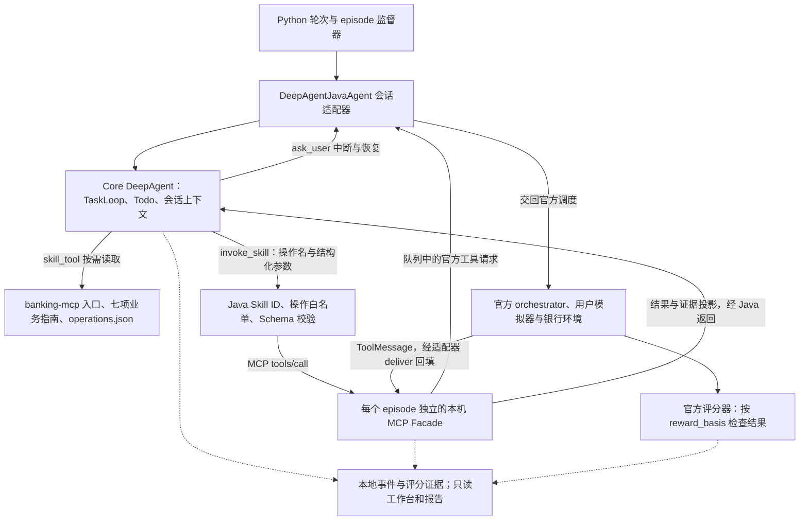

# DeepAgent 银行业务 Skill 测试方案与架构评审 V0.4

评审日期：2026-11-16。代码基线：`a789152cc1dd67e3736bebaacf132d259b486383`。Skill 基线：**3.0.0**，发布清单 SHA-256：`6faae8d2ad43a1157460fc08a3f205c30e47aaef782a445c0872fa4b26189501`。

**结论：现有架构适合继续做受控银行 benchmark 实验；业务 Skill 的收益尚未验证。** 当前是一个 DeepAgent、一个可执行 `banking-mcp` Skill 和七项按需读取的业务指南。下一轮应验证“选择指南—收集证据—处理依赖—调用工具—核验结果”，并用同一运行环境比较旧版和新版 Skill。不能把协议通过解释为业务通过，也不能把业务部门分类解释为已具备独立权限或多 Agent 协作。

本文是当前设计与评审入口，承接 V0.3、V0.3.1 和第一轮经验。旧方案、旧成绩及冻结输入保持原样。本次只更新文档并做离线核查；下述新增测试和执行器改造均为待实施，不启动模型、不重跑历史用例、不增加原始轨迹提交。

本文归档于独立 [v0.4 实验目录](README.md)。[experiment.json](experiment.json) 登记实验版本、两组 Skill 发布身份及选题来源；它是设计描述，不能替代可执行计划或运行冻结 manifest。

## 1. 范围、目标与证据

评审覆盖 Java DeepAgent 装配、Python 适配/MCP/监督器、Skill 发布资产及现有测试。采用源码和已有验证记录；不评价 MOA MAIN、Runtime A2A 或生产银行系统的能力，也未重新审查整个上游 Core。

| 要回答的问题 | 本方案的证据 | 不由这些证据证明 |
|---|---|---|
| 新版 Skill 是否真正参与运行 | manifest、部署 hash、模型实际读到的指南及调用事件 | 仅有文件部署不能证明选择正确或行为遵循 |
| 业务处理是否改善 | 同环境 v1/v3 配对结果、逐项办理证据与失败原因 | 历史成绩差值不能单独归因为新版 Skill |
| 工具链是否可靠 | Schema、会话、超时、重复调用、响应关联检查 | 本机 MCP 不代表生产银行接入和分布式事务 |
| 结果是否可追溯 | 发布身份、冻结制品、评分依据、报告和事件关联 | 相同 seed 不保证云端模型输出或轨迹一致 |

历史第一轮为有目的抽样的 22 题、11 类，每题一次：21 题已评分，12 通过、9 失败，062 模拟器异常未评分。见[本轮执行报告](../reports/round-01-20261115-a00/本轮执行报告.md)及[人工核查与建议](../reports/round-01-20261115-a00/人工核查与建议.md)。这些题已被分析，只能作为诊断回归集，不能再宣称为独立保留集。

## 2. 当前架构与状态归属

图中官方环境拥有银行业务状态；MCP 只转接请求及结果，不直接修改银行数据库。评分和参考答案在评估侧，不能回流到模型上下文。

| 实体 | 入口及职责 | 状态与生命周期 |
|---|---|---|
| 轮次/episode 监督器 | `run_round.run_round`、`python/episode.py`；取题、超时、记录终态 | 轮次截止、执行台账归 Python 所有；单题独立进程 |
| DeepAgent | `DeepAgentAssembly`；规划、选择指南、调用工具、答复 | 会话上下文、原生 Todo 和内存检查点；每题新会话 |
| 业务指南 | `SkillUseRail`、`skill_tool`；读取发布文档 | 文档无自主执行生命周期；业务负责人角色是维护归属 |
| 执行入口 | `SkillOperationTool.invokeInternal`；唯一执行 Skill ID 为 `banking-mcp` | Java 检查操作和参数，产生 `skill-N` 调用 ID |
| MCP Facade | `BenchmarkMcpFacade`；HTTP、会话校验、请求队列和结果回填 | 每题随机本机端口；内存 pending、重复 ID 记录、KB 文档投影 |
| 官方环境 | 官方调度器、工具、用户模拟器、评分器 | 拥有业务状态、客户侧操作和评分；实验不替换其实现 |
| 工作台 | `trace_viewer.py`；事后查看能力、对话、工具和评分 | 只读本地证据；页面展示参考动作不代表 Agent 能看到 |

模型工具白名单包括 `invoke_skill`、`skill_tool`、`list_skill`、`ask_user` 和四个 `todo_*` 工具；某次实际暴露集合以模型请求记录为准。底层银行工具不直接注册给模型。模型配置沿用既定网关与 `deepseek-v4-flash`；具体参数以该批 manifest 和请求为准。

### 2.1 交互分类及控制权

| 边 | 请求/返回与执行方式 | 控制权和状态影响 | 分类、证据 |
|---|---|---|---|
| DeepAgent → 指南/Todo | 路径或 Todo 参数 → 文档/计划结果；同步工具调用 | Agent 决定后续步骤；指南只读，Todo 修改会话计划 | 非 Agent 间交互；direct，S1 |
| DeepAgent → invoke_skill → MCP | operation、arguments、session_id、invocation_id、todo_version → 结构化结果；阻塞等待 | Agent 保留业务推进权；桥负责边界与传输 | 工具 Calling，非 Agent 委派；direct，S1/S2 |
| MCP → 适配器 → 官方工具 | 请求事件 → ToolMessage；队列回调 | 官方调度器执行业务操作，结果按 ID 回填 | 非 Agent 间交互；direct，S2/S3 |
| Agent → ask_user → 用户模拟器 | 问题 → 用户消息；会话中断后恢复 | 官方调度器驱动客户角色；原 Agent 继续处理 | 客户交互，不是业务子 Agent 委派；direct，S1/S3 |
| 官方轨迹 → 评分器/报告 | 记录 → reward、状态差异；事后评估 | 不授予 Agent 新权限，不推进办理 | 非 Agent 间交互；direct，S9 |

测试系统还包含模型驱动的用户模拟器，但被测银行服务端是单 Agent。没有发现业务子 Agent 委派或多个业务 Agent 协调；`addGeneralPurposeAgent(false)` 已关闭通用子 Agent。按部门建立七个 Agent 会增加权限、状态和失败域，当前没有必要。优先保留一套执行链和可独立维护的业务指南。

## 3. Skill 3.0.0 的业务边界与覆盖

权威资产是 [releases/3.0.0](../skills/releases/3.0.0/)，[catalog.json](../skills/releases/3.0.0/catalog.json) 记录能力 ID、领域、责任角色和路径。每项指南都通过同一个 `banking-mcp` 执行边界；`permission_scope` 明确不新增授权。

| 业务能力/维护角色 | 应检查的关键过程 | 成功证据与典型错误 |
|---|---|---|
| 信用卡申请／信用卡业务负责人 | 需求筛选、政策依据、资格与申请意愿 | 区分产品建议、受理、审批；不能把推荐当成办卡成功 |
| 额度调整／信用卡业务负责人 | 当前限额、资格及前置整改，必要时重新判断 | 有效额度或权威决定；不能跳过相关状态核查 |
| 转账／支付结算业务负责人 | 来源、去向、金额、授权和可用资金 | 区分受理、处理中、拒绝、完成；超时不能盲目重提 |
| 开户／账户业务负责人 | 产品条件、资格、现有账户依赖 | 已开户状态与账户信息；不能先破坏开户条件 |
| 销户／账户业务负责人 | 余额、待处理事项、资金迁移和其他目标依赖 | 权威销户凭据；余额为零或转账成功不等于销户 |
| 交易争议／争议业务负责人 | 逐项事实、政策、历史记录、限制与处置 | 每项均有核验结果；提交争议不等于退款到账 |
| 其他账户/卡变更／账户业务负责人 | 识别具体变更，确认对象和客户侧操作 | 验证变更后的状态；转接人工不等于变更完成 |

七项能力与原 11 类测试场景不是一一对应。推荐奖励、利息核算、部分费用调查等没有专门指南；按入口要求查询政策及已部署操作，并明确未支持项。不能把所有未覆盖业务都当作“其他账户变更”，也不能以文件数宣称覆盖全部银行业务。

下一轮用例标注采用“一个主目标＋零至多个关联能力＋通用路径/缺口”。例如 054 涉及争议、补卡和提额；060 涉及开户、销户及可能的资金迁移；具体依赖以题面和运行时政策为准。标注只供离线评审，**不将题号、参考动作、理想顺序注入 Skill 或系统提示词**。

## 4. 评审发现与改进顺序

本节规则 ID 来自本次采用的架构评审方法。`direct` 表示源码或文件直接证明；`strong_inference` 表示多处源码共同支持。P1 是下一轮正式对照前应解决或明确排除的事项；P2 是后续改进。风险等级针对当前实验，不等于生产合规评估。

| 编号/优先级/规则 | 结论、影响与证据 | 建议与验收 |
|---|---|---|
| F1／P1／COM-07、CALL-04 | 指南中的身份、精确授权和业务依赖主要是模型指令；Java 校验 Skill、Schema 和部署目录，未实现逐业务权限或完整前置状态机。把“已读指南”当作安全门槛会漏报违规。direct：S1 `invokeInternal` 96–130 行、S4 业务指南 | 下一轮独立记录授权、依赖和结果核验；加入缺授权、依赖未完成、不确定写入场景。若以后要求强制控制，再设计业务状态校验与参数绑定确认，不把当前实现说成已有 |
| F2／P1／CALL-01、COM-09 | 协议脚本预设争议指南读取；同时核对所有文件部署，但没有验证真实模型对七项业务的选择。direct：S5 `script`、`dispute_guide` 16–31、74–82 行 | 为七项能力及组合/不适用场景补选择与行为检查。合成脚本只能验证加载链；语义选择要由独立业务运行验证 |
| F3／P1／COM-03、CALL-01 | Java 工具描述宣称支持 `evidence_read`，且内部有特例；MCP HTTP `tools/call` 先拒绝不在 schemas 的名称，当前 schemas 来自官方工具。内部单测成功不能证明端到端可达。direct：S1 98、105 行，S2 62、124–130、173–180 行，S3 `_start` | 明确选一种契约：正式注册受会话约束的本地只读工具并测试完整 HTTP 链，或移除不可达描述/特例。修复前按 v3 指南仅使用目录实际支持的检索能力；不要求模型调用缺失工具 |
| F4／P1／COM-08、COM-09 | 第一轮是旧配置单次抽样；v3 同时改变内容、组织和加载方式。历史差值不能证明收益来自“业务分类”。direct：S4、S7；因果限制为 strong_inference | 同一代码基线配对 v1/v3，记录暴露题和所有失败；结论限定为整套 Skill 配置变化。若要分离分类与内容收益，另立消融实验 |
| F5／P1／COM-04、COM-05 | `run_round.prepare` 仍使用第一轮 execution_kind 和固定方案文件名；通用 `run_deepagent` 则默认 72 小时，不实现原第一轮显式顺序和 4 小时门槛。direct：S6 及 S8 | 配对控制器需独立计划、明确组别与发布身份、轮次时限和恢复规则；未实现前只称单组入口可用，不能直接复制第一轮命令称配对实验 |
| F6／P2／COM-03、COM-07 | Java 仅允许 `banking-mcp`，但 Facade `invoke` 仍兼容 `dispute-processing`。不是已实现第二个执行 Skill；目录与代码契约有遗留差异。direct：S1 102 行、S2 164 行 | 明确并测试兼容范围，或统一允许列表；拒绝未知 Skill 与跨会话请求，避免前后台能力描述分叉 |
| F7／P2／COM-08、COM-10 | 已有 hash、请求 ID 和工作台；尚无覆盖七指南的逐项目标/依赖/验收自动关联，日志存在不代表流程合规。direct：S1 91–162 行、S2 日志；覆盖限制见 S5 | 先定义离线逐题判定表并人工核查；需要自动化时再补解析器。指南加载缺日志记 unknown，不推断为遵循 |

### 4.1 必查风险与评分

已见显式模型/工具等待、Core/桥/episode/整批时限；MCP 自动重连重放关闭，同一 invocation ID 不重复执行。Schema 校验和会话/调用 ID 已存在。没有递归子 Agent 或协调循环，因此委派终止和协商收敛不适用。Facade 队列用锁维护，模型工具并行数为 1；没有验证共享生产宿主的并发一致性。

**在本次审查的实验边界内，未确认“无超时调用、无 ID 追踪、自动重试重复写入”等硬性失败；不据此认定生产安全。** 模型可用新调用 ID 再次提交同类业务，当前去重不能代替业务幂等；进程重启后的持久化去重、生产 IAM、授权强制校验及事务恢复均缺少验证。F1 在生产写入场景中需按高风险单独处理。

架构评审分 **78/100，中等风险、需要整改**：通用质量 32/40（边界 8/8、职责 7/8、契约 6/8、失败恢复 5/6、权限隔离 3/5、观测测试 3/5）；调用质量 36/50（路由 7/10、契约 8/10、结果校验 7/12、超时降级 7/8、权限上下文 2/5、工具必要性 5/5）；复杂度适当性 10/10。主要扣分对应 F1–F3、F5–F7。这是基于规则的评审判断，不是 benchmark 分数、统计结果或生产准入结论。

简化建议：保留单 Agent 和统一 MCP；用明确操作契约和离线证据检查解决边界问题。无需为部门标签新增 Agent，也无需为固定 Schema、版本或 hash 校验引入模型。

## 5. 重写后的测试设计

### 5.1 分层推进与退出条件

| 阶段 | 内容和范围 | 通过/停止条件 | 当前状态 |
|---|---|---|---|
| T0 资产与契约 | 三个版本校验；版本锁定；路径、额外文件、篡改拒绝；Java/MCP/AskUser 基础链 | 选定版本与部署 hash 一致，非法输入不触发官方写入；新缺口另列失败 | 已有离线与协议记录；本次新复核见第 9 节；F3 尚未解决 |
| T1 业务指南检查 | 七项能力各至少一条成功、一条拒绝/缺信息路径；另加组合依赖、目标变更、无适用指南、不确定写入 | 逐项检查选读、授权、依赖、调用和验收；不能只断言文档字符串出现 | 新场景集待编写；合成数据明确标注，不计官方成绩 |
| T2 v1/v3 配对回归 | 原 22 题保持诊断属性；每个版本每题一次，共 44 次计划尝试，独立业务初态 | 先冻结配对计划与控制器；证据或系统性故障不合格则停止；未执行保持未执行 | 建议方案，未生成可执行配对计划、未启动 |
| T3 扩展验证 | 从其余题审查暴露情况、覆盖缺口及裁判依赖后选样；必要时扩至 97 题 | 选题与验收在运行前冻结；不得事后挑成功题；额外重复需独立计划 | 后续阶段，无当前成绩或耗时承诺 |

T1 的离线脚本可检验“按给定动作走通”，不能检验模型会不会选择该动作。真实选择检查放在独立模型运行中；优先复用 T2 可覆盖的场景，缺项明确登记，不为补齐表格自动追加模型请求。T1 合成场景成功率与 T2 官方通过率分别报告。

### 5.2 对照条件与执行控制

- 对照 A 使用 `1.0.0` 文本，对照 B 使用 `3.0.0`；两组使用同一当前 runner、Core、依赖、MCP、提示模板、官方题集/评分器及配置。1.0.0 是旧文本补登记版本，不能把这次 A 组叫“原始运行完整复现”。2.0.0 暂不加入，以减少无必要实验组。
- 配对按原 22 题顺序组织；预先固定相邻题交替 A→B、B→A，每次全新 episode。它可降低时间漂移影响，但不能消除云端模型和用户模拟器随机性。控制器必须记录 task、arm、version、seed、尝试 ID、状态和启动顺序。
- 沿用单并发、每组每题一次、temperature=0、实验 seed=300、BM25、max_steps=200、max_errors=10。模型、授权网关、工具目录、官方初始状态、裁判配置与版本/hash 一并冻结。seed 是实验配置，不声称覆盖远端全部随机源。
- 建议该 44 次配对轮设置 6 小时检查点、8 小时硬截止；Core 1200 秒、桥事件 1500 秒、episode 2400 秒，MCP 请求/回填等待 120 秒。8 小时是待落实的排期控制，不是现有入口默认值；44 次均到 episode 上限需 29 小时 20 分钟，不能承诺全部完成。
- 截止停止在途任务、保留已知结果，剩余标未开始；暂停恢复不能重置总截止。只继续未开始尝试，失败、中断或未评分均不自动重试。批次内不改 Skill/代码；修改后另立批次，不拼接成绩。
- 不设累计 Token 预算；记录真实 usage，缺失为 unknown。系统性鉴权、模型路由、Java 启动或 MCP 故障停止整批；业务拒绝、合法 reward=0 不自动解释为基础设施故障。超时不替代业务状态核对。

当前 `run_deepagent.py --skill-version ...` 可生成单组计划，但不能实现上述交替组别和 8 小时截止。`run_round.py` 具备冻结/顺序/截止基础，但需去除第一轮硬编码并增加配对恢复语义。**正式执行前先完成 F3、F5 及所选场景门槛；本文件不把建议参数冒充现有能力。**

### 5.3 冻结、恢复与比较口径

冻结内容包括 Skill 发布身份、全部指南与 catalog、部署操作 Schema、源码和 class/JAR hash、官方题集及评分器 commit/本地 diff、模型配置、顺序、时限、判定规则和环境依赖清单。新 manifest 的 `skill_release` 必须在 episode 初始化前校验，不能静默使用默认版本。

旧 Skill 文本已可精确导出；已有记录证明第一轮 1432 个冻结输入可校验归档，其中 4 个变化 class 经重建匹配原 hash。归档不等于可直接运行的新工作区：绝对路径需迁移，Python 环境和远端模型状态未完整封装。具体命令和限制见[版本与复原说明](../skills/README.md)。

报告按组给出启动、已评分、通过、失败、未评分、未开始及原因；配对表另列双方通过、v3 改善、v3 退化、双方失败和不完整对。若以双方均已评分的子集比较，必须同时公开被排除的题和两组评分覆盖，避免选择性分母。单次 22 对只作描述，不宣称统计显著、泛化改善或轨迹稳定。

## 6. 成功、失败与未知的判定

四个层次分别记录，不能相互替代：

| 层次 | 成功条件 | 失败/未知条件 |
|---|---|---|
| 资产/协议 | 版本和部署一致；合法调用关联完整；非法输入被拒绝且无副作用 | hash/路径/协议断言不满足为失败；缺运行记录为未验证 |
| 业务过程 | 适用指南已读取，政策要求的身份/授权、依赖顺序、逐项处理和核验有证据 | 明确违背已知要求为失败；资料不足为 unknown；合理业务拒绝可算过程正确 |
| 业务结果 | 各目标有权威完成、拒绝、处理中或转接凭据，答复准确说明范围 | 虚报完成、遗漏目标或未核对不确定写入为失败；转接只证明已转接 |
| 官方用例 | 有有效官方 reward 且等于 1 | 有效数值 0≤reward<1 为官方未通过；无 reward 为未评分；状态与结果矛盾或异常数值需核查 |

官方评分依据每题 `reward_basis` 解释。DB 类评分对实际动作与参考动作分别回放再比较状态；查询/审计记录也可能影响状态，因此“金额正确”或“未匹配动作列表为空”都不足以证明通过。不要求所有题逐字复制参考调用序列，也不修改官方评分以满足企业解释。

建议逐题评审表包含：主目标及关联能力、实际加载路径/版本、用户要求、当时可见政策、前置条件、实际操作及 ID、工具业务状态、核验结果、官方评分及依据、错误所在事件、归因置信度。参考动作和 DB 差异仅用于事后核查。指南未读、指南已读但未遵循、指南本身缺失规则、检索未提供证据、工具契约错误和环境异常应分开归因。

典型历史问题用于定义检查项，不作为预置答案：051 提醒核查业务状态之外的必要调查；060 提醒识别开户/销户依赖；077 提醒并列记录客户要求与参考动作冲突；062 保持模拟器异常未评分。新 Skill 是否修复这些问题，需要新运行证据。

**整轮完成验收**要求：计划尝试都有明确终态或未执行原因；版本与冻结条件可核验；所有通过、失败、未评分和退化均纳入报告；关键缺证据项不填成功。整轮报告合格不代表全部业务用例通过。不设置缺乏业务依据的“80%即成功”阈值；正式业务准入阈值需业务负责人另定。

耗时与 Token 按组、按成功/失败分别报告，含墙钟、逐题 duration、中位数、最大值和已观测 usage。Skill、MCP、模型区间嵌套，不能求和；KB 去重字节差不能直接换算节省 Token。小样本 P95 不作 SLA。81 卡中无法取得的规划 Token、服务端排队/推理时间、生产能力等继续保留未知。

## 7. 证据交付与跨设备查看

保留代码、版本化 Skill、计划、最终报告、逐题判定表和必要的精选证据。报告需标明代码/资产身份及对应本地批次；原始 `runs/`、模型请求日志、完整 MCP 回包继续本地保留并由 `.gitignore` 排除，按用户要求不增加远端原始轨迹。

另一台设备仅拉取 Git 后可阅读这些设计、Skill 和已提交报告；不能据此获得完整原始对话时间线。完整工作台查看仍依赖另行提供的数据，此任务不新增数据打包或同步。工作台只读能力见[使用说明](../../../viewer/README.md)。

## 8. 后续工作与单一责任角色

以下为建议分工，尚未指定具体人员；每项只设一个主责角色，协作方不重复承担主责。

| 顺序 | 主责角色 | 交付与依赖 | 验收 |
|---|---|---|---|
| 1 | 平台接口负责人 | F3 工具契约收敛；同步处理 F6 兼容定义 | 目录、工具说明、真实 HTTP 行为一致；拒绝未授权读/写 |
| 2 | 银行业务测试负责人 | 七能力/11 场景映射与 T1 判定表；业务负责人审核适用规则 | 无题目答案进入指南；每项都有成功、异常、核验依据；缺项可见 |
| 3 | 评测平台负责人 | F5 独立配对计划与控制器，依赖 1、2 | 冻结后顺序、版本、截止、暂停恢复、禁止重试均有离线验证 |
| 4 | 评测执行负责人 | T2 独立新目录执行与全量结果登记，依赖阶段门槛及既有执行授权 | 44 次计划尝试逐一有结果或未执行原因；不覆盖历史批次 |
| 5 | 银行业务测试负责人 | 双组报告、退化与未评分审查；决定是否进入 T3 | 官方结果、业务过程、证据缺口分别呈现；不得只展示收益 |

## 9. 证据索引与本次验证边界

本次文档评审直接核对下列源码、发布资产和已提交历史报告。下表行号针对本文件所述代码基线，后续变更优先按符号定位。

| ID | 可核查来源 | 关键位置 |
|---|---|---|
| S1 | [DeepAgentAssembly.java](../java/src/main/java/eval/DeepAgentAssembly.java) | 构造器、`SkillOperationTool.invokeInternal`、`Boundary`；27–165 行 |
| S2 | [benchmark_mcp.py](../python/benchmark_mcp.py) | `BenchmarkMcpFacade.__init__`、HTTP `do_POST`、`invoke`、`deliver`；61–218 行 |
| S3 | [deepagent_java_agent.py](../python/deepagent_java_agent.py) | `_start`、`_init_extra`、`_send`；18–49 行 |
| S4 | [发布入口](../skills/releases/3.0.0/banking-mcp/SKILL.md)、[catalog](../skills/releases/3.0.0/catalog.json)、[skill_assets.py](../python/skill_assets.py) | `release`、`skill_release_identity`、`pin_manifest_skill`、`restore_run` |
| S5 | [check_deepagent_protocol.py](../python/check_deepagent_protocol.py)、[版本与恢复测试](../../../tests/test_skill_assets.py) | 脚本模型动作、部署核对、版本锁定与篡改拒绝 |
| S6 | [run_round.py](../python/run_round.py) | `run_round` 96 行起、`prepare` 176 行起、`main` 221 行起 |
| S7 | [第一轮方案](../plans/round-01/第一轮测试方案.md)、[第一轮结果](../reports/round-01-20261115-a00/本轮执行报告.md) | 选题、执行边界、实际状态、评分分母 |
| S8 | [run_deepagent.py](../python/run_deepagent.py)、[full_run.py](../../../python/full_run.py)、[episode.py](../../../python/episode.py) | 参数默认值、manifest、Skill 执行前锁定、官方调用 |
| S9 | [人工核查与建议](../reports/round-01-20261115-a00/人工核查与建议.md) | 评分及逐案差异；本地上游 `.deps/tau2-bench/src/tau2/evaluator/evaluator_env.py` 的 `EnvironmentEvaluator.calculate_reward` |
| S10 | [已有验证摘要](../../../evidence/skill-release-validation-20261116.json) | 版本 1/3 本机协议通过、外部模型调用 0、冻结归档限制 |

已有 S10 记录包含 Java 构建、7 项版本/恢复测试、11 项轨迹测试、5 项轮次控制测试，以及本地协议与页面检查；它是先前验证记录，不是本次重新执行所有检查。

初次架构评审的核查结果（迁移目录前）：

- `.venv312/bin/python -m unittest discover -s tests -p 'test_skill_assets.py' -v`：7 项通过，覆盖版本选择、全部指南部署载荷、篡改拒绝和隔离恢复。
- 本文全部本地链接及其他文档新增入口共 27 个：目标存在；发布 hash、代码基线、代码块和评分加总核对通过。
- `git diff --check` 通过；修改范围为设计文档、导航和历史说明，未修改执行代码、发布资产、第一轮计划或成绩。

Mermaid 按源码关系核对；未做浏览器渲染验收。未调用外部模型，未验证新版业务收益、生产银行接入、跨进程事务或长稳表现。
