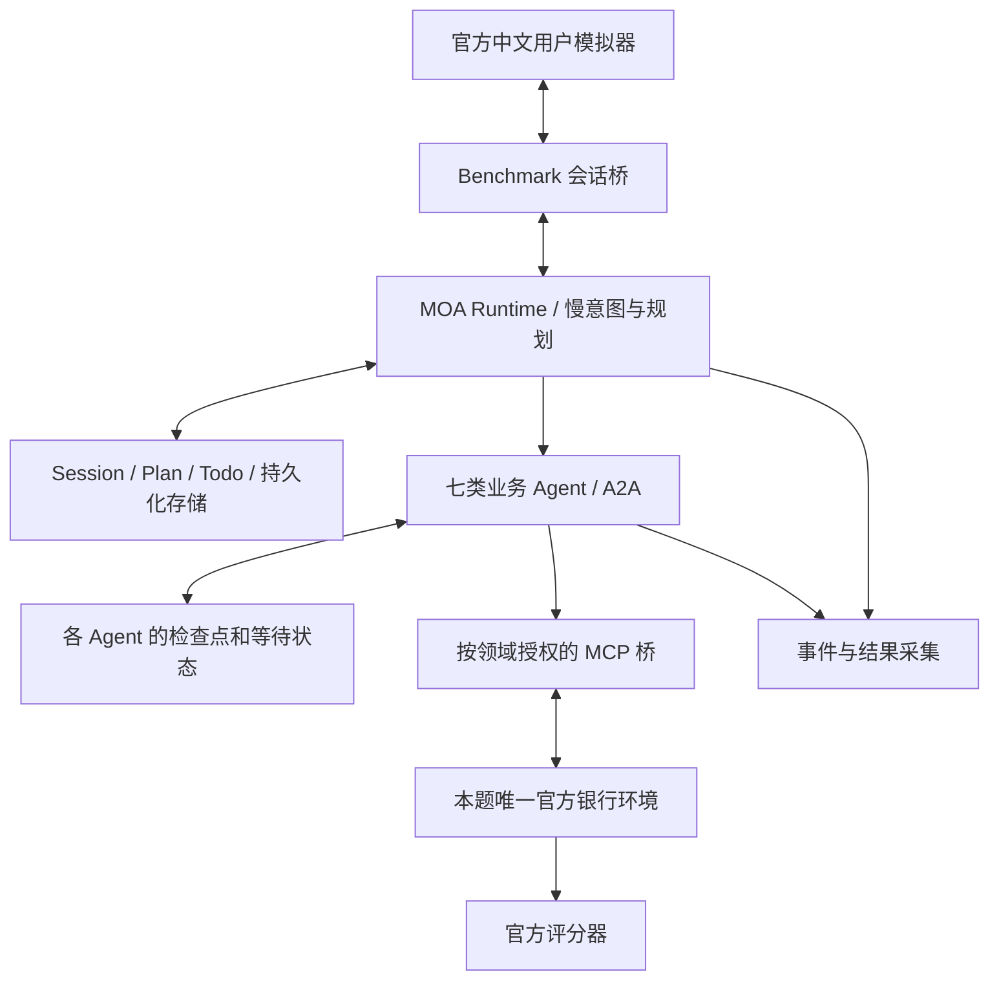

# MOA 银行业务编排架构与实施方案

## 结论与范围

可以基于 agent-solution 的完整 MOA 实现，但当前代码只直接覆盖部分要求。主方案使用真实 MOA 规划器和 Runtime，七个有独立工具权限、会话和生命周期的业务 Agent 通过 A2A 接收委派。Python 仅做官方 benchmark 适配和计量，不在 Python 中另写一个规划器冒充 MOA。

评审基于本机 agent-solution `common` 分支提交 `0298dcd28a1f3613b47f2af9def52512bab7dbd6`，目录 `common/agents/moa-agent`。以下行号对应这一提交；源码主目录为 `/home/vincent/openjiuwen/agent-solution`。未执行 MOA 构建、服务启动或真实模型联调。

## 五项要求与当前证据

| 要求 | 已有证据 | 本实验需要的工作 |
|---|---|---|
| 仅慢意图 | IntentRouter 的 SLOW 决策和慢路径 stage 工具已实现 | 增加 slow-only 部署策略，覆盖显式 intent、TARGET handoff 等策略前直达分支 |
| 分类独立 Agent | ExecutionEngine 支持 AGENT/WORKFLOW 的 A2A 委派 | 部署七个银行 Agent，绑定 Agent Card、身份、权限及独立会话 |
| 生成 Todo | StagePlan 保存 todo、depends_on、when、receipts；StagePlanningRail 分阶段绑定、确认、执行 | 将真实规划事件接入工作台；总 Todo 由 MOA 唯一管理 |
| 未完成 A 先做 B | 意图切换会归档挂起计划；可选入口支持本地恢复 | 远端挂起与检查点必须由 L2 实现；MOA 要从整计划挂起扩展为逐任务等待和可执行任务选择 |
| B 完成后接续 A | 本地恢复支持原 Plan/Todo 身份，远端 RUNNING 恢复明确拒绝 | 补远端 checkpoint 契约、依赖完成后的定向恢复、业务前置条件重查和去重 |

关键源码：
- `agent/routing/IntentRouter.java:181`：唯一显式 intent 在 RequestRoutingPolicy 之前返回 FAST；`:228` 的 TARGET 也直接返回 FAST。因此仅自定义 policy 返回 SLOW 不足以保证全链路禁用快路径。
- `agent/routing/policy/RequestRoutingPolicy.java`：分析 SPI；恢复及显式目标等路径不调用它。
- `agent/planning/StagePlanningRail.java:911`：存在 RUNNING 时先恢复它，否则选第一个 PENDING；`:932` 条件失败会将计划 BLOCKED。现有逻辑不等于动态跳过等待 A 执行 B。
- `agent/routing/IntentRoutingRail.java:688`：requestResume 检查归档的 RUNNING 远端任务，明确返回不支持恢复远端现场。
- `agent/continuation/SuspendedTasks.java:121`：本地恢复状态和归档消费；只读挂起清单不代表远端工作流仍可恢复。
- `agent/execution/ExecutionEngine.java:133`：按绑定候选委派；本地 SKILL 与远端执行为不同路径。
- `docs/operation-completion.md`：操作完成事件不等于业务完成；业务事实校验需接入方提供。

## 组件与交互图

MOA → 业务 Agent 属于 Delegation：目标、任务身份、工具范围、交互与结果验收均有边界。业务 Agent → MCP 是 Calling。七个 Agent 不直接互相写状态；跨域依赖由 MOA 调度，不应仅因有多个 Agent 就称为对等 Coordination。

## 业务 Agent 划分

| Agent ID | 职责 | 独占写入范围 |
|---|---|---|
| card-application-agent | 产品建议、信用卡申请及客户侧能力交付 | 本域申请操作；客户专属动作仍由模拟用户执行 |
| credit-limit-agent | 提额资格、申请、批准或拒绝 | 信用额度申请和决定 |
| payments-agent | 还款、转账及到账核验 | 银行转账、信用卡还款 |
| account-opening-agent | 开户资格、产品选择及开户 | 存款/支票开户 |
| account-closure-agent | 销户资格和销户 | 账户关闭 |
| transaction-dispute-agent | 交易调查、争议、退款请求 | 争议提交和相关决定 |
| card-lifecycle-agent | 冻结、销卡、补卡、激活 | 卡片生命周期操作 |

每个 Agent 必须有独立 A2A card、模型上下文、允许工具集合、task/checkpoint 命名空间；只更换提示词或名字不算完成分类。可共用模型和 MCP 服务，但桥必须按 Agent 身份执行 allowlist。共享身份事实带验证时间和证据，不能绕过官方身份政策。工具表由官方当前目录生成，写入权限在启动时校验唯一归属；查账和 KB 可共享，目录发现不能提升权限。

英文 `banking-evidence-guides` 为初始业务内容来源，按职责提取为独立包；提取与内容改动需分别记录哈希。MOA 不持有银行写工具。所有 Agent 操作同一个 episode 环境，不能每个 Agent 各复制一份银行数据库。

## 慢意图实现

新增实验部署的 `slow-only` 策略（建议名，不是现有配置键）：使用真实 IntentRecognition/CapabilityDiscovery 返回候选及理由，再交 MOA LLM 生成 stage_plan。无需快意图仲裁或单任务直达，不以伪造 MULTIPLE 绕过路由。

在 IntentRouter 的新请求决策出口统一约束 FAST/SELECT 转入 SLOW，并保留候选、授权范围与原文。显式 intent、TARGET/SELECT handoff 同样验证；非法 handoff 继续 BLOCKED。已存在的中断恢复直接续接，不重新做意图判断。规划后仍经过候选绑定、风险确认和 stage_execute_next。候选检索必须用业务描述，禁止用 task ID 或参考动作选 Agent。

## 挂起与接续：必须实现的扩展

当前只有安全的静态依赖可以直接表达为“先 B、后 A”。用户要求的 A 已执行一半再让 B 先走，需要以下扩展，不以重发 A 原始请求替代恢复。

1. L2 在安全边界返回结构化 WAITING_DEPENDENCY：taskId、checkpointRef、checkpointRevision、缺失事实、需要的业务能力、已提交操作回执及验收条件。它先持久化现场；不能把未知写入结果当作未执行。
2. MOA 持久化 A 的等待状态及依赖；保留原 planId/todoId/delegationId。把 B 加入新计划修订，检查循环及授权，选取已满足依赖的任务执行。原生整计划 SUSPENDED 不直接复用为逐项等待。
3. B 完成后先核验业务事实，不因 A2A COMPLETED 或 operation-completion 直接认定银行成功。MOA 记录依赖证据并调用 A 的定向恢复入口。
4. A 验证 checkpointRevision、授权、对象归属及回执，重新查询会受 B 改变的银行状态，从等待节点继续。恢复失败保留现场，不从头重复写入。
5. A 达成验收条件才变成 SUCCEEDED。重复回调/恢复命令去重，旧 revision 拒绝；所有目标成功或明确解释未完成后才能收尾。

MOA 保存计划、依赖、调度状态和回执索引；L2 保存执行上下文、原问题、检查点与工具操作账本；官方环境唯一拥有业务状态。恢复 handle 必须校验 tenant/episode/session/agent 归属。不要假设关闭的 A2A Task 可复活：采用稳定 businessTaskId/delegationId，记录每段 transportTaskId；新传输任务继续同一业务现场。

`contracts/task-continuation.schema.json` 是待实现的业务扩展，不能原样发送给当前 MOA 当作已支持 API。用 A2A DataPart 承载并在部署适配器中显式解码。普通问答等待与依赖等待区分处理；恢复携带的是 B 的证据，不伪装成客户授权或用户回答。

状态建议：PENDING → RUNNING → WAITING_INPUT / WAITING_DEPENDENCY → RESUMING → RUNNING → SUCCEEDED；另有 FAILED/CANCELLED。全局 PAUSED 是独立控制，不自动释放依赖。按 Session 串行写计划，checkpoint 使用 CAS revision，事件去重键独立于业务写入键。

## 示例：先还款再完成提额

模拟流程，不是预期评分答案：客户请求提额；credit-limit-agent 查询后发现利用率条件未满足，保存 A 的现场及资格证据。客户明确授权还款后，MOA 交给 payments-agent 执行 B；B 返回权威还款回执。MOA 定向恢复 A，A 重查余额、资格与现有申请，再按政策决定继续审批或拒绝。已提交申请遇到重复记录时应查询处理，不能把幂等冲突当成自动批准依据。MOA 不能读取 benchmark 隐藏参考动作来判断该不该批准。

## 实施任务与责任

| 优先级 | 交付 | 唯一责任角色 | 依赖/验收 |
|---|---|---|---|
| P0 | slow-only 路由出口与测试 | MOA SE | 所有新请求含显式意图均无 FAST/FAST_SELECT |
| P0 | 逐任务等待、可执行选择、恢复关联 | MOA SE | A→B→A 保持业务任务身份且不重做已完成步骤 |
| P0 | 七个 A2A Agent、持久化恢复契约 | 银行业务 Agent SE | 独立权限、checkpoint、问答/依赖等待可区分 |
| P0 | 官方环境桥、写入账本、结果事实校验 | Benchmark SE | 每题单一状态，所有工具写入经官方执行器 |
| P1 | 持久化及重启恢复 | Runtime SE | 明确选定 Session/checkpointer 后通过双端重启测试 |
| P1 | 轨迹与评分报告 | 测试 SE | 可关联每个 parent/child/checkpoint/tool/result |

角色为待认领责任位，不虚构个人负责人。第一阶段单会话串行，不引入业务 Agent 并发写入；多进程测试并发另做专项。MOA 进程入口可使用现有 18098 配置，七个 L2 端口在新实验配置中显式分配，不能复用仍挂起的旧测试进程。
