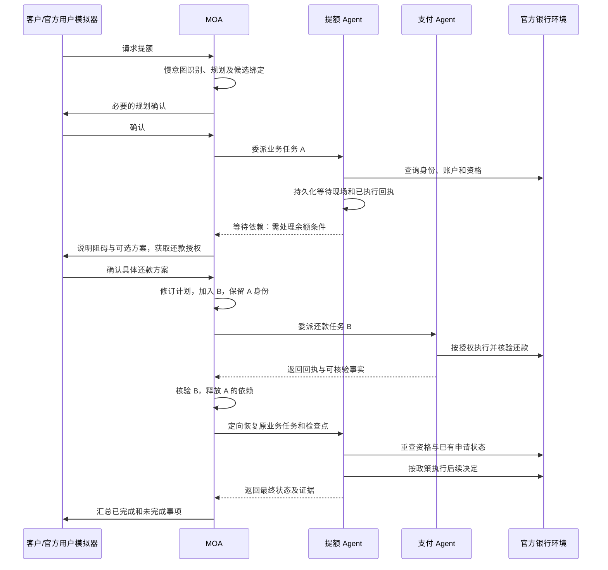

# 银行业务跨 Agent 挂起与接续场景设计

文档状态：设计稿，已完成静态评审修订；未实现、未部署、未完成真实业务验收。适用实验 `moa-banking-orchestration`。实现约束见 [技术详细设计](technical-design.md)，评审结论见 [设计评审](reports/design-review.md)。

## 1. 目标与验收口径

客户在一次会话内提出银行业务目标，MOA 识别意图并拆成 Todo，由独立领域 Agent 办理。业务 A 开始后发现必须先完成 B，应保存 A 的进度，取得 B 所需授权、完成 B，再从 A 的等待点接续。

| 需求 | 设计落点 | 验收证据 |
|---|---|---|
| R1 仅慢意图 | 新请求统一慢路径，保留候选约束和风险确认 | 普通、显式 intent、TARGET/SELECT 交接无 FAST 执行 |
| R2 分类独立 Agent | 七个领域 Agent，独立权限、会话、检查点 | A2A actor、权限拒绝记录、独立状态键 |
| R3 生成 Todo | MOA 管理总任务及依赖，领域 Agent 管内部步骤 | 可追踪的 plan/task/dependency/acceptance 记录 |
| R4 A 未完成先办 B | A 已保存的现场可等待，调度器执行就绪 B | 挂起前已完成步骤及回执仍在；B 在 A 等待后执行 |
| R5 完成 B 后接续 A | 验证 B 的事实、定向恢复 A、重查资格 | 同一业务任务身份、递增检查点、无重复写入 |

本实验区分官方 benchmark 评分、业务过程核验和 MOA 流程验收。三者分别记录，不能互相替代。一次通过不证明稳定性；人工转接不代表银行业务已完成。

## 2. 用户场景与业务边界

主要场景为“还款后继续提额”。客户提出提额目标，提额 Agent 查明当前利用率不满足政策；客户选择先还款。MOA 保存提额现场，委派支付 Agent 完成还款；提额 Agent 恢复后重新查询余额、资格和现有申请，再决定批准、拒绝或升级。

该示例仅用于流程设计，不给任何 benchmark 题硬编码处理答案。还款金额、提额金额、资格和是否允许继续处理已有申请，必须来自客户授权与实际银行政策。B 完成后 A 仍可能合法失败。

扩展场景包括开户前依赖资金安排、销户前依赖余额迁移、争议与补卡的相互影响。不能假设所有依赖都可通过另一个写入消除；涉及冻结、风控、冷却期或人工审批时，保留阻碍并明确说明。

## 3. 角色与责任

MOA 拥有总目标、计划、依赖关系和调度权，不直接进行银行写入。领域 Agent 拥有具体业务判断、参数收集、执行现场和本域工具权限；没有调度其他 Agent 的权限。客户保有业务选择及授权权，恢复任务不能替代客户授权。

七个领域分别是信用卡申请、信用额度、支付、开户、销户、交易争议、卡片生命周期。分工、英文 Agent ID 和写入边界沿用 [架构方案](architecture.md#业务-agent-划分)。共享模型不影响领域独立性，但只换提示词而共享所有工具与会话不算完成独立部署。

同题内所有 Agent 操作同一个官方银行环境，避免各 Agent 看见不同账户副本。跨题状态隔离，客户专属工具仍由官方用户模拟器执行。

## 4. 正常流程

“恢复”指同一 businessTaskId 和 todoId 的业务接续。底层旧 A2A Task 若已结束，可以启动新的传输任务，但必须关联原检查点；不能用相同的自然语言请求重建业务流程冒充恢复。

## 5. 动态依赖和客户确认

新业务 B 由 A 提出需求描述，由 MOA 在能力目录中选择 Agent。A 不能指定任意网络地址或自行扩大权限。MOA 对新目标、金额、对象和风险作差异说明，取得所需确认后才冻结新计划修订。

原计划确认只覆盖当时的业务范围。新增还款不自动继承提额授权；新增高风险任务仍需规划确认，具体支付授权仍由业务端校验。客户拒绝 B 时，A 保持未完成或按客户指示取消，不绕过依赖。

“ A→B→C→A ”表示执行时间顺序。依赖图实际是 A 等待 B、B 等待 C，不增加 C 等待 A 的边，否则形成环并被拒绝。没有依赖的新任务可单独执行；无须通过全部挂起计划来实现业务等待。

## 6. 暂停、取消与异常体验

| 情况 | 对客行为 | 状态要求 |
|---|---|---|
| A 缺少信息 | 展示当前业务问题 | WAITING_INPUT；只接收关联回答 |
| A 等待 B | 说明待办原因及已完成部分 | WAITING_DEPENDENCY；不会报告 A 完成 |
| 用户暂停全流程 | 先返回受理，再报告安全边界是否到达 | PAUSE_REQUESTED 与 PAUSED 分开；不启动新任务 |
| 写入正在执行 | 告知正在确认结果 | 不强杀后立刻重放；未知结果待核验 |
| 用户取消 | 取消尚未执行的工作，说明已提交影响 | 不自动撤销已完成支付或业务操作 |
| B 失败或结果不确定 | 说明阻碍和可选后续 | A 不自动恢复，保留现场 |
| A 恢复后资格仍不满足 | 按政策拒绝或升级 | B 成功不等于 A 必须成功 |
| 服务重启 | 恢复持久化现场并核查在途操作 | 不重复已完成步骤；无证据则标未知 |

暂停仅作用于明确的会话/计划，不影响其他实验。当前已有测试的 OS 进程挂起不属于本方案的 MOA 业务暂停验收。

## 7. 工作台和结果

工作台应看到：原始目标、慢意图候选、计划修订、每个 Todo 的所属 Agent、依赖与验收条件、挂起原因、最后检查点、已提交操作、恢复来源以及最终官方分数。恢复令牌不展示原文；身份与客户字段按最小必要范围呈现。

最终响应逐项区分已提交、已完成、被拒绝、待客户输入、待依赖、已转交。不得依据模型说“已完成”或 A2A COMPLETED 直接更新银行成功状态。

## 8. 范围、实施与验收

本期设计包含七个领域边界、单会话串行调度、逐任务依赖等待、持久化接续、官方桥和事件采集。多会话吞吐、分布式多主调度、自动补偿及跨组织授权不纳入第一期验收。

实施依次交付路由闸门、持久化接口与状态机、业务 Agent、官方桥、协议专项、真实模型冒烟、22题单轮。任何远端恢复链路门禁未通过，不能声称已完成 R4/R5，也不进入正式银行轮次。实现责任与源码改造点见详细设计；当前不申请运行真实测试。
