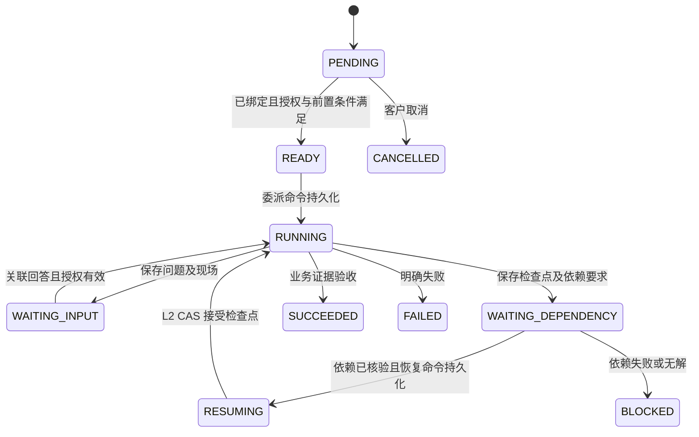

# MOA 银行业务编排技术详细设计

状态：待实现的技术契约，已静态评审修订。基线 agent-solution `0298dcd28a1f3613b47f2af9def52512bab7dbd6`。本文新类、表、消息和配置均为建议实现，不是当前 MOA 已有 API。

## 1. 现有能力与改造边界

| 源码位置（相对 moa-agent/src/main/java/com/moaagent） | 当前事实 | 计划改造 |
|---|---|---|
| agent/routing/IntentRouter.java:181、228 | 显式意图和 TARGET 在策略前返回 FAST | SlowOnlyRoutingGuard 统一约束新请求决策，保留 BLOCKED |
| agent/planning/StagePlanningRail.java:911 | 优先恢复 RUNNING，否则第一个 PENDING | ReadyTaskSelector 选择依赖已满足项；新增逐项等待 |
| agent/planning/StagePlanningRail.java:932 | 不可判定条件阻塞整计划 | 可修复业务依赖和不可安全执行的条件分开处理 |
| agent/routing/IntentRoutingRail.java:688 | 拒绝恢复未完成远端 Todo | RemoteContinuationCoordinator 定向恢复及结果关联 |
| agent/execution/ExecutionEngine.java:140 | 委派信封为 query/intent/idempotencyKey | 通过实验适配器显式承载新契约，不能假定任意 metadata 自动透传 |
| agent/continuation/SuspendedTasks.java | 归档与记录本地任务现场 | 保留兼容；远端恢复由新业务任务索引管理 |

MOA 负责总任务生命周期，L2 自主完成本域工作，交互属于 Delegation。L2 → MCP 为 Calling。全局调度是确定性代码，不另加“调度 Agent”；没有对等 Agent 协商循环。

## 2. 部署及模块接口

MOA 一个 Runtime 入口；七个 L2 Agent 各有 A2A endpoint、Agent Card、权限和持久化命名空间。设计端口见 `config/experiment.json`。银行桥是每题唯一业务状态入口，按 episode 分片；所有 L2 对同一题使用同一环境。

建议新增模块：
- `SlowOnlyRoutingGuard.normalize(decision, routeContext)`：只处理新请求，校验 scope，FAST/SELECT 转 SLOW；不把非法目标转为可执行候选。
- `DependencyPlanner.propose(waitEvent, catalog, plan)`：生成受限修订提案；不执行业务、不读取隐藏答案。
- `ReadyTaskSelector.next(plan, facts, now)`：确定性选择 READY / 可恢复任务。
- `RemoteContinuationCoordinator.accept(event)/resume(task)`：校验归属、版本、检查点及消息去重。
- `BusinessEvidenceVerifier.verify(claim, receipts, currentFacts)`：验证业务完成和依赖事实；不能访问官方参考动作。
- `BankingEpisodeBridge.invoke(actor, operation, arguments, operationId)`：鉴权、账本、调用原官方工具并记录官方消息。
- `MoaBenchmarkAgent`：适配官方 Agent 接口，只转发用户输入、工具调用及结果，不做规划或伪造授权。

独立检查点与工具权限必须在服务端实施。Agent Card 不构成授权；工具发现只能缩小到既有 allowlist。KB 内容、Agent 输出和回执文本不得改变调度权限。

## 3. 身份与契约

使用 [continuation schema](contracts/task-continuation.schema.json)。消息经 A2A DataPart 进入专用适配器，不新增与原 A2A 方法同名的伪 API。

| 标识 | 生命周期与约束 |
|---|---|
| tenant_id / episode_id / session_id | 所有查找、唯一键与权限检查包含这三个范围；tenant 从认证上下文核对，不信任载荷自报 |
| plan_id / plan_revision | 总计划及经确认的修订；修订后身份不变 |
| todo_id / business_task_id / delegation_id | A 等待和恢复前后稳定；不同任务不得复用 |
| transport_task_id | 每次 A2A 传输段可变化，映射回稳定业务任务 |
| checkpoint_ref / checkpoint_revision | L2 持久化的不可伪造引用及 CAS 版本；不当作纯内存对象引用 |
| message_id / causation_id | 消息去重与因果链；同一次重传保留 ID，不重新生成 |
| operation_id | 具体银行副作用的稳定键，不能用每次恢复的新 message_id 代替 |

消息区分命令 `resume` 和事件 `suspend/completed/failed`。事件包含 producer_sequence；恢复命令包含期望 checkpoint_revision。所有消息均关联业务任务及所属 Agent。`suspend` 带 dependency_requirements，L2 只声明能力和验收事实，MOA 分配 dependency_ids；避免要求 L2 预先知道未创建的 Todo ID。

plan_revision 校验不是简单“必须等于当前版本”：在途旧任务的回执按已登记 delegation_revision 验证；若计划修订未取消该任务，则仍可接收合法旧修订回执。未知/已取消委派的回执入审计，不推进新计划。resume 只能针对当前授权修订及最近未消费的检查点。

错误码建议：INVALID_CONTRACT、SCOPE_MISMATCH、STALE_CHECKPOINT、PLAN_CONFLICT、UNKNOWN_DELEGATION、UNSATISFIED_DEPENDENCY、AUTHORIZATION_REQUIRED、UNKNOWN_WRITE_OUTCOME、DEADLINE_EXCEEDED。可重试的传输错误与不可重试的业务错误分开，不从自由文本猜测。

## 4. 状态机及调度

计划控制状态 ACTIVE / PAUSE_REQUESTED / PAUSED / CANCEL_REQUESTED 与 Todo 状态正交。传输 Task 结束并不改变业务 WAITING_DEPENDENCY；未知写入记录为 operation UNKNOWN 并阻止相关业务继续，不把它伪装成可安全恢复的等待节点。

每个 Session 仅一个持租约的调度者，每题最多一个银行写入在途。选择顺序：先处理有效事件；再完成已授权可恢复任务；否则按计划顺序选择依赖全部成功的 READY 任务；没有就绪项时输出 WAITING/需澄清，不忙循环。已失败依赖阻断相关任务；独立任务是否继续以已确认计划为准。全局暂停时不派发 start/resume。

动态依赖修订在事务内检查：任务总数≤32、深度≤4、无环、目标仍在目录、写权限无冲突、授权范围覆盖。A 依赖 B 意味着图边 A→B；B 完成后执行 A 不是额外 B→A 依赖边。客户新增写入目标须获得差异确认，不能因为之前确认过计划就自动执行。

原 StagePlan 是展示/兼容投影；新增等待状态不得降格映射为原生 SUCCEEDED，也不能由新旧两个调度器同时驱动同一计划。实验部署启用一个受控扩展路径，历史模式继续走原流程。

## 5. 持久化与一致性

选定 openGauss 作为设计基线：MOA 已有 Core KV 和 Runtime A2A TaskStore Provider，见仓库 `docs/opengauss-storage.md`。这只证明 Provider 存在，不证明新业务表与原 Session 更新可原子提交。新表和迁移需单独实现并在真实数据库验证。

| 拟建表 | 主键/唯一约束 | 关键内容 |
|---|---|---|
| orchestration_plan | scope + plan_id；revision CAS | 目标、授权修订、控制状态、lease_epoch |
| orchestration_task | scope + business_task_id；todo 唯一 | Agent、状态、依赖、delegation_revision、验收条件 |
| task_checkpoint | scope + agent_id + task_id + revision | 不可变内容摘要、引用、等待原因、已执行步骤；L2 为唯一写者 |
| delegation_attempt | scope + delegation_id + segment | transport_task_id、起止时间、恢复命令关联 |
| message_inbox | scope + producer_id + message_id | payload_hash、producer_sequence、处理结果 |
| message_outbox | scope + message_id | payload、投递状态、lease_epoch、过期时间 |
| bank_operation | scope + operation_id | 工具、参数摘要、INTENT/SENT/CONFIRMED/UNKNOWN、官方回执 |
| business_evidence | scope + evidence_id | 来源操作、对象、观察时间、有效范围、状态版本 |

MOA 任务账本与 outbox 是同一事务的权威源；Session 的 StagePlan 是带 applied_revision 的可重建投影。投影失败时不得回退到另一调度器继续执行。L2 同样先提交 checkpoint 与事件 outbox，再投递事件。跨进程不宣称分布式事务或 exactly-once。

恢复流程：MOA 验证依赖并在同事务写 RESUMING/outbox；L2 inbox 去重并 CAS checkpoint_revision，写入恢复段；重复相同消息返回已保存回执，相同 message_id 不同 payload_hash 拒绝。L2 生成下一检查点后旧版本不能再次消费。

崩溃窗口必须逐项测试：保存前崩溃不发命令；保存后投递前由 outbox 重发同 ID；业务已执行但回执丢失由操作账本核验。官方工具若不支持幂等键，桥的去重不能跨越“已执行但未记录”窗口提供恰好一次保证；必须只读查询确认，不能确认时保持 UNKNOWN 并停止依赖写入。

多节点锁不是第一期吞吐功能，但 lease_epoch/fencing 必须保证重启后旧调度者的迟到写入被拒绝。L2 服务和银行桥都核验执行 epoch，不仅在 MOA 进程内加锁。

## 6. A2A 等待与恢复的映射

普通缺参沿用 A2A INPUT_REQUIRED 和关联问题。依赖等待由显式 `suspend` 事件表示，业务状态为 WAITING_DEPENDENCY；允许旧传输段完成并释放 Runtime 等待占用，事件适配器必须在 MOA 原生“远端最终应答即 Todo 完成”逻辑之前消费，禁止标为业务成功。

B 结束后，MOA 发 `resume` DataPart，在新传输段恢复同一 business_task_id。恢复内容只含引用、证据及受控参数，不能把证据拼接成伪造的客户确认。远端服务不支持该契约时，启动检查失败，而不是退化为重发原 query。

暂停命令先写 PAUSE_REQUESTED，停止派发新命令；已发送但未接受命令由 epoch/control 状态拒绝，在途不可逆写入允许回收明确结果。所有参与者报告安全边界并保存 checkpoint 后才写 PAUSED。若远端失联或写入 UNKNOWN，报告暂停未完全确认，不能提前称已停稳。取消不自动补偿已完成业务。

## 7. 官方环境与业务证据

MOA/L2 不读取 task.evaluation_criteria 或 gold actions；Bridge 与官方 scorer 的权限分离。用户消息仍由官方模拟器产生，内部调度消息进入独立事件轨迹。银行调用在统一串行队列中执行并写入官方 assistant/tool 消息，保留调用次序和 ID，避免“子 Agent 做了业务但评分器看不到”。

验证 B 完成使用实际回执和状态，不用模型总结替代。例如还款后检查金额、目标账户和余额；恢复提额时重查受影响资格。没有读回工具时保留权威提交回执及核验限制。参考 DB 中的文字差异可在离线报告解释，不能在运行中用隐藏参考值纠正输入。

现有失败经验：重复提额申请不等于新的业务拒绝，需结合现有申请状态和政策处理；可选销户 reason 无业务理由时保持工具默认值。以上是通用契约规则，不硬编码题号或目标分数。

## 8. 超时、边界与观测

远端单次调用120秒、单题40分钟、整轮16小时，最多200业务步骤、32任务、每任务8次恢复、依赖深度4，来自实验设计配置。超时包含排队；总 deadline 不因重试/重启重置。传输失败只允许重投已有幂等消息；不自动重新运行 episode 或未知结果写入。Token 只计量，无用户未指定的累计 Token 截断。

事件至少包含 trace/episode/session/plan_revision/todo/agent/business_task/delegation/transport_task/checkpoint_revision/message/operation 标识、时间、结果和原因码。checkpoint_ref 日志中仅存摘要；完整引用只在授权链路可用。Token 按意图、规划、各 L2、用户模拟器和裁判分层统计，不能只报 L2 消耗。

工作台应显示同一任务跨传输段的接续关系。官方结果与框架验收两张独立视图；协议成功、业务成功、评分通过各有来源。

## 9. 实施分解与门禁

| 工作包 | 唯一责任角色 | 依赖 | 完成证据 |
|---|---|---|---|
| slow-path-routing | MOA SE | 候选目录 | 普通、显式、handoff 三类无快路径 |
| durable-task-scheduler | MOA SE | 表与事务适配 | 动态依赖、CAS、去重、暂停专项 |
| remote-continuation | Runtime SE | 契约和账本 | A2A 终态映射、重启、旧回调拒绝 |
| banking-domain-agents | 业务 Agent SE | 权限表、恢复 SDK | 七个 Agent 独立状态和受限工具 |
| official-bank-bridge | Benchmark SE | 统一环境、业务账本 | 写入一次、未知不重试、官方回放一致 |
| acceptance-and-viewer | 测试 SE | 以上全部 | 12类协议专项、真实流程冒烟及22题报告 |

责任角色需项目安排具体人员。暂不估算人日：远端恢复 SDK 与事务接入尚无实现验证，避免把源码存在当作交付成本已知。

放行顺序沿用 test-plan。每项 R1—R5 均需真实 MOA 运行证据；脚本模型只验契约。源码/文件/schema 检查不等于 Java 编译通过，更不等于银行 E2E 通过。

## 10. Runtime 部署与启动详细说明

完整 A2A 测试需要实际服务端。当前 MOA 由 agent-runtime-java 的 JiuwenCoreAgentExtHandler 托管；仅在 Python 中调用模型或启动 MCP 不能验证这条链路。每个 L2 可用 Runtime 提供 A2A 服务，或另行实现兼容 A2A 的服务端；本方案统一选择 Runtime 以减少协议差异。

第一阶段进程清单：MOA + Runtime 一进程（18098）；七个 L2 Agent + Runtime 各一进程（18101—18107）；Benchmark/银行桥一进程（监听地址由运行清单分配）；openGauss 持久化服务。共享模型网关和持久化实例，数据库访问身份及命名空间按职责隔离。七个 L2 是否能合并到一个 Runtime 宿主须另验多 Agent 注册、路由与权限隔离，不将其作为初始假设。

启动顺序：
1. 检查源码和依赖制品 hash，校验数据库驱动、DDL、账号权限及配置；迁移不得由业务请求隐式触发。
2. 启动持久化服务及银行桥，创建 episode 独占环境和安全访问上下文。
3. 启动七个 L2 Runtime，逐个检查实际 Agent Card endpoint、skills、A2A URL 与模型/工具访问能力。端点取自部署配置，不能只检查端口已监听。
4. 启动 MOA Runtime，加载目录和 slow-only 部署策略，检查候选 id→adapter→resource→endpoint 绑定。
5. 用脚本请求验证 SendMessage/SendStreamingMessage、INPUT_REQUIRED、关联回答、结果回调，再执行新增 suspend/resume 业务契约。
6. 完成重复回调、断连、重启和错误权限测试后，才启动真实模型冒烟。

MOA 不负责自动启动所有 L2、模型网关或数据库。运行监督器需管理 PID/进程启动时间、就绪、退出、日志及端口归属；不能把旧测试端口存活当作本批次服务就绪。退出时先停止新调度，确认在途写入和检查点，再停 MOA/L2/桥，避免数据丢失。

A2A 负责通信与传输任务生命周期；跨 Agent 业务恢复仍由本设计的 MOA 调度账本和 L2 检查点契约完成。Runtime A2A TaskStore 与 MOA Plan/Todo 是不同层的状态，不得用一个 Task 的 COMPLETED 覆盖未完成的银行业务。

## 11. 慢意图的模型输入输出

本实验的慢意图是模型参与的语义识别与 MOA 规划。新增 `BankingSlowIntentRecognition`（待实现）输入仅包括当前用户请求、必要的已授权会话事实和七类能力目录；输出为候选 id 数组、简短依据及需要澄清的事项。候选必须来自当前目录，空候选进入无法匹配/澄清路径，越界或格式错误不默认取第一项。该模型请求禁止工具调用，设置显式超时和输出上限。

识别候选后继续进入真实 MOA stage_plan / binding / finalize 流程，不用单候选直接调用业务。多候选可以保留，但不能将同一目标的多个备选全部变成必执行任务。恢复既有任务不重新识别意图；客户明确修改业务目标时才新建受控修订并重新识别。

慢意图和规划 Token 分别计量，模型名称及温度进入 manifest。候选排名和解释不直接构成授权，业务检查仍由领域 Agent 和工具桥完成。当前默认目录匹配不能被宣称为上述模型识别已实现。
