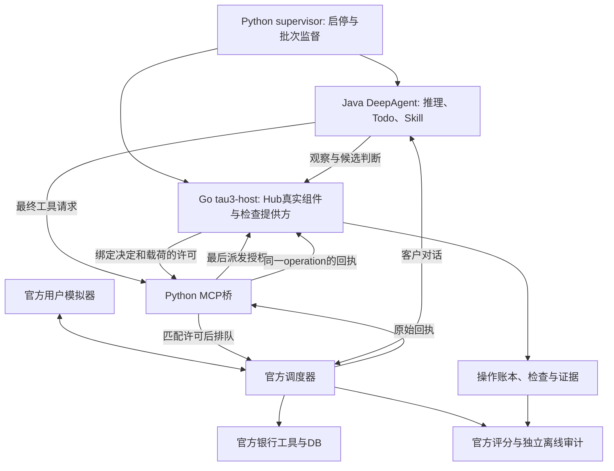

# Agent Hub Alpha × openJiuwen Java：英文 Banking 整合测试方案 V1.1

日期：2026-11-16。状态：**最新修订设计；整合实现和成绩提升尚未验证。** 本文件替代[V1.0方案](../v1.0/测试方案与架构评审.md)的实施与验收安排，落实[审查的F01–F08](../v1.0/reports/design-audit-20261116/测试方案审查与修订要求.md)。旧方案、基线运行及分数保持原样。

**结论：实际复用agent-hub-alpha的Go组件，在openJiuwen Java规划与官方银行工具之间建立可验证的控制链。它有望减少缺证据、错误金额、跨目标顺序和遗漏，但启动Go或增加账本本身不会提高模型的业务判断能力。是否提升官方成绩必须用同版本配对实测确认，当前不承诺提升幅度。**

## 1. 目标与不可变要求

1. 真正调用agent-hub-alpha代码：构建、启动、请求、库函数控制事件、官方效果、回执必须能连成证据链。只引用架构、复制接口名、运行schema夹具或启动空进程均不通过。
2. 保留openJiuwen Java为Agent执行基座；不增加第二个自主Agent或工作流调度器。Go为有界控制组件宿主，Python官方环境拥有银行效果。
3. 使用原始英文τ³ banking v1.0.1，commit=`fc0055dc4e0a316c3f83133267fbd6faaa770992`；`.deps/tau2-bench`、`.venv312`、`banking_knowledge`、英文Skill **3.2.0**、英文`evidence-todo-v1`。新增运行提示、协议错误、测试夹具均用英文；方案说明可用中文。
4. 不改变官方任务、DB、KB、用户模拟器或评分语义；不把隐藏task说明、reference actions、required_documents或判分读取清单输入Agent/Go检查器。不为已暴露题号、商家、账号、金额写策略分支。
5. 保留失败、未评分和未启动；不重跑到通过、不回填官方分数。官方得分、控制正确性、集成状态分别报告。

本次交付范围是研究demo与测试接线，不等于[07主架构](../../../../agent-hub-alpha/achitecture%20design/07-nga-architecture-proposal.md)完整Java SDK/Boot Starter或生产银行认证。Go组件的实际保证和开放项继续服从[08接收范围](../../../../agent-hub-alpha/achitecture%20design/08-r1-r6-acceptance-and-open-items.md)。研究性质限制可宣称范围，不取消实际代码复用要求。

## 2. 当前证据与待实施边界

| 对象 | 已核实状态 | 本方案处理 |
|---|---|---|
| V1.0英文task_054 | 原基线reward=0；369.63秒；未调用Go | 保留为B-pre诊断，不能改称B0/B1 |
| 历史22题 | 21已评分、12通过、9失败；062未评分 | 用于提出机制假设，不作为新实验的同版本对照 |
| 历史与新054 | 历史054=1、新054=0；4个适配器文件hash和1个Java源文件hash不同 | 不能推断纯随机波动、Skill因果或增强收益；必须重新冻结并配对 |
| Go原组件 | adopt/ledger/evidlog/replay等真实代码存在 | 直接导入使用，保留原套件与独立系统反例 |
| Go运行宿主、Java控制客户端、MCP末端授权 | 尚未实现 | 本次整合必须交付；缺任何一项不得运行增强测试 |
| 语义检查、有效修订、拒绝审计与恢复 | 存在尚未闭合的系统契约 | 指定补齐责任，不能认为原库自动具备全部能力 |

证据：[历史逐题报告](../../deepagent-todo-skill-mcp/reports/round-01-20261115-a00/本轮执行报告.md)、[逐案核查](../../deepagent-todo-skill-mcp/reports/round-01-20261115-a00/人工核查与建议.md)、[新054实测](../v1.0/reports/english-e2e-20261116-task054-a00/端到端验证报告.md)、[本次来源快照](reports/design-revision-20261116/source-snapshot.json)。

## 3. 真实整合拓扑与所有权

Java拥有Agent调度；Go拥有有效决定、授权和操作生命周期；Python官方scheduler拥有银行状态。MCP是传输和最后出口，不拥有另一套决定状态。模拟客户不是Java委派的Agent，其工具仍由官方调度独立执行，不强行经过Go来改变原基准。

最小部署为单episode、单Go宿主、单账本写者。宿主使用loopback临时端口和进程级认证，凭据不进入模型上下文。supervisor是唯一生命周期所有者，记录PID、启动/退出时间和实际二进制hash；异常退出后停止新业务派发，不降级为原runner。

### 3.1 逐组件代码复用

| 代码位置 | 必须实际复用 | 仍需补齐 |
|---|---|---|
| [adopt.go](../../../../agent-hub-alpha/agent-festival/go/internal/adopt/adopt.go) | `Open/Adopt/Dispatch/MarkUnresolved/MarkCompleted/MarkFailed` | 宿主提供受信当前权限和有效修订；Adopt不证明银行语义正确；DispatchIfCurrent不等于跨操作的当前决定检查 |
| [ledger](../../../../agent-hub-alpha/agent-festival/go/internal/ledger/ledger.go) | 原身份、版本、操作事件及校验 | 将decision/request/official_call关联；不同业务意图不能只靠相同参数合并 |
| [evidlog](../../../../agent-hub-alpha/agent-festival/go/internal/evidlog/evidlog.go) | 原证据追加、读取及覆盖校验 | 合法原始证据和真实拒绝持久化；多存储写入的恢复协议 |
| [judgment.CheckSpec](../../../../agent-hub-alpha/agent-festival/go/internal/judgment/check.go) | 原判断规格schema校验 | 银行语义检查器：规则覆盖、单位、范围、计数与时序；schema合格不是判断正确 |
| [replay](../../../../agent-hub-alpha/agent-festival/go/internal/replay/replay.go) | `Replay/Inspect/Recover`与真实宿主记录适配 | 控制回放、官方DB回放和Java响应回放分开；禁止活模型/银行出口 |
| [validate](../../../../agent-hub-alpha/agent-festival/go/internal/validate/validate.go)、[compose](../../../../agent-hub-alpha/agent-festival/go/internal/compose/compose.go)、[release](../../../../agent-hub-alpha/agent-festival/go/internal/release/check.go) | 在契约、组合及发布用例中调用原实现 | 明确结构检查与当前授权/激活的区别；不为凑覆盖制造无意义图 |
| [t2Host](../../../../agent-hub-alpha/agent-festival/go/internal/e2e/t2host_test.go)、[verify](../../../../agent-hub-alpha/agent-festival/go/internal/e2e/verifier_test.go) | 抽取已有宿主/端口与R/K入口逻辑，保留原测试 | 目前位于_test.go；不能从main直接调用。银行规则不能照搬原信用贷夹具 |

拟新增入口为Go模块内的`cmd/tau3-host`及必要宿主包，以合法导入现有internal包；这些路径是实施目标，当前不存在可执行整合命令。Java模块只做openJiuwen绑定与协议客户端，不重新写一份Go状态机冒充代码复用。

## 4. 让控制结果真正影响业务

所有接口均为拟建适配契约，不冒充现有API。协议需携带schema_version、request_id、scope、release_id和typed outcome。

| 接口 | 关键输入/输出 | 约束 |
|---|---|---|
| `recordObservation` | 实际可见工具/对话、原文hash、对象与模拟时间→evidence_id | 无数据、查询失败、未查询分开；来源绑定本episode |
| `proposeDecision` | 本次目标、候选规则、证据、计算与操作依赖→candidate_revision | 模型只有提议权；不得自行采纳或发布规则 |
| `checkAndAdopt` | 独立检查结果及expected_generation→adopted/needs_evidence/rejected/conflict | 缺检查配置不能当通过；持久保存拒绝；使用原Go组件并补其语义缺口 |
| `authorizeDispatch` | 最终内层工具及载荷、意图、operation_id、有效decision_revision→一次性许可 | 位于MCP排入官方队列之前；权限来自受信配置，不信模型自报 |
| `recordReceipt` | operation/attempt/official_call_id、原始回执→completed/failed/unresolved | 传输success不等于业务成功；未知不能改成失败后新号重发 |
| `reconcileCompletion` | 客户确认的目标集、操作和回执→完成/部分/等待/未知 | Todo不能授权写入；ORDERED不能宣称SHIPPED；转人工不能代替未完成业务 |

操作身份独立于Todo ID、模型调用号和对话ID。同一请求同载荷可查询原状态/回执，同键改载荷冲突；客户合法新意图另立身份。R只复用同一实例已确认结果，K只复用已批准方法，新任务必须重新取证。

**最后出口必须检查实际派发载荷。** `call_discoverable_agent_tool`的内层JSON需要解析、规范化并绑定工具名、对象、金额和载荷hash。直接向MCP请求、Rail改金额、旧许可或跨episode回执均不能绕过检查。阻断后必须给Agent可执行的英文原因，例如缺少哪类证据、哪项前提已变化，允许重新查询/澄清/提出新候选；不能只返回“拒绝”而让任务停滞。

**提交与恢复边界。** 单宿主串行化有效修订、操作预留及许可消费；Python在官方队列出口执行许可关联。检查到真正调用之间不是天然事务：派发意图和必要证据先持久化，跨文件中断按日志恢复；已消费许可无回执保持unresolved。Go原文件替换只按进程崩溃保证评估，不宣称断电fsync或外部银行exactly-once。无幂等/查询能力的provider，不盲重发。

**可见性边界。** 客户新消息、实际返回的工具状态可触发相关证据失效和重查；不能从用户侧隐藏状态、评测DB或参考动作提取事实喂给Go。对不可见用户写入只能在评测侧审计，运行侧依正式可查询结果决策。

## 5. 业务检查如何避免“有门禁但不提分”

首版重点实现四类通用检查，不能按题号选择规则：

| 检查 | 输入来源 | 需要的纠正反馈与正例 |
|---|---|---|
| 必需事实与证据覆盖 | 实际检索到的适用政策、账号/交易回包 | 缺争议历史不能声称无争议；补查后合法提额可继续 |
| 跨目标前置关系 | 客户明确目标、可见政策和当前状态 | 写入前解释销户/补卡/争议对其他目标的影响，取得合法改序确认；紧急保护规则优先，不为分数延误保护 |
| 规则适用范围与确定性计算 | 产品、时间、计数范围、单位、正负差额和原始事实 | 先核对“规则适用谁、何时、哪些项目”，再算净额；不能只验证错误前提下的算术 |
| 交付集合与结果对账 | 客户目标、完整可见对象集、实际回执 | 对每个子目标登记完成/未完成原因；缺产品/例外覆盖时继续取证，不虚报全量或最优 |

规则模板可预先批准，但任务中的具体依据必须绑定官方可见来源。完整性检查不能只检查同一个模型自己列出的条件；需有独立的规则审查和变异夹具。若提供方使用额外模型判断，两组使用相同模型/输入/次数策略，并单独计量；不把普通LLM或确定性规则称为已验证Jev能力。

Todo修复作为公共工程修复同时进入B0/B1：合法状态转换、失败不污染状态、嵌套`result_type=error`不包装成客户answer、同轮工具异常不导致未授权后续效果。已完成银行操作不因Todo重试再次执行。修复Todo可能改善连续性，但没有证据支持“单修Todo即可修复全部业务失败”。

## 6. 强制契约与故障测试

每项含独立正例和反例；不得用被测gate输出当oracle。以公开政策/契约和原始效果记录判定，关键负例配删除检查、篡改字段等变异。

| ID | 场景及必须观察的结果 |
|---|---|
| CT01 | 缺政策/查询失败/仅Todo完成：needs_evidence，写入0；补足后能完成 |
| CT02 | 跨账户、跨episode或伪造证据：拒绝，原文hash和范围可核查 |
| CT03 | 单位、净额方向、时间窗和计数边界：正确区分；缺必需配置拒绝 |
| CT04 | D2取代D1、未采纳高版本、撤权：旧决定不可派发；不能仅依赖DispatchIfCurrent |
| CT05 | Rail改最终金额、隐藏内层参数、直接MCP绕过：实际效果0 |
| CT06 | 同意图同载荷重复、同键异载荷、新意图同参数：复用/冲突/独立分别成立 |
| CT07 | 并发请求及第二账本写者：单一执行所有者，不产生重复效果 |
| CT08 | 必需审计/意图持久化失败：不派发；拒绝路径本身可恢复 |
| CT09 | provider已接受但响应丢失，随后迟到/重复回执：保持原身份和unresolved，不盲重发 |
| CT10 | Java在AskUser、派发前、回执后崩溃：Python/Go存活，恢复等待、身份和结果；不重复银行效果 |
| CT11 | 会话交换、篡改结果文件：隔离拒绝；损坏不当作新任务 |
| CT12 | 控制重放与原DB重放分别执行；错误历史可fidelity通过而conformance失败；活模型/银行出口0 |
| CT13 | 发布/撤销及冻结文件变化：不静默迁移活动任务；当前撤权仍有效 |
| CT14 | 抽取后的R/K/首次执行统一入口：R不重做效果；K有新身份、新取证和新结果，方法撤销有效 |
| CT15 | 完成声明与回执对账、目标遗漏、人工接管未确认：不虚报完成；不再声称覆盖M15 |
| CT16 | 模拟器空消息、模型/裁判失败、桥断开：分层未评分，不造客户消息或官方0分 |
| CT17 | 隐藏答案探针、evidence_read越界/不可达：无答案泄漏；合法HTTP重读真实可用 |
| CT18 | 多in_progress、嵌套错误及同轮后续工具：错误不变客户正文，局部失败不绕过业务授权 |
| CT19 | 政策和查询齐全但多个目标顺序冲突：写入前合法澄清和重规划，正常无冲突动作不误拦截 |
| CT20 | Go未启动/中途退出、协议或binary hash不符：整合入口失败，新银行写入0；不回退旧runner |
| CT21 | 省略实际Go检查调用或改成固定allow：接线/变异检测失败，不能靠used_hub=true或伪造日志通过 |
| CT22 | Go进程单独重启：从原账本恢复；Java/官方环境保留；未确认派发不重发，与CT10分开统计 |
| CT23 | CASE1→候选修正→离线评估→显式批准激活→旧版本回放：候选不能自授权发布；此项对应M15 |

CT09幂等/查询与故障provider属于独立合成夹具，不能给官方工具暗加幂等参数。CT14/23可用独立英文合成业务完成机制验证，银行正式回归关闭跨题K学习与在线规则修改。全栈崩溃恢复另设范围；仅Java或Go重启不证明Python环境可恢复。

## 7. 执行阶段与Go存在性门槛

| 阶段 | 规模与对象 | 放行条件 |
|---|---|---|
| P0 组件和接线 | 无外部模型：原Go套件、独立系统反例、CT01–23、第11节补充夹具、真实Java/Go/Python本机夹具 | 运行环境/构建来源/协议冻结；适用范围内控制硬门槛全部通过；未通过的系统项不得靠说明文字放行 |
| P1 最小真实链 | 英文054和003，各B0/B1一次，共4 episodes | 054覆盖目标冲突；003原始user_tools含apply_for_credit_card，验证客户侧工具仍由官方主体执行；保存真实Go事件 |
| P2 诊断余项 | 英文022、041、051、060、072、077，各B0/B1一次，共12 episodes | 与P1同一冻结版本才合计8题16次；若改代码/规则，P1保留开发批次，不能混成完整同版诊断 |
| P3 冻结配对回归 | 22题×B0/B1×3 seeds，共132 episodes | 全部接线/控制门槛通过；8题诊断完整、退化定位；独立新manifest，正式批次不在线学习 |
| P4 可选总方案对照 | 如要量化相对旧架构的整体提升，新增同条件C0组，另行冻结规模 | 不能把历史57.14%或单次054当C0；不计入默认148次，也不自动启动 |

P1+P2+P3默认计划148次；P0不计入banking成绩，本次修订不启动任何新模型运行。P1/P2是开发诊断，不计入132次正式统计。若只做当前最小整合验证，只执行P0/P1，不以扩大题量替代修接线。

整合入口必须验证：Go实际可执行文件及`go version -m`、源码commit/dirty diff、库依赖、binary hash、schema/checker/release版本、宿主握手、单写者、健康状态及适用CT记录。还必须关联每次实际派发的Go请求/事件和官方call_id；杀死Go的反例证明该依赖不可省略。

已存在的[v1.0入口](../v1.0/tests/run_english_e2e.py)只运行旧基线，不得充当本方案入口。新入口完成前没有可执行增强命令；`plans/test-spec.json`是设计规格，不是runner manifest，不得被默认当作可执行任务。

## 8. 实验组与控制变量

| 组 | 定义 | 可支持的结论 |
|---|---|---|
| B-pre | 已有历史22题及新054旧基线，版本各自保留 | 失败机制与选题依据，不是同版本收益对照 |
| B0 | Java、Go、规则/检查器和接口均真实接线；业务语义检查为观察模式 | 对照组；记录would_allow/would_block及真实效果，不把shadow放行伪称检查通过 |
| B1 | 与B0同制品；检查结果反馈给Agent并控制最终派发 | B1−B0衡量检查反馈与强制执行这一组合的增量效果 |
| C0（可选） | 同期同模型/数据/公共修复的原架构，显式不启用Hub | B1−C0才用于总方案效果；C0须单列，不能代替任何增强运行 |

B0也保留身份、权限、隔离和不确定写入保护；只对本次待评估的银行语义约束采用shadow模式。Go服务失效时两组都停止新派发；不以“B0应不阻断”为理由忽略基础设施错误。所有额外规则知识、工具描述、候选接口、公共Todo修复与辅助判断策略在B0/B1保持一致。

固定模型请求名deepseek-v4-flash及仓库指定网关，temperature=0，BM25，max_steps=200，max_errors=10，并发1；Core1200秒、Java桥1500秒、episode2400秒，MCP120秒，Go控制RPC30秒。跨目标修正每个稳定目标/证据版本最多3轮；若无新证据/候选变化则提前停止循环并如实报告待处理；不得自动重试银行写入。无累计Token预算；超时与重试边界仍然生效。

正式seeds=300/301/302；以题目×seed为配对单位，组顺序按题目序号与重复号交替B0→B1、B1→B0。记录模型响应实际标识，不能用请求别名证明后端版本固定；两组返回型号不一致的配对保留在主结果并标注，另报同型号子集，不事后删去不利样本。

22题固定为：003、017、031、036、043、051、060、076、077、093、098、016、022、033、041、049、054、062、072、087、097、100。已暴露题只支持回归评估；不得宣称未见任务泛化。官方上游commit、tasks、DB/KB/政策/工具schema、实际Skill/提示、Java/Go制品与检查配置全部冻结。

## 9. 能否提升成绩：逐机制评估

以下“机会”是基于已核查错误与机制匹配程度的判断，不是成功概率或已实现收益。

| 场景 | 已有失败证据 | 新机制的作用 | 对官方分数的判断 |
|---|---|---|---|
| 051 | 业务额度/还款终态正确，但漏查询争议历史 | 事实必须绑定本次查询证据，状态变化后重查 | **优先验证，修复目标相对集中**；不能从参考动作偷取必查清单 |
| 072 | 费用只加多收，漏应补收抵扣，净额多退 | 双向逐项差额台账与确定性净额校验 | **优先验证，金额路径明确**；还需正确识别适用费率和对象范围 |
| 054 | 已取得政策仍先争议/补卡，未提额；另有配送偏好与参考冲突 | 跨目标影响检查，先解释/确认合法顺序，再派发 | **业务改善机会明确，官方转1不保证**；普通配送可能仍与参考加急不符 |
| 060 | 先销户破坏开户资历，另有closure_reason文本差异 | 变更前检查后续前提，取得改序同意；有公开规范时使用受控原因 | **业务改善机会明确，官方仍可能为0**；不能照抄隐藏参考文案 |
| 041、097 | 计数边界/产品奖励适用范围错误，按错误规则完成写入 | 独立语义核验+适用范围矩阵，再执行算术 | **条件性收益**；仅Adopt、schema校验、写后回查都不能修复 |
| 022、100 | 未取到商家例外或最优候选政策，过早宣称完整/最优 | 覆盖清单、允许的补充检索、对象集合对账 | **条件性收益**；需真正补齐知识覆盖，不能只增加拒绝次数 |
| 087 | 部分卡完成，转人工后缺另一卡争议/关闭/补卡 | 子目标对账、符合政策的补齐路径、未完成交接 | **条件性收益**；必须确认权限/政策允许Agent办理，不能为分数强制自动执行 |
| 077 | 客户明确普通配送/卡面，与参考最好免费选项冲突 | 事前澄清矛盾偏好、保留客户选择 | **不作保证提分项**；不得覆盖客户选择或改官方分数 |
| 062 | 用户模拟器空消息，未产生官方评分 | 正确识别、留证据、与Agent故障隔离 | **Hub不能直接修复**；增加检查不应把未评分伪装成通过或0分 |

最可能的直接收益来自**051的证据完整性、072的净额检查、054/060的操作依赖**。其余依赖检索覆盖、规则语义或客户澄清质量。Go提供的是执行约束与可审计状态；业务规则和完整性提供方仍必须实现并验证。

**反向风险也要测量：**过度拦截使原来能完成的题变为未完成；错误检查器比原模型更坚决地执行错误规则；额外检索/判断增加Token和延迟；错误把客户侧工具纳入Agent控制改变基准；异常处理修复后仍缺恢复策略。原来通过的12题必须留在回归集，不能只选失败题展示收益。

本次不报“预计提升到某个百分比”。历史12/21=57.14%只适用于那一批。新054失败也不足以估计当前整套基线。正式每组66 episodes，每个额外成功episode对应计划成功率约1.52个百分点；这是分母换算，不是预测。

## 10. 成绩、业务质量与归因的判定

每个episode记录三项互不替代的结果：`integration_status`、`control_acceptance`、`benchmark_reward`。Go不参与时integration失败；控制绕过即使reward=1也不能验收；业务失败或未评分不由控制日志改写。

主要报告：

- **官方已评分通过率**：reward=1次数/已评分次数，同时列未评分、失败、未启动，不能只保留易评分样本。
- **计划成功完成率**：已评分且reward=1次数/预定66个位置。未评分或未启动没有完成成功，计入该交付指标的分母，但其官方reward仍为null，不能改成0。
- **配对改善与退化**：双通过、仅B1通过、仅B0通过、双失败、配对不完整；另列未评分转已评分，不能混称业务纠错。
- **独立业务质量**：正确目标完成数、必要证据覆盖、错误写入、未知结果盲重发、错误完成声明、政策/客户/参考冲突；不由gate给自己评分。
- **代价**：全部尝试的Token、墙钟、额外模型/检索、阻断修正轮次；区分成功/失败/未评分，不把嵌套耗时相加，不设累计Token停止预算。

先计算每题三次的B1−B0计划成功完成率差，再按22题等权平均；用题目为cluster的bootstrap给95%区间（预注册10,000次、seed=500），不把同一题三次视为66个完全独立任务。官方配对分数仅在双方均已评分的子集另报，连同子集大小与覆盖偏差。样本小、非随机选题，区间不代表全97题或真实企业分布。

判定规则：

1. 控制硬门槛全部满足、合法正例能完成，是进入性能比较的前提。
2. 净成功改善为正且评分覆盖不下降，只能报告“本回归样本点估计改善”；区间跨0时结论是提升尚不确定。
3. 若区间下界也大于0，可在本样本和冻结配置内报告有统计支持的改善；仍不能外推泛化。
4. 任何新增严重错误写入、越权或未知结果盲重发都阻止推广，不能用平均分抵消。
5. 原得分敏感的配送/自由文本差异单列解释，但仍留在官方主成绩中；不另造一个删掉难题的“官方提升率”。

B1−B0不能归因于“Go语言更强”，也不能隔离公共Todo修复的收益。要证明相对旧架构的总改善，需按P4增加同期C0；要隔离某一种机制，另做预注册消融，不能用历史结果拼接因果结论。

## 11. M01–M15覆盖与责任

下表是实施后应交付的证据映射，当前均不得标已通过。CT编号只表明对应测试，完整性仍按07原要求逐项核对。

| 主架构要求 | 对应证据/剩余边界 |
|---|---|
| M01 | 单supervisor、Go/Java生命周期、替换提供方、非法配置拒绝；完整Java SDK/Boot Starter仍在本研究demo范围外 |
| M02 | CT01/03/19及英文业务有用正例、拒绝和unknown；真实Jev能力单独未验证 |
| M03 | CT06/07：重复、并发、异载荷冲突和新合法意图 |
| M04 | CT04/10/14/22：重规划/重启身份与修订；未使用的子工作流分支不得算覆盖 |
| M05 | CT04/13：发布固定版本、激活冲突与当前撤权 |
| M06 | CT05/20/21：最终载荷及直接MCP出口无法绕过 |
| M07 | CT09/10/22：provider接受前后崩溃；限定Java或Go重启，Python环境仍在 |
| M08 | CT09/10/22：AskUser等待、重复/迟到回执；异步业务Await需要独立夹具，不能由聊天等待替代 |
| M09 | CT09/16：超时/取消/断开不伪造provider失败，支持与不支持取消分别断言 |
| M10 | 独立英文可补偿/不可撤销provider夹具；tau3不提供的保证保持unsupported |
| M11 | 各层超时、修正上限、禁止写入自动重试、权限不扩大；不启用的子Agent分支不算覆盖 |
| M12 | CT08/11/22：必需审计、损坏拒绝和检查点/控制账本恢复对账 |
| M13 | CT12：真实控制记录回放，修改金额/来源/顺序/缺证据均能击中失败 |
| M14 | CT13/14及自定义检查器、导入规格用例；不是只做Skill hash检查 |
| M15 | CT23：CASE1改进评估激活闭环；CT15仅管完成表述，不代替此项 |

| 包/唯一责任角色 | 交付 | 依赖与完成证据 |
|---|---|---|
| W1 规则与评测SE | 英文公开规则来源、独立oracle、政策/客户冲突标签、成绩统计规格 | 不依赖隐藏参考运行；CT正负及变异预期可核查 |
| W2 Go控制SE | 薄宿主、原库复用、有效修订/拒绝审计、R/K抽取与恢复 | W1；实际依赖hash、库事件、原套件与系统反例 |
| W3 Java/Python集成SE | 候选/观察客户端、MCP最终授权、回执对账、Todo与错误输出修复 | W1/W2；CT05/09/10/16/18/20/21/22 |
| W4 测试自动化SE | 新整合runner、B0/B1模式、冻结/监督/独立验收和统计 | W2/W3；无Go拒绝启动、无静默回退、失败非零、配对完整性 |
| W5 验证SE | P0–P3证据审核、逐案改善/退化与成本报告 | 前序门槛；保留所有结果，报告边界符合第10节 |

责任角色在实施时落实到实际人员。旧20–30人日估算作废；Go抽取、状态恢复和语义规则仍需补齐，未完成工作分解前不以“复用”承诺更短工期。模型运行墙钟独立记录。

## 12. 产物、冻结和下一步执行条件

本次仅修订方案和可机读规格，不修改运行代码、不启动Go或付费模型。正式实施产物应包含新Go宿主、Java/Python适配、CT测试、增强runner及验收器；它们未存在时状态必须保持implementation_pending。

本版文件：[README](README.md)、[英文测试规格](plans/test-spec.json)、[来源快照](reports/design-revision-20261116/source-snapshot.json)。规格明确`executable=false`，不能与执行manifest混用。冻结时记录规则/schema/检查器、Go/Java制品、原官方资产、两组共享配置及每次实际模型标识，发现漂移新建批次。

运行原始证据按现有`runs/`忽略规则本地保留，报告位于版本目录`reports/`，不提交凭据。当前V1.0的原方案、审查和B-pre证据继续可核查；新方案不能反向改变历史成绩。
