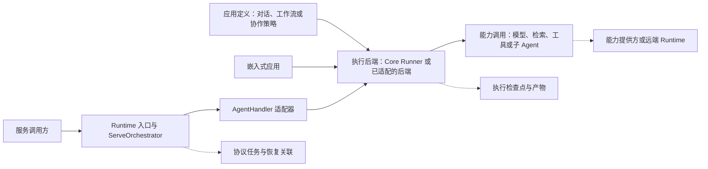

# openJiuwen Java 智能体框架总体架构设计建议

2026-11-18 · 本地源码评审与目标设计 · 适用于嵌入式应用、托管服务和跨服务协作

**建议沿用现有的 Core SDK 与 Runtime 服务边界，把增强重点放在两者之间的契约。** 开发者应能用同一套能力构建单 Agent 助手、预定义工作流和多 Agent 应用。应用选择控制流程，Core 执行本地步骤，Runtime 在需要托管时管理请求、资源和跨服务交互。只有应用承诺长期办理、修改外部系统或中断后继续时，才需要相应的持久化与恢复保证。

框架应使三类问题有稳定答案。第一，当前由谁决定下一步。第二，下一步能用什么能力、带走哪些上下文。第三，一次调用结束、等待或中断之后，谁记录了什么，调用者接下来可以做什么。模型、prompt 和 Skill 可以更换，这三项约定应保持有效。

## 1. 已有基础与需要补齐的边界

按本地检出核对版本。表中“已有”来自源码；“建议”是待实施的设计。本次没有构建上游或运行整套系统。

| 层 | 已有 | 建议 |
| --- | --- | --- |
| 开发与执行，agent-core-java `1ffbfb81a` | Runner、ReActAgent、Workflow/Graph、Team、工具卡、上下文引擎、Rail 回调、执行预算和检查点都有实现。开发者已经可以选择多种执行模型。 | 保留各执行器的原有语义，统一对外描述能力、输入来源、输出类型、等待原因和可恢复边界。以适配器连接既有实现。 |
| 服务托管，agent-runtime-java `77004f14` | HTTP 查询经 ServeOrchestrator 到 AgentHandler，支持聚合与流式返回。已有托管实例装配、准入、A2A 任务存储、远端委派和续接机制。Runtime 的仓库文档将 Agent Server 列为当前交付，平台级 Manager 另列为规划。 | 在现有服务接口上协商能力，对请求传递身份、截止时间、取消和关联标识。把进程内、跨进程两种执行方式对调用者的保证讲清楚。 |
| 应用组合，agent-solution `0298dcd28` | MOA 已有候选选择、阶段计划、确认及委派。另有面向 AgentScope 的 AgentHandler 适配器。 | 将 MOA 作为一种可选协作策略。通过同一托管接口接入不同执行后端，分别声明支持哪些能力。本地托管一个异构 Agent 与调用远端服务分别验收。 |
| 领域与外部系统 | 应用能装配工具、Skill、模型和服务；具体业务结果由数据或工具提供方解释。 | 让领域包声明工具语义、完成条件和可选恢复方式。行业名词、推荐偏好和客户风险取舍留在应用或领域。 |

源码入口：[Core Runner](../../../agent-core-java/core/src/main/java/com/openjiuwen/core/runner/Runner.java) · [工作流](../../../agent-core-java/core/src/main/java/com/openjiuwen/core/workflow/Workflow.java) · [Team](../../../agent-core-java/core/src/main/java/com/openjiuwen/core/multiagent/BaseTeam.java) · [Runtime 架构与范围](../../../agent-runtime-java/README.zh.md) · [处理器接口](../../../agent-runtime-java/service/agent-service-spec/src/main/java/com/openjiuwen/service/spec/spi/AgentHandler.java) · [MOA 编排](../../../agent-solution/common/agents/moa-agent/docs/task-orchestration.md) · [异构处理器示例](../../../agent-solution/common/agent-runtime-ext-java/agent-service-adapters/agent-service-adapters-agentscope/src/main/java/com/openjiuwen/service/adapters/agentscope/agentfw/AgentScopeAgentHandler.java)

## 2. 总体结构与依赖方向

下图是目标逻辑结构。图中的组件可以同进程部署。“应用定义”一线表示开发时装配。其余实线表示运行时调用，虚线表示外部依赖或按需启用的存储。

- **开发时装配。** 应用选择 Agent、工作流或协作策略，声明输入输出、可用能力及版本、允许使用的资源和所需保证。Core 提供组合原语。服务化时由 Runtime 绑定处理器、身份策略、配额、端点和存储。版本或能力不匹配，应在装配时指出具体缺项。
- **运行时执行。** 嵌入式应用可以直接调用 Core。托管请求由 Runtime 做入站身份与准入检查，再经 AgentHandler 执行。工作流由图的边决定下一步，开放式任务由模型提出下一步，多 Agent 应用由选定的协调策略分派。此处的 ServeOrchestrator 负责服务请求的调度，业务任务的拆分仍由上层策略负责。
- **跨边界调用。** 本地子 Agent 可以经 Core 执行。独立服务可以经 A2A 委派。工具可以本地实现，也可以由 MCP 提供。父端只依赖声明过的输入、输出、等待及错误语义。第三方黑盒服务只能提供协议上可观察的保证。
- **公共治理。** 身份由受信入口绑定，依据租户和调用者裁剪能力；子任务只能取得本次委派所需权限。Core 限制单次执行的工具范围与循环预算，Runtime 管理托管准入、并发和截止时间。调用记录围绕同一任务关联，日志只保留诊断所需字段。平台可另行负责部署、发布和监控，嵌入式程序可以独立运行。

## 3. 把过去需要靠提示词提醒的事，变成四项通用约定

这些是拟议的逻辑契约，可以扩展现有类型或增加可选 SPI。能力名称、字段或存储格式的最终 Java API 需要单独评审。

| 契约 | 谁提供、谁消费 | 框架可以检查什么 |
| --- | --- | --- |
| **能力声明** | 提供方注册模型、工具、工作流或 Agent；装配器和执行端读取。声明类型、版本、输入输出模式、权限、读写属性及可选的流式、取消、恢复能力。 | 装配时验证调用方所需保证。执行时按最终目标和实际参数检查权限。发现某个工具只能表明它存在，不能授予调用权限。 |
| **调用上下文** | Runtime 或嵌入式宿主注入可信身份、调用链、截止时间。应用将任务目标、约束及资料按来源与可见范围传给下游。 | 分开表示用户原话、模型建议、工具观测和系统控制消息。子 Agent 得到必要背景及可引用的资料，不必收下整段对话。内部审查意见不能变成用户指令。 |
| **执行结果与事件** | 执行端返回类型化结果，协议适配器映射为响应、流事件、产物或等待请求。 | 明确区分进度、正常完成、等待输入、失败、取消以及外部结果未知。等待携带原因、关联号和允许的续接者。流结束和下游返回成功都只证明各自约定的范围。 |
| **编排与完成条件** | 应用选用的图或协调策略持有依赖、阶段和合并规则，Core 执行并记录步骤。 | 对固定依赖校验输入是否就绪；对动态计划校验可用能力、依赖闭环、预算与退出条件。多分支明确“全部必需”或“允许部分结果”。对含义不明的目标仍需模型或用户解释。 |

**哪些内容继续交给 prompt 和 Skill。** prompt 描述当前角色、沟通方式和开放问题的推理策略。Skill 提供可版本化的领域方法、示例和资料入口。对于“能否调用”“依赖是否就绪”“这条输入是否来自用户”“结果未知时可否重试”，应用声明规则，框架负责强制执行。对于“客户原话有两种合理理解”“哪条新政策适用”，仍需查证或提问。把语义不确定性显式返回给调用者，可以避免把猜测当成执行依据。

例如一个资料编研助手请两个专员校对同一份报告。术语校对已交回，引用核查仍在等授权。如果交付约定要求两项都完成，界面应显示“一项完成，一项等待授权”，并保留已交回的校对稿。换成允许先交草稿的应用，同一框架可返回带缺项说明的草稿。**完成标准随应用变化，记录和判断完成标准的机制可以共用。**

现有 Core 工具卡和 Rail 可承接能力及回调扩展。工具卡目前生成给模型的工具描述时只投影名称、描述和入参。新增权限或恢复字段还必须由实际调用边界读取和执行。现有聚合及流式调用可先通过适配器投影新事件，保持原有调用者可用。[工具卡与投影](../../../agent-core-java/core/src/main/java/com/openjiuwen/core/foundation/tool/ToolCard.java) · [Core 回调](../../../agent-core-java/core/src/main/java/com/openjiuwen/core/singleagent/rail/AgentRail.java) · [上下文引擎](../../../agent-core-java/core/src/main/java/com/openjiuwen/core/context/ContextEngine.java) · [Runtime 查询调度](../../../agent-runtime-java/service/agent-service-app/src/main/java/com/openjiuwen/service/app/orchestrator/DefaultServeOrchestrator.java)

## 4. 状态由谁维护，恢复到哪里

| 状态 | 权威写入方 | 中断后的含义 |
| --- | --- | --- |
| 会话、运行步骤与检查点 | 所选执行后端。Core 可以保存会话、图节点、交互等待点 | 恢复到受支持的执行位置。对无持久化要求的短调用，使用内存即可。 |
| 托管请求、远端 Task 及父子关联 | Runtime 的协议和任务组件 | 按原任务号查询或续接。关联信息用于找到相应执行，不能证明外部业务是否完成。 |
| 应用目标、分支合并、人工审批 | 所选应用协调器。在固定流程中可以由工作流自身持有，多 Agent 场景也可由 MOA 或 Hub 持有 | 按同一版本接纳变更，恢复时保留已完成分支。每个目标只指定一个权威写入方。 |
| 外部动作及其效果 | 执行适配器记录调用与凭据，外部提供方拥有实际结果 | 对有副作用且承诺可靠恢复的动作，采用稳定操作号、幂等键或状态查询。条件不具备时返回结果待核实。 |
| 长期记忆、知识和产物 | 各自配置的记忆、知识或产物提供方 | 引用需带版本、权限和来源。检索到的旧对话可辅助理解；当前授权须通过本次调用认可的来源判断。 |

**恢复顺序取决于中断位置。** 本地纯计算节点可按检查点重算。等待人工输入时，先确认答复对应的是哪一个仍有效的问题。若远端已接单，应先查原 Task；若外部写入可能已发生，先查操作结果。没有可验证的恢复点时，返回明确的重新开始或人工处理选项。这样既能恢复复杂任务，也能让简单应用避免维护一套业务账本。[Core 检查点](../../../agent-core-java/core/src/main/java/com/openjiuwen/core/session/checkpointer/Checkpointer.java) · [Runtime 远端批次关联](../../../agent-runtime-java/service/agent-service-app/src/main/java/com/openjiuwen/service/app/orchestrator/RemoteInvocationBatchCoordinator.java) · [A2A 等待续接](../../../agent-runtime-java/service/agent-service-app/src/main/java/com/openjiuwen/service/app/controller/a2a/A2ATaskContinuation.java)

## 5. 同一架构怎样运行不同应用

下表是设计走查，列出可执行的验收条件。示例均独立于现有银行测试。

| 应用形态 | 谁决定下一步 | 启用哪些能力 | 验收时看什么 |
| --- | --- | --- | --- |
| 嵌入式只读问答 | 单 Agent 的模型循环，必要时调用检索 | Core、模型、检索、预算。宿主可直接返回答案。 | 不启 Runtime、MOA 或持久任务库，仍能完成一次问答。达到预算应明确结束。 |
| 固定的文档转换与检查 | 工作流的节点和条件边 | Core Workflow、转换工具、产物；长流程可选检查点。 | 不调用大模型也能完成。校验失败可定位到节点，恢复使用原输入版本。 |
| 跨服务异步编研 | 应用协调器分派与合并，专员自行决定怎样完成各自任务 | Runtime、远端 Agent、产物引用、任务关联、超时和部分结果策略。 | 一个专员超时，其他产物保留。迟到回包只能更新原分支，不能结束后来发起的新任务。 |
| 需要审批的外部发布 | 应用决定是否允许发布，执行适配器按授权派发 | 在既有调用上增加审批版本、操作记录和提供方对账。单 Agent 也能使用。 | 发布后回包丢失，不重复发布；无法查询结果时明确告知用户待核实。 |

公开模板可以提供常见默认值，例如只读问答、固定工作流或带委派的协作。**应用选择由谁编排，操作风险决定需要什么保障**，两项独立配置。一个只读多 Agent 研究任务可以很轻，一个只有单 Agent 的发布工具也可能需要严格的授权与对账。

## 6. 本次评审修正与落地顺序

| 上一版的局限 | 总体设计中的处置 |
| --- | --- |
| 以跨 Agent 业务任务服务为图的中心 | 提升 Core 执行、Runtime 托管、领域应用组合为总体视图。业务任务服务收为可选扩展。 |
| 从“可靠写入”开始定义所有执行 | 确立通用调用与结果边界，将外部操作回执、对账和长期审批限定到要求这种保证的能力。 |
| 以 MAIN/专员组织形式解释编排 | 同时检验模型循环、固定图和动态协作。每种模式有明确的控制者和退出条件。 |
| 用特定测试总分评价架构 | 用跨应用契约测试检验通用性。领域实测负责验证一套装配的业务效果。 |

1. **先对齐接口，牵头方为 Core 接口维护者。** 与 Runtime 约定能力、上下文、结果和错误的最小字段及版本策略，用适配器接通一个只读 Agent 和一个无模型工作流。验收要求包括原有 API 可用和嵌入式运行不依赖服务端。
2. **再打通托管与异步协作，牵头方为 Runtime 维护者。** 将相同逻辑部署为本地处理器和远端 A2A 服务，验证同一结果含义、权限隔离、剩余预算传递、重复/迟到事件及等待续接。测量增加的延迟、存储和默认路径调用次数。
3. **按需纳入强保障，牵头方为相应的应用集成负责人。** 选取确有外部写入或人工审批的应用，验证授权变更、写入结果未知和重启恢复，再复用到第二个领域。运行期间固定 prompt 和 Skill，记录正确放行、正确阻断和未能判定三种结果，衡量收益是否来自框架。

本稿评审的是总体边界、依赖与可验证性。已有的业务回执、受控写入和故障恢复分析作为一个扩展示例保留。[有外部副作用的业务执行专题](../../studies/banking-architecture-comparison/design/java-business-task-execution.md)
