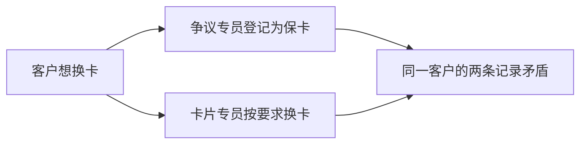
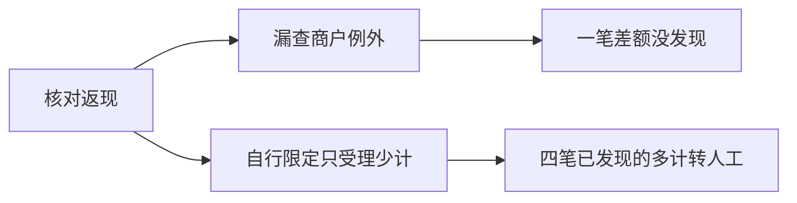
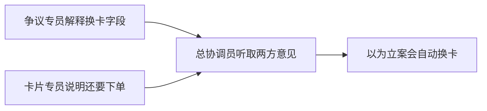
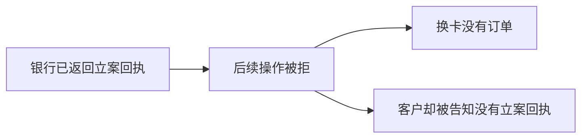

# 一次银行请求，怎样让几个 AI 一起办对？

**MOA 银行业务测试复盘 · 汇报版 · 2026 年 11 月 18 日**

[打开带流程图的 8 页 PDF](moa-testing-briefing-20261118.pdf)

MOA 让一名 AI 总协调员与七个业务专员协作。本次测试实际调用模型，在模拟银行环境中办理业务，由官方评测核对结果。

一位客户发现一笔陌生扣款，同时想换卡和提高额度。银行助手要决定先办哪件事，告诉每位专员该做什么，最后还得拿出凭据告诉客户哪些事办成了。这三个问题在测试中先后出过错。即使客户收到“已完成”的答复，银行里也可能留着相互矛盾的记录，甚至根本没有换卡订单。

**最后一轮选了三个已知场景。** 旧版通过 1 个，新版通过 3 个，每个场景各跑一次。最复杂的一题确实完成了提额、争议立案和换卡，但客户纠正了最初的办理顺序。业务能办成，以及助手能否独立给出好方案，是两项不同的成绩。[三题官方结果与核查记录](moa-v10-three-case-regression.md)

| 汇报中的叫法 | 在这次测试中做什么 |
| --- | --- |
| 总协调员（MAIN） | 接待客户，把请求交给合适的 AI 业务专员，安排先后，最后向客户答复。 |
| 工作指令（prompt） | 告诉总协调员和专员办理时要做哪些动作，例如先查条件、再请客户确认。 |
| 业务手册（Skill） | 告诉专员去哪里查适用政策、怎样使用银行工具、怎样解释办理结果。 |
| 银行回执 | 银行工具返回的实际办理结果。例如，争议立案回执和换卡订单证明的是两件事。 |

前四个阶段按版本演进。最后两个阶段是同一轮 v10 改进，分别讲专员怎样核查业务、总协调员怎样对客户交代结果。每个阶段先看当时怎么办，再沿着第二张图看问题出在哪里。

## 阶段一｜让助手接得上上一步（早期版本至 v3）

### 1. 当前实现

客户咨询适合自己的信用卡。总协调员把比较工作交给信用卡专员，专员查资料，用待办清单记住查到了哪一步。

### 2. 发现的问题

在一次真实办理中，专员以为第一项已经完成，保存的清单却仍显示“办理中”。它又启动第二项，清单同时出现两项“办理中”，流程停下。另一次故障后重新发起请求时，客户已补充的答案也没有带过去。

### 3. 解决方案

**改专员的工作指令。** 先读清单里实际保存的进度，完成当前项和启动下一项要一起提交。**改程序。** 客户重新发起请求时带上先前已说过的相关信息。后续在争议场景又遇到清单问题，程序进一步检查漏填和重复项目，并在每次更新成功后及时记住新状态。

### 4. 效果

修订后，信用卡场景 003 有一次真实复测通过，客户实际提交了申请。模拟故障检查也证实新请求能带上之前的回答。真实运行中的推荐排序仍有瑕疵，故障后恢复的全部过程也只做了局部验证。[选卡实测](context-timeout-fix-20261117.md) · [清单的后续修订](task054-v6-v7-live-e2e-20261117.md)

## 阶段二｜先查资格，再决定先办哪件事（v4 → v5）

### 1. 当前实现

客户先提关掉旧账户，再提开一个储蓄账户。v4 已要求总协调员“整体考虑”，但在场景 060 的一次真实测试中，它仍按客户叙述的顺序分派任务。

### 2. 发现的问题

开新户要求客户保有一个开户时间足够长的活期账户。要关闭的恰好是唯一满足条件的账户。销户这一步可以办成，却同时拿走了下一步需要的资格。

### 3. 解决方案

**改总协调员的工作指令，明确三个动作。** 第一，让开户和销户专员各自按业务手册查条件，此时只查资料。第二，总协调员把两方结论放在一起，排出能兼顾两个目标的顺序。第三，向客户说明并取得确认，再交专员办理。具体先开还是先关，取决于当次查到的账户和规则。

### 4. 效果

此前曾发生 120 秒模型超时。切换到 DeepSeek 官方接口后，v4 的七次协调员调用都正常返回，仍因先关旧户而得 0 分。v5 的同题复测先做只查条件，随后先开新户、再关旧户，官方评分通过。后来 v9 批次仍做对了先后顺序，但销户原因的文字与参考记录有差异，整题仍得 0 分。两次失分的原因不同。[v4 实测](task060-deepseek-direct-e2e-20261117.md) · [v5 实测](task060-v5-skill-evidence-prompt-20261117.md) · [v9 批次核查](moa-v9-single-round-20261118-analysis.md)

## 阶段三｜拆给不同专员的任务，要保留同一个客户选择（v5 → v7）

### 1. 当前实现

回到陌生扣款场景 054。客户要提额、对扣款发起争议、换掉旧卡。v5 的一次测试已排好顺序。争议专员负责立案，卡片专员负责订购新卡。

### 2. 发现的问题

争议单还要记录客户想怎样处理旧卡。争议专员知道换卡由别人执行，却在争议单上填成“客户要保卡”。后来新卡确实下单，银行里却同时留下“客户要保卡”和“已经订购替换卡”两条相互矛盾的记录。该次测试还缺身份核验记录，官方评分为 0。

### 3. 解决方案

**改总协调员和专员的工作指令。** 派任务时说明客户最终想要什么，再说明这位专员负责哪一步。争议专员按客户选择填写记录，卡片专员负责实际下单。v7 又要求总协调员在批准顺序前比较几种安排，检查先办一项会不会堵死另一项。

### 4. 效果

在 v6、v7 的两次已评分测试里，争议单都正确记为换卡，也都只产生一个换卡订单。但这两次又把争议和换卡放在提额前面，提额未能办理，整题仍为 0 分。修正一张表上的选择，仍不足以保证三个目标一起完成。[v5 失败记录](task054-v5-deepseek-e2e-20261117.md) · [v6 与 v7 对照](task054-v6-v7-live-e2e-20261117.md)

## 阶段四｜计划排对了，还要看专员实际收到了什么（v8 → v9）

### 1. 当前实现

v8 要求总协调员在客户确认前，复核办理顺序、风险和最新授权。一次测试中，客户明确提出先提额。最终提额获批、争议立案，也下了一个加急换卡订单。

### 2. 发现的问题

查看专员实际收到的委派文本，发现其中强调了“争议专员不得换卡”。明明客户仍要换卡，专员却再次填成保卡。另一个问题是，部分专员即便核对了身份，也没有权限登记核验结果。顺序正确的这次测试仍得 0 分。

### 3. 解决方案

**改委派时真正发给专员的内容。** v9 要求把客户最新选择、最终目标、本人的职责和其他专员后续要办的事一并带过去。用本例转述就是“客户要换卡。请你把这个选择登记在争议单上，换卡订单由卡片专员办理。”

**改程序权限。** 向七个业务领域开放共用的身份核验登记工具，其他银行操作仍按各自职责授权。

### 4. 效果

v9 一次单题复测中，提额获批、争议单正确记录换卡、加急订单只有一笔，身份登记成功，官方通过。但随后 22 题批次中的 054 又得 0 分。这次争议单已经填对，真正缺的是换卡订单。查看同一道题的两次银行记录，才看出还要解决“谁来核实事情确实办成”。[v8 委派与失分](task054-v8-live-e2e-20261117.md) · [v9 单题通过](task054-v9-context-identity-20261117.md) · [v9 批次失分](moa-v9-single-round-20261118-analysis.md)

## 阶段五｜把“核对返现”写成逐笔可执行的业务手册（v10 专员侧）

### 1. 当前实现

客户要求把名下各张卡的返现都查一遍，少给和多给的都要核实。场景 022 中，专员读到了 77 笔交易，再查银行卡规则，逐项判断实得和应得是否一致。

### 2. 发现的问题

实际交易清单里有一笔适用商户例外，但专员没查到那条例外，按大类费率把它算成正常。对另外四笔已经识别出的多计返现，专员又自行认定“只有少计才能提交”，把四笔都转给人工。客户最后只提交了五笔少计。

### 3. 解决方案

**改业务手册。** 逐笔记下交易标识，核对卡种、商户例外、应得、实得和差额方向。多计与少计各自按适用政策决定后续动作。缺少政策依据时，把该笔列为“待核实”，在回复中说明还缺什么。这套做法适用于不同商户和金额。

### 4. 效果

用虚构交易检查验收方法时，能识别漏项、重复、差额方向算反和缺少回执却声称已提交。新版手册也已在三题真实测试中装载。**022 没有用新版重跑，因此逐笔核算的真实通过情况仍待验证。** [022 的逐笔核查](moa-v9-single-round-20261118-analysis.md) · [新版争议业务手册](../../../shared/skills/releases/moa-evidence-guides-v2/banking-mcp/guides/disputes/transaction-dispute.md) · [合成交易校验](../tests/test_policy_fixture_audit.py)

## 阶段六｜办成了哪一步，要凭每一步的银行回执（v10 协调侧）

### 1. 当前实现

在 v9 批次里，两位专员对同一件事给出不同解释。争议专员认为，在争议单上登记换卡就会触发换卡；卡片专员则说明还应单独下单。总协调员采用了前一种解释。客户说的是“如果已经办了，就不要再办一次”。

### 2. 发现的问题

银行已经返回争议立案回执。后续办理碰到权限拒绝，换卡没有下单。总协调员却对客户说没有争议回执。这样既遗漏了换卡，又可能诱使客户重复提交已立案的争议。本次只观察到一条争议记录。

### 3. 解决方案

**改工作指令和业务手册。** 两位专员解释冲突时，先查操作说明。总协调员分别核对“争议立案”和“换卡下单”需要什么回执。**改程序。** 将每笔写入的返回结果留给总协调员查看。没有权限时，在提交前明确返回拒绝并指出有权办理的领域。已经发出但结果未知的操作，保留为“待核实”。

### 4. 效果

在 v10 的 054 中，总协调员收到了额度批准、争议立案和加急换卡订单三份独立凭据。另两题也依客户选择办成，043 完成还款、减免年费并保卡，031 提交服务争议并保卡。三题均经银行和客户两侧的最终记录复核。拒绝后再授权改派的分支另由本地模拟测试验证，三条真实轨迹均未触发该分支。[三题回归与回执](moa-v10-three-case-regression.md)

## 最后的成绩与仍要改的地方

| 真实场景 | v9 同题 | v10 同题 | 本次客户得到什么 |
| --- | --- | --- | --- |
| 043 · 还款后减免年费 | 未通过 | 通过 | 还款成功，年费减免一年，保留卡片。 |
| 054 · 提额、争议、换卡 | 未通过 | 通过 | 三件事分别办成，每件都有对应回执。 |
| 031 · 对服务不符提出争议 | 通过 | 通过 | 已立案，按客户意愿保持卡片有效。 |

**仍要改的是客户第一次听到的建议，以及每次被要求确认的内容。** 054 中，总协调员最初仍建议先办争议和换卡。客户主动提出先提额并接受短期风险后，流程才走通。期间客户收到五次计划确认，最长一条有 10,748 个字符，还能看到给专员的内部指令。本题用了 16 分 44 秒，v9 同题约 8 分 36 秒。此外，054 有三次额外的身份登记返回“记录可能已存在”。[054 客户可见对话](../runs/moa-v10-remediation-sample-20261118-01/review/task_054-trace.md) · [逐题核查](moa-v10-three-case-regression.md)

下一轮优先看两件事。第一，在客户提示顺序前，单独记录助手的第一份建议，检查它是否解释了可行顺序及风险。第二，用同一份计划生成面向客户的简短确认，保留办理动作、影响和授权条件，让详细操作说明留给专员。这两项尚待验证。

本轮预先选了两个旧版失败场景和一个通过对照，各跑一次。3/3 描述的是这三个样本。旧版全量成绩为 5/22，新版未跑全量，多项修订同时上线，也无法把提升单独归给某条指令或手册。[原始技术复盘、超时诊断与版本历史](moa-debug-technical-notes-through-v10.md) · [完整评测口径](moa-v10-three-case-regression.md)
