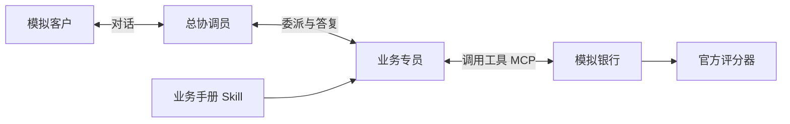
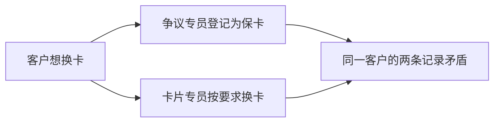
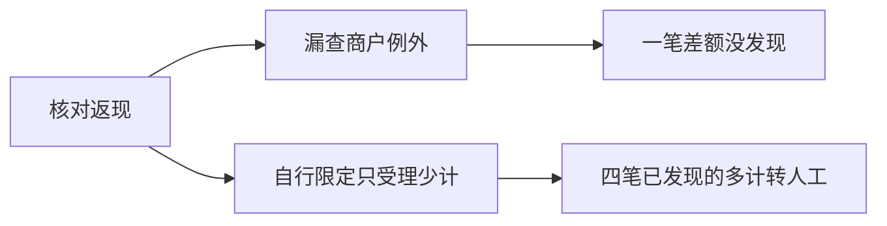
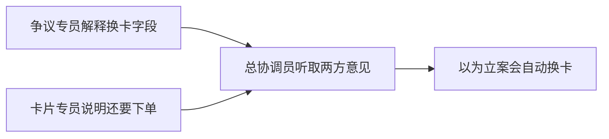

# 银行 AI 助手怎样受测？一笔陌生扣款的两次办理

**MOA 银行业务测试复盘 · 汇报版 · 2026 年 11 月 18 日**

[打开带流程图的 PDF 汇报版](moa-testing-briefing-20261118.pdf)

**当一位客户同时要办几件互相影响的事，多个 AI 能否把它们办对，并准确说出哪些已办成？** 我们把 MOA 接入官方 τ³ 银行模拟环境。在下面对照的两轮测试中，客户模拟器和银行助手都调用 DeepSeek 官方接口的 deepseek-flash 模型，用英语交谈。账户、交易、订单和银行工具均由测试环境提供，每一题从该题指定的初始记录开始。

| 谁参与 | 它掌握什么，负责什么 |
| --- | --- |
| 模拟客户 | 官方客户模拟器拿到本题的身份、处境和目标，再根据助手的答复补资料或决定授权。它还有独立的客户侧工具，例如客户可以自己提交申请。 |
| 银行助手 MOA | 一个 Java 总协调员（MAIN）接待客户，按需委派给七个独立业务专员，分别负责信用卡产品与申请、提额、付款、开户、销户、交易争议和卡片服务。 |
| 模拟银行 | 保存本题的账户和交易，提供可查询的银行政策。专员发出查询时返回资料，成功执行写入操作时更新账户、争议单或订单。 |
| 官方评分器 | 对话结束后按本题规则评分。参考操作和预期记录保留在评测侧。银行助手只能用客户告诉它的内容、可见政策、工具说明和实际回执来办事。 |

最后抽查三道题，每题各跑一次。旧版（v9）在相同三题中通过一道，新版（v10）通过三道。下面用 054 的一笔陌生扣款，说明从 0 分到 1 分，银行里究竟多了什么记录。[测试入口](../../../shared/python/run_episode.py) · [总协调员与七个专员的接入](../python/moa_pilot_agent.py)

## 测试怎么运行｜从一本业务手册到一张换卡订单

**工作指令（prompt）告诉助手怎么协作。业务手册（Skill）指导专员到哪里查依据、怎样办理。MCP 是专员调用工具、接收结果的接口。** 以换卡为例，总协调员可以要求“核实换卡条件”，只有卡片专员通过被授权的工具下单，模拟银行才会产生订单。

1. **接单与查证。** 总协调员先确认客户要什么。遇到跨业务条件，让相关专员按各自装载的英文 Skill，通过知识库搜索工具（KB_search）查政策，再用账户查询工具核对事实。各专员把条件和风险交回总协调员，由它提出办理顺序。手册中的“查政策”只是操作指引，适用的条件要以本次检索结果为据。
2. **授权与执行。** 客户同意办理后，卡片专员查看可用工具及其说明。MCP 接入层检查调用者是否有权执行该操作，通过后交给官方模拟银行。如果接入层拒绝请求，银行收不到这次下单，也就不会产生订单。
3. **回执与答复。** 模拟银行返回订单号、配送方式等结果，原调用据此对应到本次办理。v10 还把本次会话的写入结果提供给总协调员。054 的真实记录里，第 188 条消息请求解锁换卡工具，第 190 条请求下单，第 191 条才是带订单号的回执。
4. **评分。** 对 054，官方评分器从相同的初始数据分别重放实际办理和参考操作，再比较银行侧和客户侧最终记录。两侧均匹配才得 1 分。客户表示满意、专员回复“已完成”或某一次调用成功，都不足以单独得分。其他办理路径只要得到相同的受检状态，也可以通过。

[部署的 Skill 与调用示例](../../../shared/skills/releases/moa-evidence-guides-v2/banking-mcp/SKILL.md) · [MCP 工具接入](../../../shared/python/benchmark_mcp.py) · [权限检查](../python/domain_boundary.py) · [054 评分与重放证据](../runs/moa-v10-remediation-sample-20261118-01/review/task_054-evidence.json)

## 案例 054｜客户到底要什么，怎样才算办成？

客户在信用卡上看到一笔 **487.50 美元**的陌生扣款，担心卡片资料泄露。她最初把处理欺诈列为优先事项，希望争议这笔扣款并换一张卡，同时想为装修提高额度。原额度为 **5,000 美元**。困难在于，按本题查得的政策，先立案或留下待处理换卡订单，会阻碍眼前的提额申请。先提额又意味着旧卡在一段时间内仍有效。先说明取舍、取得客户选择，才能安排办理。

**v10 实际通过的一条路径**如下。表内 M 是本轮官方对话的消息编号，引用的是客户选择或银行回执。

| 办到哪一步 | 实际发生了什么 | 怎样核实 |
| --- | --- | --- |
| 查条件并确认风险 | 总协调员最初仍建议先处理欺诈。客户提出能否先提额，了解旧卡暂时有效的风险后接受该顺序。 | M062、M063、M091。正确顺序有客户的参与和授权。 |
| 提额 | 核验身份、检查资格后，额度专员提交并取得批准，增加 2,500 美元。 | M127 批准回执显示新额度为 7,500 美元。 |
| 争议立案 | 客户再次确认办理。争议专员以未经授权的扣款立案，登记客户要求全额退款并更换卡片。 | M143 是授权，M157 是立案回执。全额退款是申请内容，案件仍待审核。 |
| 换卡与结案 | 卡片专员另行订购加急替换卡。总协调员向客户逐项汇报三项结果。 | M191 给出订单号、加急配送和旧卡已注销的信息。官方最终记录匹配，得 1 分。 |

**成功依据是最后留下的记录。** 身份核验记录、已生效额度、争议记录里的客户选择、加急订单与旧卡状态均须相符。填写“客户想换卡”只记录了选择，另有订单才能说明换卡已经办理。[v10 成功轨迹](../runs/moa-v10-remediation-sample-20261118-01/review/task_054-trace.md) · [官方结果与独立重放](../runs/moa-v10-remediation-sample-20261118-01/review/task_054-evidence.json)

## 同题失败复盘｜已经立案，为什么仍得 0 分？

对照的是 v9 的 22 题批次与 v10 的三题批次。两次都办成了提额和立案。**决定 v9 失分的是缺少换卡订单及其状态变化。** 分歧出现在制定计划时，第一项漏办发生在立案之后。最后向客户答复时又出了一个错。

| v9 的关键时刻 | 证据与原因 |
| --- | --- |
| ① 计划采信了未经核实的说法 | 争议专员说立案可以一并换卡，卡片专员却说还要另行下单。M051 客户的意思是，如果立案已经触发换卡，就不要重复下单。v9 的工作指令已要求遇到矛盾先核实。总协调员这次仍把客户的假设当成了工具的效果，并把独立换卡安排在争议专员成功返回之后。 |
| ② 前两笔业务实际成功 | M089 是提额至 7,500 美元的批准回执。M114 调用立案工具，M115 收到成功回执，争议单正确登记了换卡意愿。M119 查询却显示没有待处理的换卡订单。 |
| ③ 有权办理的人没有执行 | 争议专员自己尝试下单。接入层在送达银行前拒绝了越权操作。当时的程序把拒绝表现为专员调用异常。总协调员看到这个任务失败，跳过了依赖它成功返回的卡片专员。 |
| ④ 向客户报错了失败范围 | M124、M128 又把整个任务失败说成没有立案回执。银行记录中的争议仍然存在，客户却以为两次立案都失败了，最终要求转人工。没有观察到第二笔立案。 |

**评分与体验分别出了什么问题？** 把两条办理路径重放后，查出四处差异。换卡工具没有成功调用的记录，银行缺一笔换卡订单，旧卡的状态和注销日期也没有更新。官方评分显示数据库不匹配，给了 0 分。这四处差异解释了分数的来源。误报“没有立案”又让客户要求重试，最后要求转人工。v10 的工作指令要求核对专员对同一工具的不同解释，业务手册区分登记选择与实际下单，程序把每笔回执和权限拒绝分别交给总协调员。[v9 失败轨迹](../runs/moa-v9-single-round-20261118-01/review/task_054-trace.md) · [四处状态差异](../runs/moa-v9-single-round-20261118-01/review/task_054-evidence.json) · [委派和越权调用取证](moa-v9-single-round-20261118-analysis.md)

## 其他案例｜同样是“办完了”，各题查什么记录？

054 贯穿本报告。下表列出另外五个例子，便于阅读后续阶段。“通过”是对当次完整银行记录的评分，同一个版本在不同对话中也可能走出不同路径。

| 场景与客户请求 | 正常办理路径及关键记录 | 测试中发生了什么 |
| --- | --- | --- |
| 003 · 旅行选卡并申请 | 查外币交易费、购物保障和额度范围，说明条件，由客户选择并提交。评测核对实际申请记录与参考记录。 | 一次修订后的复测里客户成功申请 Silver，得 1 分。v9 批次里客户申请了 Gold，和本题参考产品不同，得 0 分。客户首句并未指定卡名。 |
| 060 · 关旧户、开储蓄户 | 先查哪些账户满足开户年限，经确认后先开新户、再关指定旧户。核对两个账户的状态及有关字段。 | v4 先关旧户导致开户受阻。v5 同题通过。v9 顺序正确，但销户原因文字与参考记录不同，仍得 0 分。 |
| 022 · 核查四张卡的返现 | 逐笔核对适用费率和商户例外，确认多计或少计，再由客户提交需要审查的交易。离线参考有 10 笔受理记录。 | v9 检查 77 笔交易，客户最终只提交 5 笔。漏了一笔商户例外，另有四笔多计被转人工。新版手册尚未在此题真实复测。 |
| 043 · 因年费想销卡，后来决定保卡 | 经客户同意先还清 75 美元余额。客户接受免一年年费后，应登记原因、落实减免并保卡。 | v9 已还款，但越权调用后困在旧服务选择，减免未落实。v10 付款和减免均有回执，保卡，得 1 分。 |
| 031 · 酒店服务不符，客户要保卡 | 核实 167.34 美元交易，按服务不符立案，登记客户要求退款和保卡的选择。 | v9、v10 均得 1 分。它与 054 形成对照，同样要开争议单，客户一次要保卡、一次要换卡。 |

产品、订单数和交易笔数是对既有结果的离线核查。运行时由专员依据本次客户授权、可见政策和工具说明作出选择。[v9 各题需求与评分差异](moa-v9-single-round-20261118-analysis.md) · [003 早期通过记录](context-timeout-fix-20261117.md) · [v10 三题结果](moa-v10-three-case-regression.md)

## 阶段一｜让助手接得上上一步（早期版本至 v3）

### 1. 当前实现

客户经常旅行，想找一张免外币交易费、有购物保障、可提供较高额度的信用卡。场景 003 需要专员对照产品条件作推荐，并由客户自己提交申请，银行里应有相应的申请记录。总协调员把比较工作交给信用卡专员，专员查资料，用待办清单记住查到了哪一步。

### 2. 发现的问题

在一次真实办理中，专员以为第一项已经完成，保存的清单却仍显示“办理中”。它又启动第二项，清单同时出现两项“办理中”，流程停下。另一次故障后重新发起请求时，客户已补充的答案也没有带过去。

### 3. 解决方案

**改专员的工作指令。** 先读清单里实际保存的进度，完成当前项和启动下一项要一起提交。**改程序。** 客户重新发起请求时带上之前提供的相关信息。后续在争议场景又遇到清单问题，程序进一步检查漏填和重复项目，并在每次更新成功后及时记住新状态。

### 4. 效果

修订后，信用卡场景 003 有一次真实复测通过，客户实际提交了申请。模拟故障检查也证实新请求能带上之前的回答。真实运行中的推荐排序仍有瑕疵，故障后恢复的全部过程也只做了局部验证。[选卡实测](context-timeout-fix-20261117.md) · [清单的后续修订](task054-v6-v7-live-e2e-20261117.md)

## 阶段二｜先查资格，再决定先办哪件事（v4 → v5）

### 1. 当前实现

客户先提关掉旧活期账户，再提开一个储蓄账户。两件事都要完成，最终应同时看到新户已开和指定旧户已关。v4 已要求总协调员“整体考虑”，但在场景 060 的一次真实测试中，它仍按客户叙述的顺序分派任务。

### 2. 发现的问题

开新户要求客户保有一个开户时间足够长的活期账户。要关闭的恰好是唯一满足条件的账户。销户这一步可以办成，却同时拿走了下一步需要的资格。

### 3. 解决方案

**改总协调员的工作指令，明确三个动作。** 第一，让开户和销户专员各自按业务手册查条件，此时只查资料。第二，总协调员把两方结论放在一起，排出能兼顾两个目标的顺序。第三，向客户说明并取得确认，再交专员办理。具体先开还是先关，取决于当次查到的账户和规则。

### 4. 效果

此前曾发生 120 秒模型超时。切换到 DeepSeek 官方接口后，v4 的七次协调员调用都正常返回，仍因先关旧户而得 0 分。v5 的同题复测先让两位专员查清资格，随后先开新户、再关旧户，官方评分通过。后来 v9 批次仍做对了先后顺序，但销户原因的文字与参考记录有差异，整题仍得 0 分。两次失分的原因不同。[v4 实测](task060-deepseek-direct-e2e-20261117.md) · [v5 实测](task060-v5-skill-evidence-prompt-20261117.md) · [v9 批次核查](moa-v9-single-round-20261118-analysis.md)

## 阶段三｜拆给不同专员的任务，要保留同一个客户选择（v5 → v7）

### 1. 当前实现

回到陌生扣款场景 054。客户要提额、对扣款发起争议、换掉旧卡。v5 的一次测试已排好顺序。争议专员负责立案，卡片专员负责订购新卡。

### 2. 发现的问题

争议单还要记录客户想怎样处理旧卡。争议专员知道换卡由别人执行，却在争议单上填成“客户要保卡”。后来新卡确实下单，银行里却同时留下“客户要保卡”和“已经订购替换卡”两条相互矛盾的记录。该次测试还缺身份核验记录，官方评分为 0。

### 3. 解决方案

**改总协调员和专员的工作指令。** 派任务时说明客户最终想要什么，再说明这位专员负责哪一步。争议专员按客户选择填写记录，卡片专员负责实际下单。v7 又要求总协调员在批准顺序前比较几种安排，检查先办一项会不会堵死另一项。

### 4. 效果

在 v6、v7 的两次已评分测试里，争议单都正确记为换卡，也都只产生一个换卡订单。但这两次又把争议和换卡放在提额前面，提额未能办理，整题仍为 0 分。修正一张表上的选择，仍不足以保证三个目标一起完成。[v5 失败记录](task054-v5-deepseek-e2e-20261117.md) · [v6 与 v7 对照](task054-v6-v7-live-e2e-20261117.md)

## 阶段四｜计划排对了，还要看专员实际收到了什么（v8 → v9）

### 1. 当前实现

v8 要求总协调员在客户确认前，复核办理顺序、风险和最新授权。一次测试中，客户明确提出先提额。最终提额获批、争议立案，也下了一个加急换卡订单。

### 2. 发现的问题

查看专员实际收到的委派文本，发现其中强调了“争议专员不得换卡”。明明客户仍要换卡，专员却再次填成保卡。另一个问题是，部分专员即便核对了身份，也没有权限登记核验结果。顺序正确的这次测试仍得 0 分。

### 3. 解决方案

**改委派时真正发给专员的内容。** v9 要求把客户最新选择、最终目标、本人的职责和其他专员后续要办的事一并带过去。用本例转述就是“客户要换卡。请你把这个选择登记在争议单上，换卡订单由卡片专员办理。”

**改程序权限。** 向七个业务领域开放共用的身份核验登记工具，其他银行操作仍按各自职责授权。

### 4. 效果

v9 一次单题复测中，提额获批、争议单正确记录换卡、加急订单只有一笔，身份登记成功，官方通过。但随后 22 题批次中的 054 又得 0 分。这次争议单已经填对，真正缺的是换卡订单。查看同一道题的两次银行记录，才看出还要解决“谁来核实事情确实办成”。[v8 委派与失分](task054-v8-live-e2e-20261117.md) · [v9 单题通过](task054-v9-context-identity-20261117.md) · [v9 批次失分](moa-v9-single-round-20261118-analysis.md)

## 阶段五｜把“核对返现”写成逐笔可执行的业务手册（v10 专员侧）

### 1. 当前实现

客户要求把名下各张卡的返现都查一遍，少给和多给的都要核实。场景 022 中，专员读到了 77 笔交易，再查银行卡规则。完整办理需要覆盖应复核的每笔交易，由客户通过客户侧工具提交，并留下相应受理记录。

### 2. 发现的问题

实际交易清单里有一笔适用商户例外，但专员没查到那条例外，按大类费率把它算成正常。对另外四笔已经识别出的多计返现，专员又自行认定“只有少计才能提交”，把四笔都转给人工。客户最后只提交了五笔少计。

### 3. 解决方案

**改业务手册。** 逐笔记下交易标识，核对卡种、商户例外、应得、实得和差额方向。多计与少计各自按适用政策决定后续动作。缺少政策依据时，把该笔列为“待核实”，在回复中说明还缺什么。这套做法适用于不同商户和金额。

### 4. 效果

用虚构交易检查验收方法时，能识别漏项、重复、差额方向算反和缺少回执却声称已提交。新版手册也已在三题真实测试中装载。**022 没有用新版重跑，因此逐笔核算的真实通过情况仍待验证。** [022 的逐笔核查](moa-v9-single-round-20261118-analysis.md) · [新版争议业务手册](../../../shared/skills/releases/moa-evidence-guides-v2/banking-mcp/guides/disputes/transaction-dispute.md) · [合成交易校验](../tests/test_policy_fixture_audit.py)

## 阶段六｜办成了哪一步，要凭每一步的银行回执（v10 协调侧）

### 1. 当前实现

在 v9 批次里，两位专员对同一件事给出不同解释。争议专员认为，在争议单上登记换卡就会触发换卡。卡片专员则说明还应单独下单。总协调员采用了前一种解释。客户说的是“如果已经办了，就不要再办一次”。

### 2. 发现的问题

银行已经返回争议立案回执。后续办理碰到权限拒绝，换卡没有下单。总协调员却对客户说没有争议回执。这样既遗漏了换卡，又可能诱使客户重复提交已立案的争议。本次只观察到一条争议记录。

### 3. 解决方案

**改工作指令和业务手册。** 两位专员解释冲突时，先查操作说明。总协调员分别核对“争议立案”和“换卡下单”需要什么回执。**改程序。** 将每笔写入的返回结果留给总协调员查看。没有权限时，在提交前明确返回拒绝并指出有权办理的领域。已经发出但结果未知的操作，保留为“待核实”。

### 4. 效果

在 v10 的 054 中，总协调员收到了额度批准、争议立案和加急换卡订单三份独立凭据。另两题也依客户选择办成，043 完成还款、减免年费并保卡，031 提交服务争议并保卡。三题均经银行和客户两侧的最终记录复核。拒绝后再授权改派的分支另由本地模拟测试验证，三条真实轨迹均未触发该分支。[三题回归与回执](moa-v10-three-case-regression.md)

## 最后的成绩与仍要改的地方

| 真实场景 | v9 同题 | v10 同题 | 本次客户得到什么 |
| --- | --- | --- | --- |
| 043 · 还款后减免年费 | 未通过 | 通过 | 从活期账户偿还 75 美元，年费减免一年，卡片保留。 |
| 054 · 提额、争议、换卡 | 未通过 | 通过 | 三件事分别办成，每件都有对应回执。 |
| 031 · 对服务不符提出争议 | 通过 | 通过 | 对 167.34 美元的酒店服务争议立案，按客户意愿保持卡片有效。 |

**仍要改的是客户第一次听到的建议，以及每次被要求确认的内容。** 054 中，总协调员最初仍建议先办争议和换卡。客户主动提出先提额并接受短期风险后，流程才走通。期间客户收到五次计划确认，最长一条有 10,748 个字符，还能看到给专员的内部指令。本题用了 16 分 44 秒，v9 同题约 8 分 36 秒。此外，054 有三次额外的身份登记返回“记录可能已存在”。[054 客户可见对话](../runs/moa-v10-remediation-sample-20261118-01/review/task_054-trace.md) · [逐题核查](moa-v10-three-case-regression.md)

下一轮优先看两件事。第一，在客户提示顺序前，单独记录助手的第一份建议，检查它是否解释了可行顺序及风险。第二，用同一份计划生成面向客户的简短确认，保留办理动作、影响和授权条件，让详细操作说明留给专员。这两项尚待验证。

本轮预先选了两个旧版失败场景和一个通过对照，各跑一次。3/3 描述的是这三个样本。旧版全量成绩为 5/22，新版未跑全量，多项修订同时上线，也无法把提升单独归给某条指令或手册。[原始技术复盘、超时诊断与版本历史](moa-debug-technical-notes-through-v10.md) · [完整评测口径](moa-v10-three-case-regression.md)
