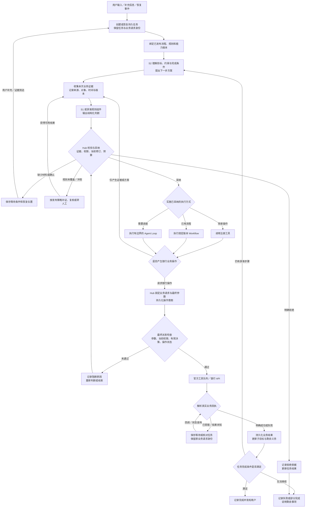
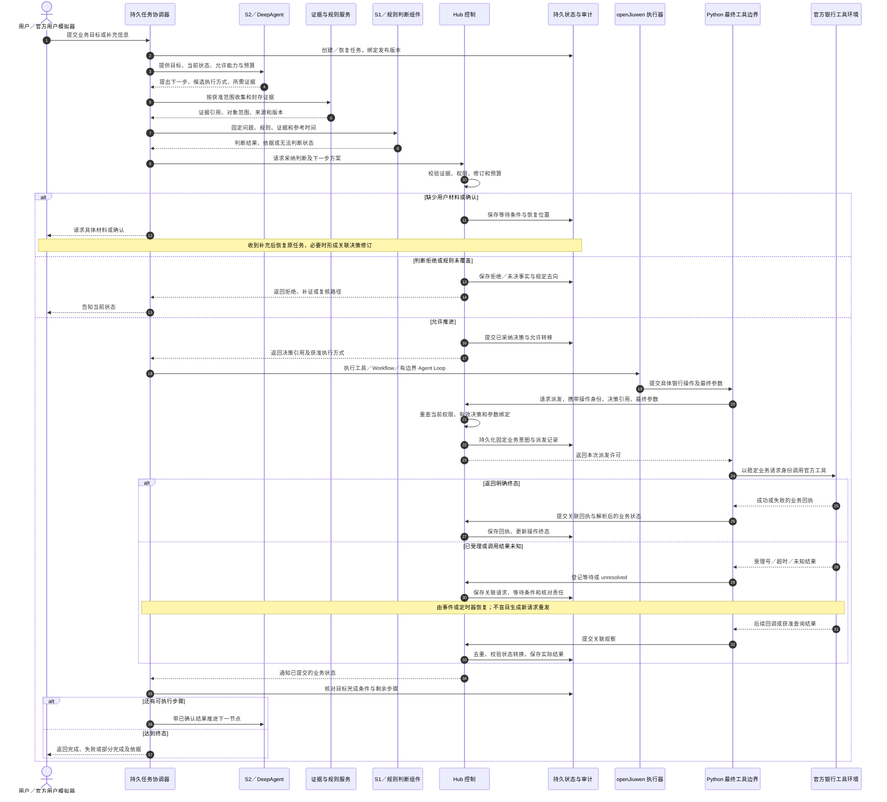

**建议将方案 4 调整为：由持久任务驱动业务，S2 提出执行方案，S1／规则组件判断业务条件，Hub 采纳决策并控制推进，openJiuwen 执行，官方银行环境确认业务结果。**

现有的“工具调用前经过 Go Gate”可以保留，作为最后一道派发检查。需要向前补齐任务、证据与决策，向后补齐回执、等待和恢复。

下面两张图是**建议的目标设计**，并非当前代码已实现的能力。以“挂失并补卡”这类多步骤任务为例；具体步骤依赖和确认条件由业务规则定义。

**一、业务流程图：从用户意图到可核验的任务完成**

这张图有三个关键点：

- **执行方式按节点选择。** 一个任务可以先调查、再走 Workflow、再等待银行处理。路由依据的是已采纳判断，不能每走一条边就重新让模型随意决定。
- **“等待”是持久状态。** 用户退出聊天、进程重启后，任务仍有等待对象、截止时间和恢复位置。
- **子操作完成与总任务完成分别判断。** 挂失成功、补卡失败时，保留挂失结果，报告部分完成；不能把工具返回成功直接当作整件事完成。

S1 可以是经过验证的类型化判断模型；明确的权限比较、金额计算、状态匹配等采用确定性代码。初期可以使用明确标注的模型替身验证控制链。

**二、时序图：谁提出、谁批准、谁执行、谁确认**

图中的“任务协调器”和“Hub 控制”是逻辑职责，可以在同一宿主内实现；不要求新增两个独立服务。

这里的派发记录和外部银行操作之间，**不能假设有跨系统原子事务**。如果在发送前后崩溃，恢复逻辑必须根据银行接口的查询、幂等或回执能力核对；没有安全核对方式时，继续保留未知状态。

**三、现有方案 4 应怎样映射到这两张图**

| 当前组件 | 保留的职责 | 需要调整或补齐 |
|---|---|---|
| `DeepAgentJavaAgent` | 理解目标、调查、提出方案、执行局部 Agent Loop | 接收任务状态和节点约束，不能自行声明业务完成 |
| `HubPilotAgent` | 连接执行器与 Hub | 从只读 pilot 扩展为任务、决策、回执的适配层 |
| `decision_provider` | 为 Hub 提供判断输入 | 接入真实证据与规则判断，替换当前只读目录判断 |
| `GatedEventQueue` | 官方工具入队前的最终检查 | 消费已采纳决策引用，校验稳定业务身份及最终参数 |
| Go `Gate`、`adopt/ledger` | 采纳、派发、操作状态、持久事件 | 补当前有效修订、可信权限、拒绝记录及恢复接线 |
| `_send(tool_result)` | 接收官方工具结果 | 按业务契约解析受理、等待、成功、失败和未知 |
| 新增任务协调能力 | —— | 管目标、节点、等待、事件恢复和总任务完成条件 |

**最重要的调整，是把业务判断前移到方案与节点推进阶段，同时保留最终工具边界的复查。** 当前在队列入口临时生成 `decision` 的做法，适合验证只读许可；完整目标设计中，队列入口应消费已经形成、可以追溯的决策，再针对实际即将发出的参数和当前状态重新检查。

验收时应分别证明三件事：**路由选择有依据、银行操作受控制、任务能够依据真实结果持续推进并正确结束。** 当前 3 项 Python 和 2 项 Go 测试主要覆盖第二项中的部分机制。