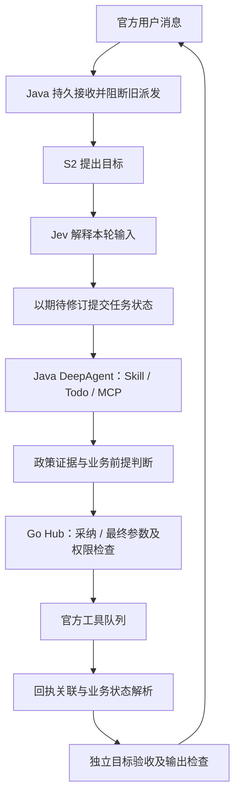

# LLM Evidence Control 独立运行器

本入口在官方银行环境中连接持久任务、Jev 判断、Java DeepAgent 和实际 Go Hub。它与旧的只读 `HubPilotAgent` 分离。`prepare.py` 仍仅准备输入，正式四方案比较开关不因诊断通过而自动打开。

## 实际调用链



`TaskCoordinator` 是唯一的任务状态写者。DeepAgent 的 Todo 是执行计划，不能直接关闭业务目标。Python 保存证据并连接各协议；Go 复用上游 `adopt/ledger`，负责操作采纳和派发状态。官方工具和评分器保持原实现。

## 构建与离线检查

从仓库根目录运行，使用已有 Python 3.12 环境、JDK 21 和本地 openJiuwen 依赖：

```bash
bash experiments/plan-4-agent-hub-refined-skills/java/build-runtime.sh
bash experiments/plan-4-agent-hub-refined-skills/java/check-task-coordinator.sh
bash experiments/plan-4-agent-hub-refined-skills/go/check-gate.sh
.venv312/bin/python -m unittest discover -s experiments/plan-4-agent-hub-refined-skills/tests -q
```

完整本机夹具使用真实 Java、MCP、Go 和框架持久检查点；模型及业务数据为合成夹具，无外部推理：

```bash
PYTHONPATH=shared/python:experiments/plan-4-agent-hub-refined-skills/python \
.venv312/bin/python experiments/plan-4-agent-hub-refined-skills/python/check_full_runtime.py \
  --output logs/new-native-check --restart-executor --read-before-wait
```

## 官方用例诊断

先向进程注入 `OPENAI_API_KEY`、`TYPESAFE_API_KEY`，不要将密钥写入命令参数、配置或报告。输出目录必须不存在：

```bash
PYTHONPATH=shared/python:experiments/plan-4-agent-hub-refined-skills/python \
.venv312/bin/python experiments/plan-4-agent-hub-refined-skills/python/full_diagnostic.py \
  --task task_003 --output logs/new-official-check --execute
```

默认沿用研究模型别名。开发诊断另支持 `--model volcengine/deepseek-v4.1-flash`，用于排查别名后端漂移；该条件变更会写入 manifest，结果不能混入原模型的正式比较。各模型层固定首次实际响应版本，漂移后停止，不自动换模型。

`manifest.json` 冻结源码、制品和依赖哈希，`freeze-sources/` 保存可核查副本。`summary.json` 分开记录官方分数与单题控制链检查。原始轨迹保存在忽略的 `logs/`，开发报告只链接或概述必要证据。运行中不要修改冻结源码及制品。

## 关键边界

- 用户自由文本逐条解释；工具回执按关联契约处理。重复消息不重复推理或产生业务效果。
- 新业务目标使用独立身份；同一业务步骤换调用 ID 不能重新派发。未知写入保留原身份，禁止盲重发。
- 执行、判断及用户模拟调用均预扣持久预算。恢复不重置预算；任务最多恢复 8 次，同证据纠错另受持久上限约束。
- 证据以内容哈希绑定。仅官方 KB 中实际出现的文档 ID 可以解析为证据引用；客户正文不能充当政策依据。
- 大 Jev 请求显式开启长上下文，不裁掉证据；API 错误仍中止。该配置和临时阈值需在正式比较前冻结与校准。[TypeSafe 上下文说明](https://docs.typesafe.ai/models.md)
- 原官方环境存活时可重启 Java 执行器；存在未知在途效果时拒绝重启。宿主环境丢失后不重建银行环境冒充续跑。
- 私有模型代理缓冲 SSE 后校验实际版本，因此首 token 延迟不能与未使用该代理的基线直接比较。
- `replay_input_routes.py` 只重放输入判断段，不能作为整链离线重放通过的证据。

完整 39 条设计契约的发布验收与单题诊断是不同门槛；当前入口不会自行声明全部契约通过。
