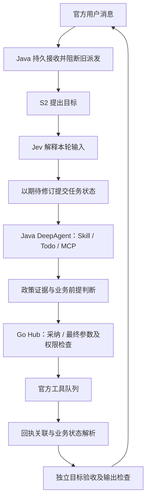

# LLM Evidence Control 独立运行器

本入口在官方银行环境中连接持久任务、Jev 判断、Java DeepAgent 和实际 Go Hub。它与旧的只读 `HubPilotAgent` 分离。`prepare.py` 仍仅准备输入，正式四方案比较开关不因诊断通过而自动打开。

## 使用历史冻结Skill执行独立诊断

`--skill-from-manifest`只复用历史清单中的完整Skill身份。准备阶段校验发布名、release.json哈希和全部文件哈希，并将Skill原文复制到本次`freeze-sources/`；历史运行器、MAIN提示词和权限配置不随Skill导入。当前发布文件与冻结身份不一致时拒绝执行。

```bash
PYTHONPATH=shared/python:experiments/plan-4-agent-hub-refined-skills/python \
.venv312/bin/python experiments/plan-4-agent-hub-refined-skills/python/full_diagnostic.py \
  --task task_054 --model deepseek-flash --api-base https://api.deepseek.com \
  --skill-from-manifest experiments/plan-3-moa-refined-skills/runs/moa-v10-remediation-sample-20261118-01/task_054/manifest.json \
  --output logs/<new-diagnostic-directory> --execute
```

凭证由`OPENAI_API_KEY`及`TYPESAFE_API_KEY`注入。端点与模型组合使用明确允许列表，不自动尝试其他服务。默认运行方式仍保留原网关和原Skill。该配置属于开发诊断，不能当作原正式四方案单轮结果。v10是来源批次的MAIN修订名，其冻结Skill发布名实际为`moa-evidence-guides-v2`。

## 当前实现补充

输入使用[S2具体提案与Jev核验](INPUT_ROUTING.md)。对外回答先抽取逐条事实，再检查原文跨度、证据来源、覆盖度和任务完成依据。问句中的费用、时效和审批状态同样需要证据；不能利用`ask_user`绕过事实检查。S1观察引用采用`observation://`内容哈希，在`judgments/references/`关联原始请求和响应，避免将输出目录或题号带入后续模型上下文。

原生模型代理还将实际episode目录映射为`/workspace/episode`，并保存实际转发的请求，避免Skill工作目录向模型泄露题号。内部Java工作区和控制文件位置不改变；实际模型版本和用量继续在交付响应前核验。

挂起问询的`controller_review`通过私有来源信封恢复为`QUESTION_NOT_PUBLISHED`工具拒绝，不交给默认用户回答格式化器。真实`user`正文保持字符串路径，不能用JSON样式正文伪造来源。信封使用SDK持久化白名单支持的标准容器，不修改SDK白名单。验证命令在原生夹具参数上增加`--reject-first-question`；该场景先拒绝未发布问题，再发修订问题、收到真实确认、恢复并完成模拟写入。

无效输入提案进入澄清，尚未解决的输入继续阻止派发。技术故障、版本漂移与业务拒绝分别记录。当前.3/.7阈值仍属开发诊断策略，完整39项发布验收与正式比较尚未自动开启。

## 整链隔离重放

正式适配器默认在`hub-control/controller/control-replay/`保存控制事件、模型观察、固定代码与制品、Schema和任务初态。结束后写入`seal.json`。该目录属于忽略的运行证据，不应提交客户原文或凭证。

```bash
.venv312/bin/python experiments/plan-4-agent-hub-refined-skills/python/replay_control.py \
  --frozen-code \
  --capture logs/<diagnostic>/episodes/<episode>/hub-control/controller/control-replay \
  --output logs/<fresh-replay-directory>
```

重放重新运行相同Python、Java协调器及真实Go Hub，恢复原目标身份、预算和控制时钟，逐事件比较结果、目标、效果记录与证据引用。模型使用精确匹配的记录，银行工具派发进入隔离队列。缺少模型记录、参数改变、制品漂移、未封存或存在并发交错的记录直接拒绝，不调用外部服务补齐。

`--frozen-code`先校验封存文件哈希，再载入该次记录冻结的控制实现，适用于工作区代码已更新的情况；重放驱动自身哈希另行记录。不指定时要求当前工作区实现与捕获版本一致。旧记录若仅因文件落盘交叠被标为非串行，驱动会重新核对全部动作时间区间与相邻状态边界，并同时报告原标志；真正的动作交叠仍拒绝，原记录不被修改。

实际工具与其同调用ID回执由控制器同一锁串行，审计快照窗口仍可能交叠。驱动只允许这个明确的因果边，并继续逐事件重执行及核对全部状态；不相关回执、其他动作交叠和状态间隙均拒绝。

必需审计在动作前落盘失败时，动作不执行；派发后的终记录失败时保留未知效果。两种情况都持久停止任务并拒绝后续推进，不能生成完整封存记录。

`--mutate-first-input`和`--omit-first-receipt`用于反事实检查，预期失败。原生DeepAgent生成过程与银行服务不在重执行范围，其工具提案和业务回执是已记录输入。完整原生恢复另由`check_full_runtime.py --read-before-wait --restart-controls --restart-executor`验证；该夹具使用合成模型与业务数据，并注入专用测试契约，因此关闭其重放捕获。

## 实际调用链



`TaskCoordinator` 是唯一的任务状态写者。DeepAgent 的 Todo 是执行计划，不能直接关闭业务目标。Python 保存证据并连接各协议；Go 复用上游 `adopt/ledger`，负责操作采纳和派发状态。官方工具和评分器保持原实现。

## 构建与离线检查

从仓库根目录运行，使用已有 Python 3.12 环境、JDK 21 和本地 openJiuwen 依赖：

```bash
bash experiments/plan-4-agent-hub-refined-skills/java/build-runtime.sh
bash experiments/plan-4-agent-hub-refined-skills/java/check-task-coordinator.sh
bash experiments/plan-4-agent-hub-refined-skills/go/check-gate.sh
.venv312/bin/python -m unittest discover -s experiments/plan-4-agent-hub-refined-skills/tests -q
```

完整本机夹具使用真实 Java、MCP、Go 和框架持久检查点；模型及业务数据为合成夹具，无外部推理：

```bash
PYTHONPATH=shared/python:experiments/plan-4-agent-hub-refined-skills/python \
.venv312/bin/python experiments/plan-4-agent-hub-refined-skills/python/check_full_runtime.py \
  --output logs/new-native-check --restart-executor --read-before-wait
```

## 官方用例诊断

先向进程注入 `OPENAI_API_KEY`、`TYPESAFE_API_KEY`，不要将密钥写入命令参数、配置或报告。输出目录必须不存在：

```bash
PYTHONPATH=shared/python:experiments/plan-4-agent-hub-refined-skills/python \
.venv312/bin/python experiments/plan-4-agent-hub-refined-skills/python/full_diagnostic.py \
  --task task_003 --output logs/new-official-check --execute
```

默认沿用研究模型别名。开发诊断另支持 `--model volcengine/deepseek-v4.1-flash`，用于排查别名后端漂移；该条件变更会写入 manifest，结果不能混入原模型的正式比较。各模型层固定首次实际响应版本，漂移后停止，不自动换模型。

`manifest.json` 冻结源码、制品和依赖哈希，`freeze-sources/` 保存可核查副本。`summary.json` 分开记录官方分数与单题控制链检查。原始轨迹保存在忽略的 `logs/`，开发报告只链接或概述必要证据。运行中不要修改冻结源码及制品。

## 关键边界

- 用户自由文本逐条解释；工具回执按关联契约处理。重复消息不重复推理或产生业务效果。
- 新业务目标使用独立身份；同一业务步骤换调用 ID 不能重新派发。未知写入保留原身份，禁止盲重发。
- 执行、判断及用户模拟调用均预扣持久预算。恢复不重置预算；任务最多恢复 8 次，同证据纠错另受持久上限约束。
- 证据以内容哈希绑定。仅官方 KB 中实际出现的文档 ID 可以解析为证据引用；客户正文不能充当政策依据。
- 大 Jev 请求显式开启长上下文，不裁掉证据；API 错误仍中止。该配置和临时阈值需在正式比较前冻结与校准。[TypeSafe 上下文说明](https://docs.typesafe.ai/models.md)
- 原官方环境存活时可重启 Java 执行器；存在未知在途效果时拒绝重启。宿主环境丢失后不重建银行环境冒充续跑。
- 私有模型代理缓冲 SSE 后校验实际版本，因此首 token 延迟不能与未使用该代理的基线直接比较。
- `replay_input_routes.py` 只重放输入判断段，不能作为整链离线重放通过的证据。

完整 39 条设计契约的发布验收与单题诊断是不同门槛；当前入口不会自行声明全部契约通过。
