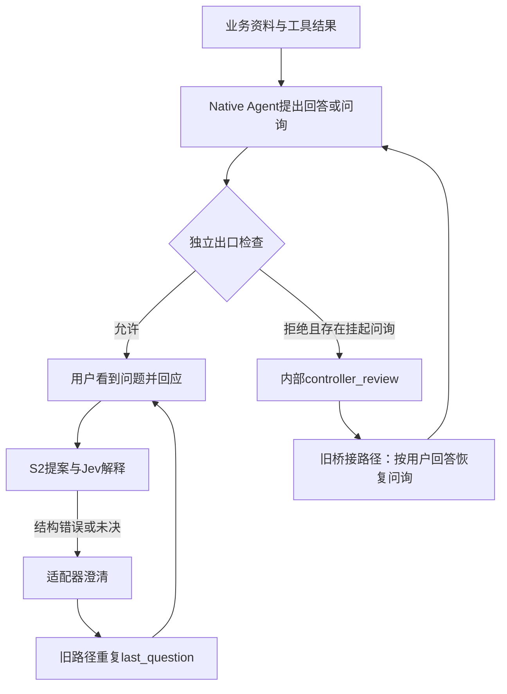

# 003 / 054逐轮失败分析与第一组TDD修复

## 结论

两题的正式reward均以**数据库最终状态（DB）**为依据，实际均不匹配，reward=0。`user_stop`是终止原因，不是评分公式；`action_checks`仅为辅助诊断，不能要求执行与参考完全相同的动作序列。

失败集中在“形成可用回答—接收后续信息—推进实际业务”这段链路。源码与原始模型请求还确认了一个来源错误：**挂起问询期间，内部审查被默认AskUserRail格式化成了用户回答。** 第一组确定性修复已完成，118项Python回归、Java来源检查及完整原生恢复夹具通过；本轮未调用付费模型、未重跑官方题目，不能宣称业务提分。

完整逐消息记录：[003：64条消息](task_003.md)、[054：72条消息](task_054.md)。机器记录：[003](task_003.json)、[054](task_054.json)。每条都关联原始轨迹或控制事件，原始文件保持不变。

## 两题各自如何走到失败

| 层次 | 003：产品咨询 | 054：组合业务 |
|---|---|---|
| 官方工具 | 25次，全部为KB检索 | 17次读取或能力解锁 |
| 内部候选回答 | 15次，全部被拦；用户未收到这些比较和建议 | 10次，只有最初身份问询通过，其余被拦 |
| 主要回答阻断 | 11次`unfinished-goal-declared-complete`；另有事实引用、覆盖度及数值比较未决 | 3次数值比较分类未决；事实覆盖、要求及引用检查多次未通过 |
| 输入路由 | 一次同目标重复context提案导致结构拒绝；后续仍有未决或需求覆盖不足 | 18次输入解释中14次未决，最后反复套用旧身份问题 |
| 未进入官方队列的尝试 | 无此类工具拒绝记录，问题集中在回答出口 | 2次身份日志、2次补卡、1次争议提交被阻断 |
| 可核查结果 | 未发生用户侧办卡申请，DB不匹配 | 未形成目标业务写入，DB不匹配 |



图中两处旧路径已在本组修复；出口拒绝、Jev未决和业务前提不足仍然有效，没有被改成放行。

## 003：证据、判断与边界

1. **检索没有及时收敛。** 消息3–52完成25次检索，有多次“查询某卡、返回其他产品或其他业务文档”的结果。此后15个候选回答都未通过出口检查，不能把内部已生成比较表等同于用户已得到推荐。公开逐轮表保留每个查询和结果。
2. **整体目标验收阻止了回答发布。** 首个完成提案的`conditions_complete=0.49`；其后的多个提案仍未超过0.7，部分还包含无效政策引用。11次拒绝不全是误报：需要分别核对事实是否充足、S2是否正确提取了“完整完成声明”。显式说“仍未完成”不应直接跳过事实检查；给出部分信息也不应被自动解释为完成全部业务。
3. **消息54的上下文被结构拒绝。** S2把收入/订阅信息与重述需求拆为同一目标的两条`context`，验证器把重复目标ID当作冲突，尚未调用Jev就返回`invalid_s2_proposal`。这是本组可确定修复的协议问题。
4. **后续办卡意图需要显式建模。** 用户后续明确要求“find and open”，原目标仍以查询/推荐为主。这个变化不宜只当作背景信息。后续TDD需验证新增办理义务和用户侧执行权，不能从隐藏参考中选择产品或替用户申请。
5. **内部问询来源混淆已在实际请求中出现。** 按工具消息内容去重，找到1条把`Independent controller review`放进`User has answered your questions:`的消息。证据位置见逐轮报告的来源小节。它证明协议错误；对最终分数的影响大小仍需修复后对照。

## 054：证据、判断与边界

1. **资料已收到，验证记录仍未写入。** 客户在消息14提供身份资料，路由为`ready/context_only`；后续同样有有效上下文更新。读取到账户和交易资料也不等于已成功调用`log_verification`。
2. **判断范围错位。** 首次`log_verification`提案包含“定位争议交易、收集争议细节、判断临时贷记资格、查询争议历史”等条件，`conditions_complete=0.20`。这些属于争议流程的内容；实际当前调用是身份日志。这直接表明S2没有把本步操作范围表达清楚。现有拒绝不能删除；下一组应按公开工具契约区分“单步前置条件”与“总目标完成条件”。
3. **其他拒绝也需要保留。** 后续补卡提案的`conditions_grounded=0.63/0.66`、`conditions_complete=0.25`；争议提案分别为0.55与0.15；第二次身份日志还引用了不存在的证据。本组没有将这些判断改为允许。
4. **边界值是未决，旧模板放大了问题。** 消息44对应的`covered=0.70`，按现有规则等于上界仍属未决，判定符合配置。适配器随后却重复旧身份问题；当时各目标没有记录中的用户等待事项，旧`last_question`也未因先前有效回复而退休。不断增加的澄清消息又带来更多待解决观察，形成循环。
5. **存在3条独立的审查→用户回答污染消息。** 来源问题与003一致。银行最终门禁仍阻止了写入，轨迹中没有观察到因此发生的越权银行操作。

## 第一组TDD：已实现并验证

| 编号 | 修复 | 必须保持的反例 | 验证 |
|---|---|---|---|
| F01 | 只归并同目标、原文有效且完全为context的片段；归并后仍由Jev核验 | 取消/修改/确认、虚构引用、超32候选不归并；不新增或关闭目标 | 4个归并测试、2个真实Java集成正反例 |
| F02 | 有效回复后，没有真实用户等待事项则清理旧问题指针；澄清模板从任务状态取得真实待答问题 | 另一目标仍待确认时保留其等待；不自动验证身份、同意操作或授予写权限 | 3个问题生命周期/恢复测试 |
| F03 | 审查恢复使用桥接器生成的来源信封；AskUserRail将其输出为`QUESTION_NOT_PUBLISHED`工具拒绝 | 用户JSON样式正文不能伪造控制事件；真实回复仍由默认用户回答流程处理；未知来源拒绝 | Java4项来源检查；真实挂起、重启及模拟写入夹具 |

F03首轮原生测试发现SDK持久化白名单不接受自定义类型。已改用SDK支持的标准容器，没有放宽反序列化白名单。失败目录`logs/full-native-question-provenance-20261118-b00/`保留；从新构建制品执行的最终夹具为`logs/full-native-question-provenance-20261118-b02/episodes/task_999/`。

测试日志与制品指纹见`logs/failure-analysis-first-tdd-20261118/`。测试模型和业务效果均为合成；没有重新计算003/054的官方分数。

## 下一组TDD优先级

1. **操作判断范围。** 对身份记录、争议提交、补卡分别按公开政策定义本步前置条件；总目标验收仍要求真正结果。合法单步有正例，缺身份/确认/证据有拒绝例。
2. **阶段性输出与整体完成。** 独立校验S2的完成声明提取，允许有证据的阶段性说明；缺证据不能靠“未完成”免责声明绕过检查。新增办理义务不能被context吞掉。
3. **阻断反馈与来源。** 区分客户资料缺失、政策证据缺失、提案无效和判断未决；控制器拒绝记录可证明本次尝试的进度，不能充当银行回执。避免把每种故障都转成要求客户重述。
4. **检索收敛。** 对持续未补足所需事实的调查建立可检查的停止/交接条件，保留官方工具与评分器，不能注入参考产品答案。

完成下一组后，再按最新代码各执行003/054一次独立诊断，并报告业务状态、官方分数与控制链验收。当前证据不足以把失败单独归因于Jev或Skill语言，仍需固定制品的对照；完整39项发布验收和正式22题比较继续关闭。

## 复现与审查边界

分析器只读取冻结证据，不导出参考动作参数、目标产品或隐藏数据库内容。它未被运行时导入，报告数据也未进入Agent或Jev输入。

```bash
.venv312/bin/python experiments/plan-4-agent-hub-refined-skills/python/analyze_episode_failures.py \
  --run logs/full-official-task003-20261118-b00 \
  --run logs/full-official-task054-20261118-b02 \
  --output /tmp/new-failure-analysis
```

参与实体是Python控制适配器、S2/Jev客户端、Java任务宿主、Native DeepAgent和Go操作控制器；没有新增Agent。控制器对Native的任务是有界委派，校验和反馈是调用/内部协议，未发现本组需要多Agent协商的理由。优先使用确定性归并、状态检查和来源信封。

局部架构审查按COM-03/04/08/09、CALL-04、DEL-07/08记录结构契约、故障分类、来源与验收问题；详见[结构化审查](focused-architecture-review.json)。审查范围包含两条冻结轨迹及相关源码，不代表完整方案或其他三组已验收。真实模型效果、任意并发轨迹和全部发布门禁仍在本组验证范围之外。
