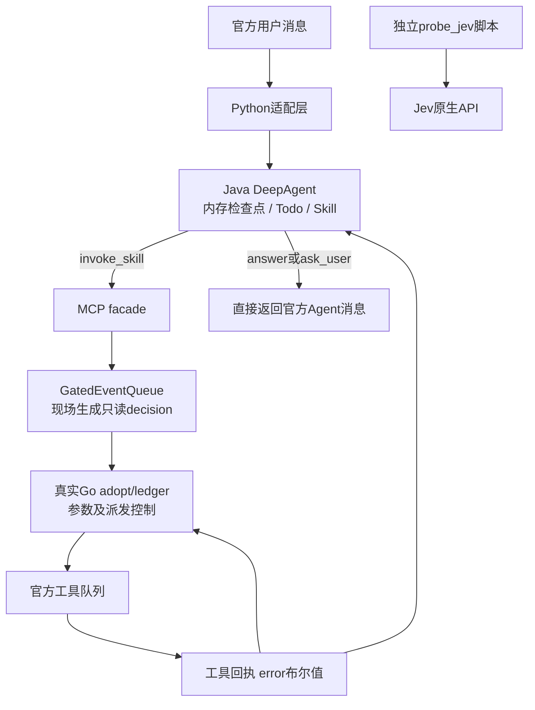

# LLM Evidence Control：代码对设计符合性审查

日期：2026-11-17。审查基准为[最新测试设计](../../plans/llm-evidence-control/test-design.md)和[39项规格](../../plans/llm-evidence-control/test-spec.json)。

**结论：现有代码只落实了早期只读pilot的部分机制，尚未按最新设计形成可执行的完整方案4。** Jev原生客户端和Go控制组件都是真实代码，但二者没有组成逐轮输入、业务判断、持久任务及官方写入的闭环。不能将当前pilot称为最新方案的端到端实现。

本次没有修改运行源码、设计或执行开关；新增审查记录，并重新构建Go制品。现有只读限制仍生效，未调用模型或执行官方业务。

## 1. 已实现与待实现

| 设计能力 | 当前判断 | 关键依据 |
|---|---|---|
| DeepAgent、Skill、MCP、官方调度 | 已有基础接线 | 工具参数校验、真实官方队列及官方评分入口 |
| 真实Go派发检查 | 已实现局部组件 | 深拷贝、摘要、同ID防重复、撤空grant拒绝及进程失联拒绝均有测试 |
| Jev原生问答 | 已实现独立探针，未业务接线 | 只有probe/test调用，没有每轮输入或判断提案消费者 |
| 逐轮意图与目标关联 | 未接线 | waitingId存在即作为恢复输入，缺少独立路由和歧义阻断 |
| 持久任务与注册节点 | 未接线 | 内存检查点、进程变量和原生Todo；无权威目标图及节点控制 |
| 业务证据、当前修订与权限 | 部分原语，业务层缺失 | 静态读目录与policy hash不能代表本次条件成立 |
| 合法银行写入 | 未实现 | pilot明确拒绝所有非读操作 |
| 推荐/总结验收 | 未实现 | answer/ask_user直接输出，Go门禁不覆盖文字建议 |
| 分层回执、部分完成和恢复 | 部分Go组件，任务链缺失 | 工具error布尔值决定完成，迟到回执缺少持续核对 |
| 累计预算与正式driver | 未接线 | 离线预算函数未进调用入口，新driver不存在 |

## 2. 当前实际链路

图中Jev分支与业务链路没有连线，这就是当前源码状态。这里是单个执行Agent调用工具和控制服务；Go、MCP、Jev客户端都没有独立自主目标生命周期，不是多Agent协商。组件清单、逐边请求/响应、控制归属及证据置信度见[结构化审查](assessment.json)。目标中有限S2委托的验收要求可用于检查缺口，不能反向宣称当前已实现该委托机制。

## 3. 按影响排序的发现

严重程度按“要执行完整22题方案”的目标评估。当前写入拒绝降低了实际风险；以下缺口不表示已经发生银行误操作。

### F01 每轮输入路由与Jev没有接入（high / CALL-01）

Jev仅被probe_jev和测试调用；Java在waitingId存在时直接把本轮query填入InteractiveInput，没有设计中的输入提案和歧义阻断。 取消、新目标或组合输入仍由执行模型处理；不能证明每轮独立解释后才续办。

依据：[run:75](../../../../shared/java/src/main/java/eval/DeepAgentBridge.java)、[main:60](../../python/probe_jev.py)、[generate_next_message:59](../../python/hub_pilot_agent.py)。

修复方向：先实现InputEnvelope、逐轮Jev解释、InputRouteProposal和原子提交；输入未决时阻止受影响派发。

### F02 持久任务与节点控制未接线（high / DEL-02）

Java显式使用InMemoryCheckpointer；pilot要求新建hub目录，未见目标图、WaitRecord、注册Workflow及目标修订协调器接线。 不能证明进程重启后恢复原任务，或A等待、B完成后按原位置接续A；Todo不是权威完成状态。

依据：[run:67](../../../../shared/java/src/main/java/eval/DeepAgentBridge.java)、[_start:25](../../python/hub_pilot_agent.py)、[constructor:89](../../../../shared/java/src/main/java/eval/DeepAgentAssembly.java)。

修复方向：实现Java确定性任务协调器、持久Goal/WaitRecord和节点注册；限定官方环境存活的恢复范围。

### F03 decision仍是临时只读许可（high / COM-03）

队列入口现场生成decision；pilot只检查读目录，以domain_policy的hash作为evidence版本，未传客户证据、goal/node或已采纳业务判断。 所有真实写入仍被拒绝，现有路径不具备完整22题业务执行能力；去掉只读条件也不会补齐业务判断。

依据：[_start.decision:39](../../python/hub_pilot_agent.py)、[put:23](../../python/hub_boundary.py)。

修复方向：新增前置证据快照、Jev原子观察、规则提案和Hub采纳；边界只消费有效引用并复查。

### F04 操作身份绑定调用ID（high / CALL-06）

business_request_id=session_id，operation_id=call.id；相同操作参数换调用ID在合成队列产生两条真实Go派发记录。 只能防同ID重发，无法表达重规划是否仍属同一业务意图；不代表本次发生真实重复银行写入。

依据：[_start.decision:42](../../python/hub_pilot_agent.py)、[SkillOperationTool.invokeInternal:142](../../../../shared/java/src/main/java/eval/DeepAgentAssembly.java)、[invoke:184](../../../../shared/python/benchmark_mcp.py)。

修复方向：由持久任务层分配business_request/goal/operation，attempt单列；增加同意图换调用ID反例。

### F05 回执和目标完成未分层（high / CALL-04）

HubPilotAgent._send只传success=not error；Go Complete只区分completed/failed。合成accepted回执按无错误登记completed。 该映射可代表读取调用完成，但不足以表示受理、等待、业务拒绝或总目标完成；当前只读限制使写入风险尚未开放。

依据：[_send:52](../../python/hub_pilot_agent.py)、[Complete:69](../../go/gate.go)。

修复方向：增加按工具契约解释的OperationReceipt与业务投影，再独立验收Goal。

### F06 推荐与最终答复没有独立验收（high / DEL-07）

Java把answer或ask_user文本直接emit；Python将content包装成AssistantMessage，仅做消息结构validate。 Go工具门禁管不到错误产品推荐或无依据总结；不能证明业务要求被完整满足。

依据：[run:100](../../../../shared/java/src/main/java/eval/DeepAgentBridge.java)、[generate_next_message:83](../../../../shared/python/java_agent.py)。

修复方向：增加推荐、ask_user选项及最终总结出口；绑定原始要求、证据和父子目标结果。

### F07 恢复仅覆盖Go组件，迟到回执仍可能中断（high / COM-05）

Go重开能把dispatched标为unresolved，但没有同官方环境核对与任务续接；MCP超时删除pending，迟到结果报Unknown or expired。 账本可加载不等于Agent可续跑；未完成操作和已到达回执缺乏完整关联处理。

依据：[OpenGate:19](../../go/gate.go)、[invoke/deliver:199](../../../../shared/python/benchmark_mcp.py)、[_start:25](../../python/hub_pilot_agent.py)。

修复方向：实现恢复入口、事件去重与持久回执，验证两个派发崩溃窗口；原环境丢失安全停止。

### F08 当前权限与有效目标修订未接线（high / COM-07）

live_grants再次运行同一静态decision，未关联已采纳目标修订或受控实时能力状态。 Go支持派发时检查grant，但应用层没有提供设计要求的当前授权事实。

依据：[_start:44](../../python/hub_pilot_agent.py)、[Dispatch:57](../../go/gate.go)。

修复方向：实现受控能力状态提供方和当前有效修订登记，测试取消/撤权/修订后的旧许可拒绝。

### F09 累计预算仅有离线辅助函数（high / COM-05）

正式调用上限512、Jev64及纠错/恢复次数尚未接入统一计数器；study_policy.dispatch_allowed仅见离线测试使用。 已有单请求超时、maxIterations和监督器期限不能证明跨轮、跨模型累计预算执行。

依据：[dispatch_allowed:1](../../../../shared/python/study_policy.py)、[constructor:96](../../../../shared/java/src/main/java/eval/DeepAgentAssembly.java)、[execute:122](../../../../shared/python/diagnostic_run.py)。

修复方向：在调用入口统一扣减预算并持久化；所有S1/S2调用、恢复与修正共享上限。

### F10 Jev版本和问题映射校验不完整（medium / CALL-04）

JevClient.ask只验证answers为dict及model为str，未核对每个请求问题；探针仅在请求MODEL固定名时检查实际模型，别名未校验期待版本。 正式设计默认别名加期待实际版本；直接复用探针无法满足H28/H29。模拟响应的空answers及意外模型被ask接受。

依据：[JevClient.ask:56](../../python/jev_provider.py)、[main:75](../../python/probe_jev.py)。

修复方向：在业务提供方验证期待实际版本、问题集合、各答案类型和Choice适用性；保留原生响应及输入引用。

### F11 Go子进程仍继承TypeSafe密钥变量（medium / COM-06）

HubGate只过滤OPENAI_API_KEY；以合成环境验证TYPESAFE_API_KEY仍进入子进程env。 Go不调用模型，未来从环境注入Jev密钥会扩大凭证可见范围；未发现或宣称密钥已经外传。

依据：[HubGate.__init__:19](../../python/hub_gate.py)。

修复方向：改为Go进程所需环境白名单，加入TYPESAFE_API_KEY不继承的回归；本次不修改代码。

### F12 新版正式driver及验收入口缺失（high / COM-09）

run_episode仅支持既有三种driver；诊断器对方案4正式模式抛NotImplementedError，pilot验收明确not-yet-evaluated。 无法通过当前启动参数运行llm-evidence-control；现有8个Python和2个Go测试不是39项完整验收。

依据：[driver selection:47](../../../../shared/python/run_episode.py)、[build_manifest:35](../../../../shared/python/diagnostic_run.py)、[execute:139](../../../../shared/python/diagnostic_run.py)。

修复方向：完整链路实现后新增driver、独立验收器与共同调度绑定；继续保持执行开关关闭。

## 4. 本次实际验证

| 检查 | 结果 | 能证明什么 |
|---|---|---|
| Go上游源码/Schema指纹检查 | 通过 | 使用锁定的真实Hub来源 |
| Go重新构建及测试 | 2项通过 | 参数绑定、同ID重复派发拒绝、账本重开未知状态等局部机制 |
| Python方案4测试 | 8项通过 | 3项实际Go边界/传输测试，5项mock Jev协议测试 |
| 针对缺口的合成探针 | 4项观察复现 | 换ID可再派发、布尔回执映射、Jev响应校验不完整、TypeSafe变量继承 |
| Java构建、真实Jev和官方业务E2E | 本次未执行 | 不给出新版业务成绩或端到端通过结论 |

具体命令、探针边界、源码及新Go制品hash见[验证记录](verification.json)。P01/P02使用真实Go但没有调用银行；P03/P04使用模拟响应及合成环境。导入tau2/LiteLLM触发公开价格表读取失败并回退本地备份，对上述本地断言无影响。

Jev请求/响应格式另外核对了[官方System One接口](https://docs.typesafe.ai/api/system-one.md)和[Noul定义](https://docs.typesafe.ai/primitives/noul)。原生概率答案与应用授权不同；客户端能解析Noul不代表业务判断已接入。

## 5. 39项契约逐项核对

“部分实现”表示基础机制存在，完整条款仍未验收；“未实现/未接线”限定于本次审查的运行路径；“缺少新版验证”用于真实模型观察。没有将任何一项完整新版契约标为通过。下表是审查判断，不修改原规格的not-run状态。

| 契约 | 状态 | 当前证据与缺口 |
|---|---|---|
| H01 判断协议 | 部分实现 | Go结构验证存在，应用判断提案/证据引用尚无接线。 |
| H02 证据隔离 | 未实现/未接线 | 仅policy hash，无客户/目标/时间覆盖证据检查。 |
| H03 执行倾向污染 | 缺少新版验证 | 新版执行倾向污染观察未运行。 |
| H04 数值与偏好 | 未实现/未接线 | 未见候选矩阵数值/偏好验证器；只存在提示要求。 |
| H05 推荐出口 | 未实现/未接线 | 最终文字和ask_user直接输出。 |
| H06 业务写入判断 | 未实现/未接线 | 非读操作明确拒绝，无合法银行写入链。 |
| H07 稳定操作身份 | 部分实现 | 同ID去重存在，业务意图身份未实现；P01换ID两次派发。 |
| H08 固定参数 | 部分实现 | 深拷贝和Go摘要验证已测试；完整包装操作/目标绑定未验收。 |
| H09 有效修订 | 未实现/未接线 | 未见当前有效目标/决策修订登记；原生版本字段不等于该机制。 |
| H10 实时权限 | 部分实现 | Go可拒绝空grants；运行时仍重复静态许可。 |
| H11 分层结果 | 部分实现 | 只有工具错误布尔映射；P02 accepted登记completed。 |
| H12 派发入队窗口 | 部分实现 | Go重开转unresolved，未覆盖两个真实入队故障窗口。 |
| H13 持久恢复 | 部分实现 | Go恢复有测试；Java为内存，pilot旧目录不可重入。 |
| H14 回执时序 | 部分实现 | 有调用ID关联；重复/迟到/取消回执未完整处理。 |
| H15 审计持久化 | 部分实现 | Go写入错误可返回拒绝，缺应用证据落盘失败全链测试。 |
| H16 控制失联 | 部分实现 | 真实Go、进程关闭拒绝和参数检查已测；其他故障组合未覆盖。 |
| H17 依赖与等待 | 未实现/未接线 | 仅Todo/提示词，没有权威目标依赖和A-B-A恢复链。 |
| H18 主体边界 | 部分实现 | 工厂不传隐藏task，pilot排除用户工具；完整合法写入主体未验收。 |
| H19 隔离重放 | 未实现/未接线 | 所审新版路径无隔离决策重放入口。 |
| H20 学习发布禁用 | 部分实现 | 每episode独立session和固定Skill，未见新版跨题残留专项。 |
| H21 变异检查 | 未实现/未接线 | 现有测试无固定allow/删除校验/输出旁路变异。 |
| H22 预算计量 | 部分实现 | 有墙钟/单请求超时；累计预算函数未接运行链。 |
| H23 未知与拒绝 | 未实现/未接线 | Jev探针有unknown，但没有业务补证/拒绝/修正状态机。 |
| H24 判断能力观察 | 缺少新版验证 | 历史6探针不等于新版24次独立观察。 |
| H25 受控节点路由 | 未实现/未接线 | 无注册Workflow/Loop/等待节点的采纳与路由。 |
| H26 状态所有权与并发修订 | 部分实现 | Go局部锁/原生旧写者保护存在，任务修订与跨存储投影未接。 |
| H27 有界重入与取消 | 部分实现 | 监督器可终止，未有目标取消和持久有界重入。 |
| H28 Jev原生协议与业务适配 | 部分实现 | Noul/Box解析及异常测试存在，Choice/应用提案适配缺失。 |
| H29 Jev版本与用量 | 部分实现 | usage与探针固定名检查存在，别名漂移和共享预算未接。 |
| H30 S1组合与未决分支 | 部分实现 | 只有相关性与支持两问的探针三分支，无完整业务真值表。 |
| H31 自由文本与事件分流 | 未实现/未接线 | 新文本直接交DeepAgent；无Jev输入分流和消息去重。 |
| H32 多目标与歧义 | 未实现/未接线 | 未见多目标路由/歧义阻断；waitingId直接填值。 |
| H33 输入路由提交 | 未实现/未接线 | 无message级期待revision和新输入派发阻断。 |
| H34 episode与隐藏输入隔离 | 部分实现 | episode UUID和工厂隔离已有，目标候选/终止索引未实现。 |
| H35 公开确认与时间 | 部分实现 | 官方政策进入提示词，没有目标/参数绑定确认记录。 |
| H36 官方终止与环境恢复 | 部分实现 | 监督器期限/取消及官方终止已有，环境恢复与待办持久化未接。 |
| H37 完整接线与旁路 | 部分实现 | 最终工具队列接Go，输入/节点/推荐完整旁路检查缺失。 |
| H38 目标覆盖与分层完成 | 未实现/未接线 | 目标覆盖及父子验收未实现；Todo仍由S2自报。 |
| H39 双层日志与可追溯性 | 部分实现 | 已有session/tool/Go日志，缺输入路由/目标/S1全链关联。 |

逐项源码定位见[契约映射](contract-coverage.json)。全部37个阻塞项与2个模型观察项仍需按新版验收；不以测试函数数量换算设计完成百分比。

## 6. 硬性检查、复杂度与评分边界

- 已有显式MCP/Go/模型超时、禁止自动业务重试、单并行工具限制及进程清理。没有发现无限递归子Agent创建；`addGeneralPurposeAgent(false)`明确关闭该能力。
- 完整目标的硬性缺口是：没有持久任务生命周期与可恢复交付位置；最终输出没有独立验收；要求恢复时仍依赖重建内存会话。这些使整体风险至少为high。
- 当前只读模式拒绝银行写入，不能将“完整写入前置校验缺失”写成“当前真实银行写入无保护”；同样不能因全拒绝就判合法业务链通过。
- Go上游已有进程内锁及旧写者检查，不能笼统称没有一致性控制。未证明的是应用任务修订、独立宿主互斥及跨存储核对。上游持久性声明为进程崩溃级，未声明断电级保障。
- 任务协调器应采用确定性状态服务；Jev保留问答接口，Go保留控制服务，无需增加另一个ReAct Agent或七个业务Agent。

按架构审查技能，对完整目标暂评 **52/100，高风险、主要控制链缺失**：通用边界24/40、有限调用控制20/50、复杂度8/10。该分数是审查判断，不是52%完成率、官方reward或模型准确率；调用分项评估的是单Agent对工具/服务的控制质量，不宣称存在Agent间协作。

## 7. 下一步实施顺序

1. J0/J1：输入事件、持久目标、逐轮Jev路由及歧义阻断。
2. J2/J3：前置判断、推荐出口、稳定操作身份、有效修订与一条真实合法写入/拒绝闭环。
3. J4：业务回执、父子目标验收、A等待→B完成→A续接及同官方环境恢复。
4. J5：累计预算、版本和凭证边界、正式driver与完整验收；四组共同条件齐全后再冻结22题单轮执行。

这些是建议工作包，本次未修改运行代码或启动实施。历史只读测试、Jev接口探针和本次组件测试分别保留原有证据范围。
