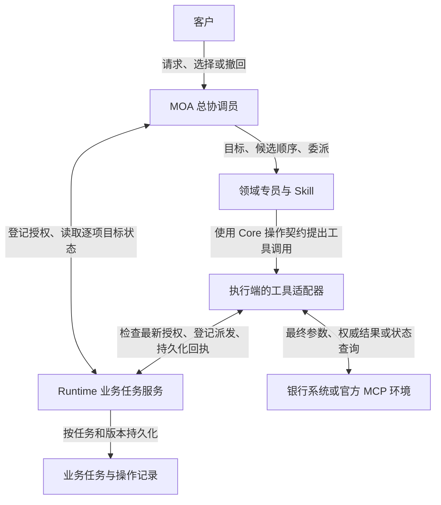
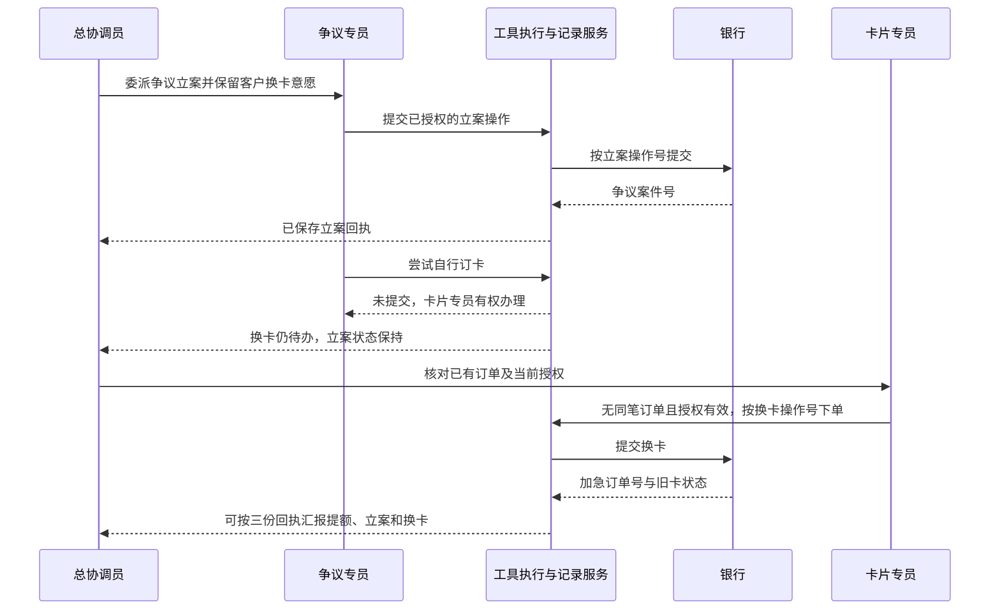

# 怎样让 openJiuwen 可靠地办完一件跨 Agent 的业务

设计建议 · 2026-11-18 · 基于本地 Java 源码和银行实验记录

**建议从“可信业务回执”和“按客户授权派发”两项能力开始。** 客户同意做三件事，框架就应能逐项回答“谁有权办、哪一步已提交、凭什么说已办成、下一步还可以做什么”。模型负责解释需求、查政策和提出方案。Core 提供通用的操作契约与状态转换，Runtime 负责可靠保存、派发及恢复，MOA 使用这些能力协调专员。银行系统对实际账户和订单保持最终解释权。

## 一、哪些问题值得下沉到框架

| 测试中发生的事 | 哪部分可由程序保证 | 还需要人或模型判断什么 |
| --- | --- | --- |
| 054 的 v9 批次已提额、已立案。争议专员随后越权下单被拒，卡片专员被跳过，总协调员却告知客户“没有立案”。 | 给每一笔写入独立编号和回执。后续失败只能更新失败的那一步。换卡目标须有订单或等价的权威查询才能完成。 | 是否先提额、让旧卡短暂保持有效，由客户了解风险后选择。v10 通过的那次是客户主动提出先提额。 |
| 060 的早期版本先关闭唯一满足开户年限的活期账户，储蓄户随即开不成。 | 若政策和账户资料已说明开户依赖这个账户，冻结计划前应发现“先销户会破坏开户资格”，执行前再验证。 | 规则不清楚时要查政策。客户若坚持先销户，应告知后果并尊重选择。后来 v9 顺序已正确，仅销户原因文字与参考不同，是另一种失分。 |
| 043 的客户从销卡改为保卡并减免年费。旧版仍停留在原候选专员的选择中。051 又曾把转人工解释成付款已交接。 | 客户变更决定时作废冲突的待执行操作和旧问题。只把转接回执映射为“已转接”。此前成功的还款仍保留。 | 新说法是否真的改变目标，含糊时向客户问一个具体问题。 |
| 022 检查了 77 笔交易，实际提交五笔。漏查了一项商户例外，还把四笔已发现的多计返现转给人工。 | 对已取得的交易逐笔追踪。记录适用政策、证据、差额和处置，对未判定条目保留缺口。 | 工具查全了多少交易、哪条政策适用、多计是否应提交，仍需领域依据。框架无法从一个题号推导正确笔数。 |
| 方案 4 的一次 054 使用与 MOA v10 相同的冻结 Skill。18 次查询和 6 次工具解锁均有记录，银行业务写入为零，官方给 0 分。 | 检查能否把合法提案推进到写入。拒绝时指出具体缺哪项、谁能补、怎样恢复。 | 单凭这次运行不能断言所有拒绝都错误，也不能把 MOA 与 Hub 两条路线的差异单独归因于 Skill。 |

以上是历史运行结果。身份核验、权限、证据来源和回包归属适合做确定性检查。自由文本精确匹配、产品推荐偏好和未查到的业务例外，均不能承诺通过升级框架消除。[MOA 六阶段复盘](../../../experiments/plan-3-moa-refined-skills/reports/moa-main-task054-debug-retrospective-20261117.md) · [v9 逐题分析](../../../experiments/plan-3-moa-refined-skills/reports/moa-v9-single-round-20261118-analysis.md) · [方案 4 的 054 实测](../../../experiments/plan-4-agent-hub-refined-skills/reports/hub-frozen-guides-task054-20261118.md)

## 二、现有 Java 能力可以接在哪里

以下是已核对的源码。Core 与 Runtime 均取当前工作区的 develop 版本，MOA 取 agent-solution 的 common 版本。相邻仓库链接按三个仓库与 tau3 同级检出解析。实验实际装配使用了适配层及补丁，源码能力与某次实验所启用的能力应分别核验。

| 层与版本 | 现有能力和实际边界 | 建议的改动 |
| --- | --- | --- |
| agent-core-java，`1ffbfb81a` | `AgentRail` 有模型和工具前后回调。`ToolCard` 已有参数、扩展属性和幂等标记。`TaskManager` 管理父子任务和状态快照。`TaskPlanningRail` 维护 Todo，Checkpointer 保存执行现场。 | 在工具注册侧提供可选的**业务操作契约**，在工具执行与输出处消费。复用任务和检查点承载引用，新增纯 Java 的状态转换、前置条件校验及结果映射接口。 |
| agent-runtime-java，`77004f14` | 已有 A2A Task 存储、批次关联和回调续接。`RemoteInvocationBatchCoordinator` 能从持久化的批次记录恢复关联，`A2ATaskContinuation` 能在相应等待态续接。Redis TaskStore 的保存采用覆盖写。 | 增加带版本条件的**业务操作存储接口**、最终派发及按原操作号对账。沿用 A2A Task 查询和续接通道，另行保存业务操作号。A2A 快照覆盖写不能充当并发授权裁决。 |
| agent-solution / MOA，`0298dcd28` | `StagePlanningRail` 已做分阶段规划、确认、冻结和串行派发，支持前序依赖与条件。`OperationCompletionListener` 可接完成事件，但直接 A2A 通知止于委派，进程内回调是尽力投递。原生 MOA 明确限制未完成远端 Todo 的现场恢复。 | 让原有规划器先提交候选阶段和依据，在冻结处校验。在原有 A2A 委派上携带业务任务、授权版本和所需结果。将监听器用于通知，权威记录来自实际工具执行边界。 |
| 实验已做的部分 | MOA v10 的 `DomainBoundary` 已能检查包装工具内的真实操作，`ReceiptContext` 已让 MAIN 看见部分回执。方案 4 已有 Java 任务协调器原型及独立控制链。 | 优先把这两条路径共用的契约抽出来。实验内 Python 回执缓存可作为行为对照。若部署已经由 Hub 持有业务任务，则由 Hub 实现同一存储和状态转换接口，Runtime 做执行适配。每个任务只有一个业务状态写入方。 |

核查入口：[Core 工具回调](../../../../agent-core-java/core/src/main/java/com/openjiuwen/core/singleagent/rail/AgentRail.java) · [工具卡](../../../../agent-core-java/core/src/main/java/com/openjiuwen/core/foundation/tool/ToolCard.java) · [父子任务](../../../../agent-core-java/core/src/main/java/com/openjiuwen/core/controller/modules/TaskManager.java) · [Todo](../../../../agent-core-java/core/src/main/java/com/openjiuwen/harness/rails/TaskPlanningRail.java) · [检查点](../../../../agent-core-java/core/src/main/java/com/openjiuwen/core/session/checkpointer/Checkpointer.java)

运行与实验接线：[Runtime 远端批次](../../../../agent-runtime-java/service/agent-service-app/src/main/java/com/openjiuwen/service/app/orchestrator/RemoteInvocationBatchCoordinator.java) · [A2A 续接](../../../../agent-runtime-java/service/agent-service-app/src/main/java/com/openjiuwen/service/app/controller/a2a/A2ATaskContinuation.java) · [Redis TaskStore](../../../../agent-runtime-java/service/agent-service-app/src/main/java/com/openjiuwen/service/app/controller/a2a/RedisTaskStore.java) · [MOA 冻结与执行入口](../../../../agent-solution/common/agents/moa-agent/src/main/java/com/moaagent/agent/planning/StagePlanningRail.java) · [MOA 操作完成通知](../../../../agent-solution/common/agents/moa-agent/docs/operation-completion.md) · [MOA 远端恢复边界](../../../../agent-solution/common/agents/moa-agent/docs/suspended-tasks.md) · [实验的真实工具边界](../../../experiments/plan-3-moa-refined-skills/python/domain_boundary.py) · [业务回执](../../../experiments/plan-3-moa-refined-skills/python/receipt_context.py) · [方案 4 协调器](../../../experiments/plan-4-agent-hub-refined-skills/java/src/main/java/eval/hub/TaskCoordinator.java)

## 三、目标架构与调用流程

下图是建议设计。第一版可以在现有 Java 进程中装配。多进程部署时，各专员通过有身份校验的接口访问同一个业务状态写入方。

**职责划分。** 银行定义“什么算立案、什么算换卡”，提供可公开查询的政策、操作契约和回执解释器。Core 定义契约怎样表示、校验、测试。Runtime 负责在副作用发生的边界强制执行，并在重启后找到同一笔操作。MOA 负责组织各方、解释方案和与客户交互。模型能建议状态变化，只有客户输入、授权来源、可信工具回执或权威回查能满足相应的事实条件。

**代码落点。** Core 的 `core` 模块提供类型、契约注册表和纯函数校验。Runtime 的 `agent-service-spec` 放跨进程数据结构与存储接口，`agent-service-app` 编排持久写入、派发及恢复，`agent-service-adapters-agentcore` 连接 Core 工具生命周期。MOA 在已有的计划冻结、委派和对客输出位置消费这些接口。对于由远端 MCP 适配器直接产生写入的路径，同样要求最终适配器登记操作。现有 `ToolCard.toolInfo()` 只投影名称、描述、入参，把新字段仅写入工具卡并不能使远端自动遵守契约。建议让双方在接入时核对契约版本，并把可信调用者身份绑定到实际连接。

### 1. 先查影响，再冻结候选计划

对跨领域、会改变同一资源的请求，原生规划先进入只读阶段。只询问相关专员，返回受影响的账户或卡片、拟执行操作、适用政策引用、仍缺的事实。框架校验引用来源和版本，按资源交集检查一个操作是否破坏另一步的前提。先办哪一件有真实代价时，给客户呈现可行顺序及风险。客户选择后才冻结该版计划。单个只读问题可以直接回答。

例如开户需要继续持有一户满足年限的活期账户。只有查询确认将关闭的是**唯一**符合条件的账户，框架才应标出依赖。若客户还有另一户符合条件，“先销再开”也可能可行。政策只有散文、提供方没有结构化声明时，专员可提出附条款来源的条件。在领域适配器确认或权威查询验证之前，将其标为待核实。硬编码题号、产品名或固定顺序无法通过这个反例。

### 2. 把每次委派变成有边界的工作说明

专员接收一份结构化委派，包含客户原意与对应消息、已确认的目标、授权版本、允许读还是允许写、本人负责的操作、其他领域负责的操作、希望返回的凭据。用 054 举例，争议专员应收到“客户要求换卡，请登记该选择，订单由卡片专员负责”。业务字段“希望换卡”和动作“下换卡单”分别建模，权限限制便不会被误解为让客户保卡。

客户确认界面只从计划生成动作、对象、后果和仍需选择的事项。客户原文、工具结果和内部审查意见分别带来源类型。内部意见不能生成授权。客户明确变更计划时，只使冲突且尚未派发的操作失效。已经派发的按原编号查状态，已成功的保留。金额、对象、风险或其他实质条件变化才重新确认，相同问题和仍有效的核验可以复用。

### 3. 在最后一次工具派发处执行检查

建议由工具提供方发布有版本的 `OperationContract`。最小字段为操作及执行者、业务资源、参数模式、读写属性、执行前须满足的事实、成功后可证明的事实、回执或查询映射、是否支持业务幂等键。运行时分别保存**工具参数、业务前提、本次预期效果**。例如用户编号可以是必填参数，完成身份核验可以是登记前提，而“已成功登记”只能是登记的效果。把效果再当作前提会使第一笔合法登记永远无法执行。

在实验链路中，外层可能只看到 `invoke_skill`，里面还有发现工具、解锁工具和真正执行的工具。执行端必须在解析最终操作名、目标资源和参数后，检查执行者、当前授权版本和已验证的前提，再提交。发现、解锁和查询各自只能产生对应事实。越权应返回“尚未提交、哪个领域有权处理”；缺前提应返回具体缺项、可补证的动作及来源。拒绝结果要同时送给提出计划的一方及实际执行者。同一提案在证据未变时停止重复审查，转为一次具体查询、澄清或人工接办。

对于有权威契约、当前授权和充分证据的合法操作，确定性检查通过就可以继续。对于只能依靠文本解释的高影响条件，保留有依据的复核和待核实出口。单独的模型“完整性分数”不能作为所有写入的共同开关，否则系统可能始终安全地停在查询阶段。没有业务契约的存量工具可继续走原路径，并在能力目录标出其保障等级。需强保障的写入只接入已适配的最终执行入口。

### 4. 按业务操作恢复，并让客户看到真实的部分进度

建议把下列接口先做成小范围、可选的 Java SPI。名字表示拟议职责，不代表上游已有这些 API。

| 接口或数据 | 写入方与最小规则 |
| --- | --- |
| 业务任务状态与 `applyChange(taskId, expectedRevision, change)` | 协调服务是唯一写入方。用条件更新防止旧计划覆盖新选择。分别保存每个目标的完成条件、授权来源、等待原因。Todo 的“已完成”仅用于执行进度。 |
| `prepareDispatch(operationId, expectedRevision, actor, arguments)` | 在真实派发前，按租户、业务任务和操作号，用同一事务检查授权版本、记录最终参数摘要并写入待发送记录。操作号由框架为该次业务意图生成，在 A2A 任务重建和工具重试时保持稳定。工具调用号只标识某次尝试。同一编号、不同有效参数应拒绝并重新判断授权。 |
| `recordReceipt(operationId, attemptId, providerReference, outcome)` | 最终工具适配器按来源、租户和业务资源关联。先持久保存，再唤醒 MAIN。去重重复回调，允许迟到回执更新原操作。已受理、已生效、已拒绝和结果未知分别表达。受理争议不能把退款标为到账。 |
| `reconcile(operationId)` 与结案视图 | 恢复时先读操作记录，必要时按业务编号查提供方，再用 Core 执行检查点恢复下一步。逐项目标只由契约允许的回执或权威查询关闭。金额、案件状态、订单是否存在等事实由结构化视图生成客户摘要。 |

例如外部写入已发出但回包丢失，或程序刚登记派发就宕机，恢复者都可能无法判断银行是否已执行。优先用原业务凭据查询。只有提供方承诺同键幂等且本次授权仍有效，才按其协议使用原键重试。没有查询或幂等能力时保留“结果待核实”，提供人工接办入口。撤回先于派发登记生效就拦住该写入；撤回晚于派发登记时标明“可能已发出”，按提供方能力查询或申请撤销。框架内的一次条件更新无法把远端银行操作也变成同一笔数据库事务。

## 四、用 054 验证新设计能否改变失败路径

下面演示的是**建议设计下的异常路径**，历史 v9 真实轨迹到“漏下单、误报未立案”为止。图从提额成功后的时刻开始，此时已有提额回执。假设客户已授权办理争议与单独换卡，若授权不足则需重新询问。

在相同故障处，最小可接受结果是客户先收到“额度已生效，争议已立案，换卡尚未提交”。能在原授权内改派才继续办理。如果卡片专员调用超时，客户应得到“换卡结果待核实”，已有两份回执仍然有效。该机制降低漏办、误报和重复办理风险。它不会自动证明客户在没有提示时也会接受先提额。

## 五、实施顺序与验收

| 阶段 | 唯一牵头方 | 可独立交付与验收 |
| --- | --- | --- |
| 1 · 让业务回执可见 | Runtime 维护方 | Core 先提供最小回执类型，Runtime 接争议与换卡两个工具和一个持久库，MOA 从状态视图汇报。用“先成功一笔，再拒绝一笔”和“回执先到、专员随后退出”验证。每次都须保住第一笔，汇报错已办状态的次数为零。 |
| 2 · 让权限、授权和依赖可执行 | Core 维护方 | 发布可选操作契约，MOA 在冻结处检查，Runtime 在实际写入前复核。合成用例同时覆盖合法首次登记、缺少授权、错误领域、有第二个合格账户、客户途中改意。分别统计有依据的合法操作放行率和禁止操作的实际写入数。 |
| 3 · 在中断后继续办理 | Runtime 维护方 | 打通稳定操作号、查询、回调去重和条件更新。注入丢回包、重复回包、跨进程重启、并发撤回。已确认成功的业务重复写入为零，未知业务没有被说成失败或成功，仍有授权的独立事项可推进。 |
| 4 · 验证客户是否办成 | 评测负责人 | 先用与题目无关的合成场景做故障与反例测试，再固定模型、prompt、Skill、题集和评测条件。预先选 054（多项业务）、043（中途改意）、031（明确保卡的对照），新版本每题一次。沿用既有同题结果作描述性对照，记录第一份建议、确认次数、合法写入是否被拦、耗时和官方得分。 |

在合成环境中分别开关“持久回执”“派发校验”，用相同输入确定单个改动能否修正相应故障。三题真实运行只检验这些场景是否办成，同时记录风险被正确拦住和合法操作被误拦的情况。官方参考操作、评分数据库和离线答案始终留在评测侧。业务适配器的知识来自公开政策、授权配置、工具契约和本次客户选择。此文是设计评估，新增能力与成功率提升仍待实现和实测。
