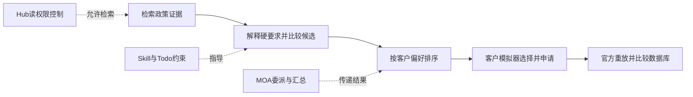

# 四方案执行效果与失败机制复核

日期：2026-11-17。范围：当前四方案目录中的 6 次真实模型诊断；均为 `task_003` 信用卡咨询。此次仅分析已有轨迹、模型可见工具结果及代码，不修改运行记录、不调用模型、不重新测试。

## 1. 结论与证据边界

**当前主要问题发生在“证据 → 条件判断 → 推荐”之间。MCP 调通、Todo 完成、A2A 返回和 Go 放行，都不能替代业务结论校验。**

- 方案 1：链路完成，但把“至少可达 100,000”收紧成“超过 100,000”，错误排除 Silver；还发生一次未注册工具调用错误向客户泄露。
- 方案 2：官方结果成功，比较表包含正确候选；但推荐顺序仍违背客户优先级，最终由模拟用户选对 Silver。因此是“本次终态成功”，不是“推荐逻辑完全正确”。
- 方案 3：真实跨 Runtime 委派成立，但早期确认阻塞、后期主 Agent 汇总失真；还没有实证完成用户要求的 A 暂停 → B 完成 → A 恢复。
- 方案 4：实际 Go 读操作管控成立，但没有业务语义裁决。Silver 的关键证据已经进入模型，仍被标记不确定。不能把这次失败归因于完整 Hub 架构，也不能把读管控成功解释成业务正确。

6 次运行不是 6 个独立用例。最新各方案只有同一道题的 1 次结果；不得换算为稳定成功率或框架排名。方案 1/2 是同一 DeepAgent 的不同 Skill 配置，方案 4 仍以 DeepAgent 为业务执行器，并不是四种完全独立模型。

## 2. 运行事实

| 方案 / 诊断 | reward | Agent 官方工具调用 | 官方消息数 | 单次耗时 | 本次证明的范围 |
|---|---:|---:|---:|---:|---|
| 1：早期 attempt-01 | 0 | 18 | 50 | 152.2 秒 | 早期接线诊断；重试配置修正前 |
| 1：zero-retry，主要分析对象 | 0 | 15 | 40 | 136.4 秒 | DeepAgent → Skill/MCP → 官方工具 → 评分 |
| 2：refined Skill | 1 | 18 | 48 | 160.9 秒 | 相同链路、实际加载业务指南、正确申请终态 |
| 3：早期 seven-runtime pilot | 0 | 0 | 8 | 55.9 秒 | 实际启动 8 个 Runtime，但确认阶段退出 |
| 3：English-confirmation pilot | 0 | 22 | 58 | 254.0 秒 | 8 个 Runtime；2 个业务 Agent 实际发出工具调用 |
| 4：actual-Go-read pilot | 0 | 9 | 28 | 119.1 秒 | 9 次 Go dispatch/complete 与官方调用 ID 对齐 |

来源：[运行索引](tdd-run-index.json)。名称 `seven-runtime` 指 7 个业务 Runtime，加主 Runtime 实际为 8 个。耗时含用户模拟和框架交互等开销，不是纯模型延迟；早期 MOA 较快是提前失败，Hub 较快也不能据此判断效率更高。官方工具调用数不包含 Skill 加载、Todo 和全部内部模型调用。现有统计不足以给出完整多层 Token/费用对比。

## 3. 本题到底怎样算成功

客户有 Rho-Bank+，收入 180,000 美元，旅行是主要开支。硬要求：零外汇手续费、有购买保护、**额度有可能达到至少 100,000 美元**。偏好顺序：先最低年费，再比较现金返还；不是先最高额度或最高卡等级。

| 产品 | 与本题相关的已检索事实 | 决策意义 |
|---|---|---|
| Silver Rewards Card | 年费 0；订阅后外汇费 0；购买保护 90 天 / 3,000；额度 10,000–100,000；旅行/软件返现 4% | 满足额度边界；按题设旅行主消费和偏好，应保留并优先考虑 |
| Gold Rewards Card | 年费 0；需订阅；外汇费 0；购买保护 105 天 / 7,500；额度 17,500–112,500；全类返现 2.5% | 符合硬要求，但更高额度、保护额不是客户优先排序条件 |
| Platinum Rewards Card | 年费 200；额度可达 150,000；返现 10% | 更高返现不应自动覆盖“最低年费优先” |

这些是测试知识库产品，不是现实金融产品建议。公开额度范围只说明可能性，不保证审批结果；缺少信用评分要标记资格待确认，不能凭空把客户固定到某档信用评分。

[任务定义](/home/vincent/openjiuwen/tau3/.deps/tau2-bench/data/tau2/domains/banking_knowledge/tasks/task_003.json:10)规定参考终态由 **user** 调用 `apply_for_credit_card(card_type="Silver Rewards Card", ...)` 产生，reward_basis 为 **DB**。[官方评分实现](/home/vincent/openjiuwen/tau3/.deps/tau2-bench/src/tau2/evaluator/evaluator_env.py:95)分别重放实际轨迹和参考动作，再比较双方数据库哈希；不是按文笔、工具数量、Todo 完成率打分，也不是要求每一步与参考轨迹完全一致。

四组最后的真实申请均由用户模拟器发起。方案 1/3/4 成功提交了 Gold 申请，工具层没有报提交失败；但 Gold 与参考 Silver 终态不同，所以业务 reward=0。方案 2 提交 Silver，reward=1。不得说 Agent 直接提交或银行已批准信用卡。

## 4. 方案 1：原始 Skill 的成功与失败

### 实际成功的部分

实际读取 `SKILL.md`、`operations.json`，后续 15 次 `invoke_skill` 进入官方 KB_search 并收到结果；最终可评分。产品信息并非完全缺失，回答已经写出 Silver 的 100,000 上限。链路接线检查通过有依据。

### 首个异常：工具名和能力名混用

首次模型响应在读取 Skill 的同批工具请求中，直接调用 `KB_search`，而已注册入口要求 `invoke_skill(operation="KB_search", ...)`。Java 桥将 `Ability not found in resource_mgr: KB_search` 作为普通 content 返回给客户。证据：[官方轨迹第 3 行](/home/vincent/openjiuwen/tau3/experiments/plan-1-deepagent-original-skills/runs/tdd-zero-retry-product-consultation/episodes/task_003/official-trajectory.jsonl:3)；对应 DeepAgent 事件第 6 行和 Java 桥记录第 4 行。

这是工具使用与错误隔离缺陷，不是 MCP 服务没有资料。后续转为正确调用，说明该异常不是最终 reward=0 的唯一原因。现有 `inspect_deepagent` 检查接线、资产和评分保真，不检查所有客户可见错误，因此它的 passed 不能升级为“运行全程无缺陷”。

### 决定业务失败的步骤

[第 35 行推荐](/home/vincent/openjiuwen/tau3/experiments/plan-1-deepagent-original-skills/runs/tdd-zero-retry-product-consultation/episodes/task_003/official-trajectory.jsonl:35)把 Silver 列为 close match，并强调“caps at exactly 100,000, so it can't go above that”。客户原要求是 `>=100000`，回答却用 `>100000` 排除它；又用 Gold 更高额度、Platinum 更高返现强化推荐。[第 36 行](/home/vincent/openjiuwen/tau3/experiments/plan-1-deepagent-original-skills/runs/tdd-zero-retry-product-consultation/episodes/task_003/official-trajectory.jsonl:36)客户随后选择 Gold。

直接证据支持“阈值解释和排序错误”；不能据此推出原始 Skill 必然失败。该组与方案 2 一样使用 `evidence-todo-v1` 系统规则，不是完全没有 Todo 要求；但本次工具事件中没有 `todo_create/modify`。原始入口未提供针对本业务的候选比较流程，可能降低了遵循度，这是机制假设而非已证明的单一因果。

## 5. 方案 2：为什么成功，又为什么不能称为完全解决

### 观察到的改善

实际加载 `guides/credit-card/card-application.md`，创建 4 项 Todo，执行 4 次修改。[第 41 行比较表](/home/vincent/openjiuwen/tau3/experiments/plan-2-deepagent-refined-skills/runs/tdd-product-consultation-attempt-01/episodes/task_003/official-trajectory.jsonl:41)明确把 Silver 列入满足三项硬要求的候选，写清订阅免外汇费、购买保护、100,000 上限和旅行返现。相比方案 1，这让正确选项进入可决策信息集合。

### 得分掩盖的残留错误

同一回答的推荐段却说：750+ 优先 Platinum，720–749 优先 Gold，680–719 才优先 Silver。这不是客户要求的“合格候选中先最低年费，再按主消费比较返现”。高信用评分只扩大可选范围，不应自动使 Silver 失去优势；邀请制 Diamond 也不应仅按分数当作当前可申请候选。

[第 42 行](/home/vincent/openjiuwen/tau3/experiments/plan-2-deepagent-refined-skills/runs/tdd-product-consultation-attempt-01/episodes/task_003/official-trajectory.jsonl:42)用户模拟器自行申请 Silver；先用了无效简称 `Silver Rewards`，工具返回合法枚举，[第 44 行](/home/vincent/openjiuwen/tau3/experiments/plan-2-deepagent-refined-skills/runs/tdd-product-consultation-attempt-01/episodes/task_003/official-trajectory.jsonl:44)改为 `Silver Rewards Card` 后提交成功。第 46 行用户说明选择 Silver 的理由，符合本题偏好。

因此，本次成功是 **正确候选信息 + 用户模拟器正确决策 + 正确申请终态**。不能表述为“Agent 已正确选出唯一最佳卡”。简称重试属于用户工具参数错误，由模拟器自行纠正，不是框架自动重试或 Agent 的银行写入重试。

### 对 Skill 的合理评价

业务指南已真实使用，不是只有部署文件。它要求“硬要求与偏好分开、筛选后排序”，但当前依然依靠模型自觉执行。Todo 状态可被模型更新为完成，尚无独立验证证明每项约束都被正确比较。此题说明指南可能改善覆盖和组织方式，不能证明它已经保证推荐正确。

## 6. 方案 3：MOA 的两类失败要分开

### 早期失败是确认流程阻塞

初次 pilot 没有官方工具调用。[第 3 行](/home/vincent/openjiuwen/tau3/experiments/plan-3-moa-refined-skills/runs/tdd-seven-runtime-product-pilot/episodes/task_003/official-trajectory.jsonl:3)向英文客户展示中文高风险计划确认；客户澄清需求仍继续遇到确认要求，最后第 8 行退出。[Runtime 装配](/home/vincent/openjiuwen/tau3/experiments/plan-3-moa-refined-skills/java/src/eval/BankingRuntimeHost.java:29)把业务卡统一设置为 `Risk.HIGH`，将只读产品咨询也纳入确认流程。

本次根因是风险分类、确认交互和语言约束不适合场景。不能解释成业务 Agent 检索失败，因为还没走到检索。

### 后期成功证明了真实委派，不等于完整协作验收

后期实际启动主 Runtime + 7 个业务 Runtime。card-application-agent 发出 21 次 KB 调用，credit-limit-agent 发出 1 次；两者加载相关指南并返回结果。它们有不同职责和操作边界，不是只改名称的虚构 Agent。

主 Agent 委派目标，业务 Agent 自行选择中间检索步骤，主 Agent 再接回流程：属于 **Delegation（委派）**。A2A 是传输方式；没有证据证明本次存在业务 Agent 间持续双向协商的 Coordination。也没有本次完成跨目标暂停/恢复的证据。

### 决定失败的是主 Agent 新增了错误比较

1. [第 49 行](/home/vincent/openjiuwen/tau3/experiments/plan-3-moa-refined-skills/runs/tdd-english-confirmation-product-pilot/episodes/task_003/official-trajectory.jsonl:49)已推荐 Silver，并清楚写出额度 10K–100K。
2. 第 50 行客户确认已有订阅，问 Silver 的购买保护和 Gold 是否可达 100K。
3. 业务子 Agent 正确回答：Silver 有购买保护；Gold 17,500–112,500，可达 100K。credit-limit-agent 的最后响应没有说 Silver 不合格。
4. [第 55 行主 Agent 汇总](/home/vincent/openjiuwen/tau3/experiments/plan-3-moa-refined-skills/runs/tdd-english-confirmation-product-pilot/episodes/task_003/official-trajectory.jsonl:55)新增“Gold is the clear fit… Silver's range doesn't extend that high”，随后引导客户申请 Gold。
5. 第 56 行客户提交 Gold，数据库终态不匹配。

**直接定位到可观察输出层：错误比较出现在主 Agent 汇总，且与先前事实矛盾。** 对模型内部为何产生它不能作确定归因；较强机制解释是局部问题答案返回后，主 Agent 没有重新对全局硬要求和原候选矩阵做一致性校验。

当前上游 `StagePlanningRail.applyCompletion` 根据远端错误/状态判定任务成功，不能证明答案满足原业务目标。子任务“回答 Gold 额度”完成，也不等于父目标“推荐最适合客户的卡”完成。

### 尚未消除的体验与成本问题

- [第 51 行](/home/vincent/openjiuwen/tau3/experiments/plan-3-moa-refined-skills/runs/tdd-english-confirmation-product-pilot/episodes/task_003/official-trajectory.jsonl:51)虽改成英文确认外壳，内部 Todo 描述仍是中文，要求严格回复 Yes/No；不能称为全链路英文修复完成。额度子 Agent 最终回复本身也是中文。
- 查询次数最多，未体现这道简单咨询题需要如此多边界。产品公开额度本可由咨询 Agent 一次比较完成；实际额度调整才更能体现独立额度 Agent 的责任价值。
- 254 秒是本次总耗时。不能用单题推导所有多 Agent 都慢，也不能把确认次数、用户模拟时间全部算成 A2A 开销。

## 7. 方案 4：Go 控制成功为什么没有带来业务成功

### 已验证的能力

实际 Go 状态机记录 9 次 dispatch 和 9 次 complete，与官方工具 ID 对齐。[Hub pilot](/home/vincent/openjiuwen/tau3/experiments/plan-4-agent-hub-refined-skills/python/hub_pilot_agent.py:25)按只读操作授权，拒绝未实现的银行写入；决策版本标记为 `official-read-access` / `read-only-pilot`。这证明本次检索通过了真实控制层。

Go 是控制组件，不是新增的业务 Agent。决策字段中的 evidence 哈希来自 domain policy，不代表已对 Silver/Gold 的业务结论做证据裁决。

### 失败发生在读操作之后

Hub DeepAgent 事件第 21 行的模型可见 `skill_result` 已包含 Silver 权威政策：订阅后外汇费 0%、额度 10,000–100,000、购买保护 90 天 / 3,000。后续重复检索会用 `Previously observed document` 引用去重。

但[第 23 行选择提示](/home/vincent/openjiuwen/tau3/experiments/plan-4-agent-hub-refined-skills/runs/tdd-actual-go-read-product-pilot/episodes/task_003/official-trajectory.jsonl:23)仍把 Silver 的外汇费豁免和 100K 上限标为不确定，明确推荐 Gold。客户先用 `Gold Rewards` 简称失败，再以 `Gold Rewards Card` 提交成功，最终 reward=0。

所以“知识库完全没给答案”不成立。证据压缩/引用可能增加回忆与回读负担，但目前没有对照实验证明它是根因；直接可证的是已知事实没有被正确应用。此处应回读对应 `doc_ref`，核对订阅事实和 `>=` 边界，而不是直接移除 Silver。

### 为什么 Hub 没有拦住

此次 Hub 校验“这一条读调用是否获授权、是否按已登记载荷执行”，没有校验“最终推荐是否满足客户条件”。推荐文字和用户模拟器自己的申请也不在这条 Agent 读调用门禁内。**合法读取错误推荐所需的资料，仍然是合法读取。**

完整方案所需银行写入语义判断、相关恢复/负向验收尚未由这个 pilot 证明。没有这些机制的实证，不能说 Hub 提升或降低了银行业务正确率。

## 8. 共同根因与因果边界

| 层次 | 已观察事实 | 可以推出什么 | 不能推出什么 |
|---|---|---|---|
| 知识检索 | 多组已经看到 Silver 条件 | 部分失败不是资料缺失 | 全部检索已完整、压缩绝无影响 |
| 条件解释 | 方案 1 收紧额度边界；MOA 主 Agent 矛盾比较 | 必须单独验证数值比较及原始要求 | 全是 Skill 描述不充分导致 |
| 偏好排序 | 方案 2 按卡等级/分数推荐 | reward=1 可掩盖推荐缺陷 | 方案 2 的正确率已经可靠 |
| Todo | 优化组真实创建和更新 | 计划工具已使用 | Todo 完成即业务条件满足 |
| 委派汇总 | 子结果正确，主结论失真 | 父目标需要独立验收 | A2A 协议本身造成错误 |
| 控制层 | Go 读调用闭环 | 权限/载荷控制已进入路径 | 已实现业务语义裁决 |
| 评分 | 用户最终申请影响 DB | 分数衡量联合交互终态 | 分数只衡量 Agent 自身推理 |

四组虽然任务一致、模型配置同族，但用户实际首轮信息不同：方案 1/4 后续才获得完整硬要求，方案 2 首轮更完整，MOA 过程中用户又给出 720+ 信用评分。任务本身同时要求“信息 upfront”和“不要一次全给”，增加用户模拟差异。同 seed、temperature=0 不能强制不同对话历史产生相同用户话术。

此外，MOA 的主提示、拓扑、确认策略与 DeepAgent 组不同；各诊断不是同时冻结的正式配对发布。不得把模型随机性、用户差异、版本变化和架构影响混为一谈。旧 22 题运行不能直接与这次单题混算。

## 9. 下一步应先补什么

本次不执行修改或重跑。建议按以下验收顺序推进，保持原始基线不动，也不在 Skill 中写死 Silver 或任务答案。

| 优先级 | 修改/验证对象 | 可检验的通过标准 |
|---|---|---|
| P0 | 独立业务决策记录 | 保存原始硬要求、规范化比较符、客户排序、候选事实、来源及未知项；不得把未知当不合格 |
| P0 | 边界与排序测试 | 通用样例验证 max=threshold 可以满足“有可能至少达到”；最低年费优先不能被高返现隐式覆盖；加入反例防止固定推荐 |
| P0 | 主 Agent 汇总验收 | 汇总结论逐项引用子结果；不得新增与候选矩阵冲突的淘汰理由；否则回读/追问，不直接推荐 |
| P0 | 接线验收范围 | 将客户可见内部错误单列质量失败；接线 passed 保持狭义含义，不改变官方 reward |
| P1 | MOA 风险与语言 | 公开政策查询不因统一 HIGH 卡强制确认；模板、Todo、子结果语言一致；确认只针对确需授权动作 |
| P1 | MOA 跨目标恢复 | 专门证明 A 等待、B 完成、原 A task/session 恢复；检查状态不丢失、完成不伪造、效果不重复 |
| P1 | Hub 正式边界 | 明确何处检验推荐/银行写入语义；实际测试拒绝路径、载荷篡改、撤权、失联和恢复；用户模拟器仍遵循官方角色边界 |
| P1 | 证据回读 | 记录事实是否首次可见、是否被引用压缩、是否回读；未知项能追溯到具体缺失字段 |
| P2 | 对比实验 | 正式冻结四组资产和依赖；同一批已选用例各跑一次并保留全部失败；单独报告工具故障、推荐质量、官方终态和架构门禁 |

可以用不调用模型的单元测试验证确定性比较和状态契约；如果给所有组增加共享业务决策控制，它会改变原对比问题，应作为显式实验因素/新实验，而不能悄悄补进方案 1。方案 1 保持原始 Skill，方案 2/3/4 的业务指南保持同一发布资产，架构差异才可解释。

## 10. 架构复核附录

### 实体与交互分类

| 实体/边 | 状态与控制归属 | 分类与置信度 | 必要性判断 |
|---|---|---|---|
| DeepAgent → Skill/MCP | Agent 持有会话与 Todo；官方环境持有银行状态 | 工具调用，非 Agent 间交互；直接证据 | 单题咨询足够简单，可保留 |
| MOA MAIN → 业务 Runtime | MAIN 持有总体计划；子 Agent 持有局部会话并选择工具；结果回 MAIN | Delegation；高 | 多业务隔离有价值，但本题公开产品查询无需普遍跨域拆分 |
| DeepAgent → Go → 官方读工具 | Agent 决策查询；Go 控制 adopt/dispatch/complete；官方环境提供结果 | 控制服务调用，非 Agent 间协作；直接证据 | 用于权限和操作追踪有价值；不应包装成业务判断 Agent |
| 用户模拟器 → apply_for_credit_card | 官方用户侧工具修改申请终态 | 测试环境参与者，非被测框架内部协作 | 不得由被测 Agent 越权替代 |

代码入口：[DeepAgentAssembly](/home/vincent/openjiuwen/tau3/shared/java/src/main/java/eval/DeepAgentAssembly.java:26)、[MoaPilotAgent._start](/home/vincent/openjiuwen/tau3/experiments/plan-3-moa-refined-skills/python/moa_pilot_agent.py:70)、[DomainBoundary.put](/home/vincent/openjiuwen/tau3/experiments/plan-3-moa-refined-skills/python/domain_boundary.py:10)、[GatedEventQueue.put](/home/vincent/openjiuwen/tau3/experiments/plan-4-agent-hub-refined-skills/python/hub_boundary.py:17)。

本次架构技能评估只针对 **MOA pilot 的委派集成成熟度**，不是对四个上游框架打榜：暂评 **58/100，高风险、功能可运行但验收不足**。通用项 27/40（边界 5、职责 6、契约 4、恢复 3、权限 5、可观测测试 4）；委派项 26/50（任务契约 5、生命周期 6、预算权限 7、恢复进展 3、确认 2、交付验收 3）；复杂度适配 5/10。该专家评估包含“证据不足不授予成熟度分”的取舍，不是测量值，也不适用于完整上游 MOA。

主要规则发现：DEL-07 / COM-03，高严重度、直接输出证据：交付和汇总没有业务一致性门禁；DEL-06，中严重度、直接证据：统一高风险确认阻断只读服务；COM-04 / COM-09，中严重度、直接证据：原始组内部错误被当作内容，接线检查未覆盖；COM-01 / COM-02，中严重度、较强推断：单题拆分收益尚不足以抵消额外确认和汇总面。对应整改见第 9 节。

硬性发布阻断：不能在未验证父目标语义验收、跨目标恢复和完整架构契约前宣称四方案端到端架构全部通过。未发现本题存在银行 Agent 越权写入的直接证据；不要把“未验证”写成“已发生越权”。完整的结构化实体、边、规则和限制见 [架构评估 JSON](four-framework-architecture-assessment.json)。

## 11. 可核查产物与限制

- [精简证据索引](four-framework-review-evidence.json)：六次运行轨迹哈希、关键可见消息、实际指南加载和 Todo 工具计数；不收录模型隐藏推理。
- [原始诊断索引](tdd-run-index.json)与各运行 manifest/result：用于追溯配置和官方分数；运行目录是否随远端同步取决于仓库归档规则，本次没有提交或推送。
- 此次分析不重放完整银行 DB；“卡种不同导致终态不同”的结论来自实际申请参数、工具提交回执、官方 reward/db_check 和评分代码的共同证据。
- 完整架构契约、恢复容错、写业务能力和跨用例泛化均未由这六次单题诊断证明。建议中的改善仍需测试，不将推断写成已实现效果。
